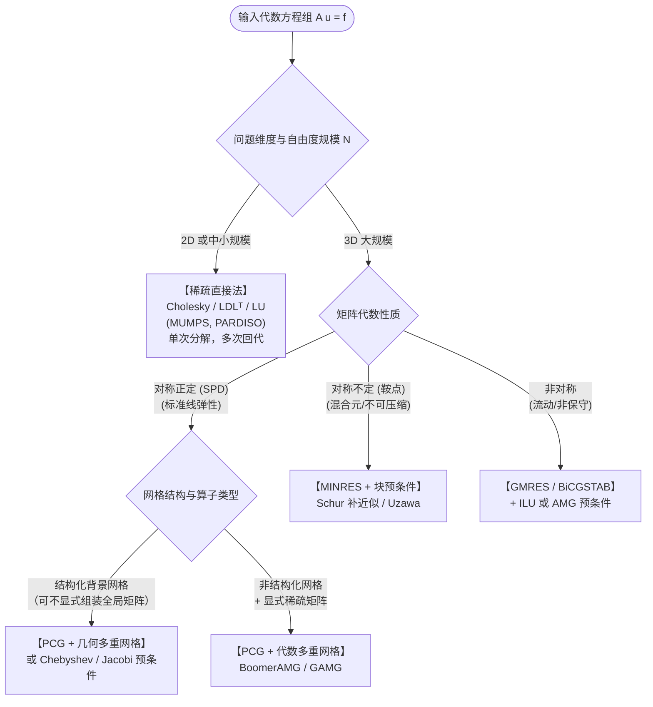

# 线性求解器体系架构

> 偏微分方程经有限元离散后，核心计算负载落在大型稀疏线性方程组 $\mathbf A\mathbf u=\mathbf f$ 的求解上。求解器分为两大类：[[direct-methods|直接法]]分解 $\mathbf A$ 后回代，结果只受舍入误差影响，但填充使三维大规模问题的内存与运算量超线性增长；[[iterative-methods|迭代法]]只用算子作用逐步逼近，内存随向量增长，但收敛依赖谱分布与预条件。本页给出两类方法的分类与组合关系、选型时的三条判定线和决策流程；各方法的机制、收敛理论与实现细节分别见这两页。

## 1. 分类与组合关系

```text
求解线性方程组 A x = b
├── 直接法：LU / Cholesky / LDLᵀ 分解 —— MUMPS、PARDISO、cuDSS          → direct-methods
└── 迭代法                                                               → iterative-methods
    ├── 定常迭代：Jacobi、Gauss-Seidel、SOR、Richardson（固定算子）       §2
    ├── Krylov 子空间方法：CG、MINRES、GMRES、BiCGSTAB（最优多项式）      §3
    ├── 预条件：Jacobi、ILU、多项式、AMG、GMG、区域分解                  §4
    └── 多重网格：几何 / 代数，作独立求解器或作预条件子                   §5
```

| 判定线 | 一侧 | 另一侧 |
|---|---|---|
| 是否形成 $\mathbf A$ 的分解 | 直接法：形成 $\mathbf L\mathbf U$ 或 $\mathbf L\mathbf L^{\mathsf T}$，一次分解后回代 | 迭代法：只用 $\mathbf A$ 作用于向量的结果，及预条件子所需的少量矩阵信息 |
| 每步作用的算子是否固定 | 定常迭代、独立使用的多重网格：误差多项式固定为 $(1-t)^k$ | Krylov：在不断长大的子空间里取最优多项式 |
| 是否跨尺度传递误差 | 单层方法：只在同一网格上迭代 | 多重网格：高频分量在细网格消去，低频分量交给粗网格 |

这几类方法在实际求解器中是嵌套组合，不是互斥选项。常见组合：

| 组合 | 外层 | 内部组件 | 典型用途 |
|---|---|---|---|
| Jacobi-PCG | CG | 对角缩放作预条件 | 最廉价的 SPD 迭代，条件数随网格加密增长 |
| MGCG（PCG + GMG） | CG | 一次 V-cycle 作预条件；V-cycle 内用定常迭代作光滑子、直接法解最粗层 | 结构化网格上的 SPD 问题，如规则网格拓扑优化 |
| PCG + AMG | CG | 代数多重网格作预条件 | 非结构网格、显式稀疏矩阵的 SPD 问题 |
| GMRES + ILU | GMRES | 不完全分解作预条件 | 非对称问题 |
| MINRES + 块预条件 | MINRES | 块对角或 Schur 补近似 | 鞍点 / 对称不定问题 |
| 直接法 | — | — | 小规模问题、多右端项复用、迭代路径的正确性对照基线 |

## 2. 三条判定线

### 2.1 矩阵代数性质

- **对称正定（SPD）**：典型背景是位移型[[../linear-elasticity|线弹性]]与自伴椭圆方程。能量内积 $\langle\mathbf u,\mathbf v\rangle_{\mathbf A}=\mathbf u^{\mathsf T}\mathbf A\mathbf v$ 定义范数，CG 在能量范数下逐步极小化误差；Cholesky 分解不需要选主元。
- **对称不定（鞍点）**：典型背景是混合有限元（如 Hu–Zhang 单元、Stokes 流动、近不可压缩弹性），分块形式为 $\begin{bmatrix}\mathbf A&\mathbf B^{\mathsf T}\\\mathbf B&-\mathbf C\end{bmatrix}$，同时有正负特征值。CG 不再适用，须用 MINRES 配块预条件（Schur 补近似）或 Uzawa 类方法；直接法用 $\mathbf L\mathbf D\mathbf L^{\mathsf T}$ 分解。
- **非对称**：典型背景是 Navier–Stokes、对流扩散、非关联塑性。失去对称性后不能使用 Lanczos 短递推，须用 GMRES（定期重启以控制存储）或 BiCGSTAB；直接法用带选主元的 LU。

### 2.2 维数与规模

- **二维与中小规模三维**：二维问题按嵌套剖分排序时，因子非零元为 $O(n\log n)$、分解运算量为 $O(n^{3/2})$，直接法在百万自由度量级仍是合理选择；一次分解后，伴随求解与多载荷工况只需回代。
- **三维大规模**：三维问题的因子非零元为 $O(n^{4/3})$、分解运算量为 $O(n^2)$，内存与运算量都远超原矩阵，千万自由度以上通常不可行，须转向迭代法。
- **GPU 与不显式组装全局矩阵的算子表示**：显存只容纳向量与局部数据时无法存放因子，迭代法是唯一可行路线；Krylov 方法只需算子作用接口，与这类算子表示天然契合，预条件子则受装配层级约束（见 [[../matrix-free/assembly-levels#3. 三条跨层级性质]]）。

### 2.3 精度要求与鲁棒性

- **直接法**：结果只受舍入误差影响，可达精度由条件数决定，不随容差设定变化；适合作对照基线。
- **迭代法**：迭代次数随所需精度按 $\log(1/\mathrm{tol})$ 增长，增长速率由预条件后的谱分布决定；条件数越大，同一残差容差对应的误差越大。工程问题常在 $10^{-4}\sim10^{-8}$ 的相对残差上停止，可提前退出是迭代法的成本优势，但过松的容差会使目标函数与灵敏度失准，须按问题检验。

## 3. 选型决策流程



二维与三维之间没有固定的自由度阈值：直接法的可行上限取决于可用内存、是否需要多右端项复用以及实现的并行模型（见 [[direct-methods#3. 主流实现与并行模型]]），须按实际问题实测确定。

## 参考依据

- [1] SAAD Y. Iterative Methods for Sparse Linear Systems[M]. 2nd ed. Philadelphia: SIAM, 2003 — 迭代法分族、Krylov 方法按矩阵性质的选择（§1、§2.1）。未入库文献。
- [2] DAVIS T A. Direct Methods for Sparse Linear Systems[M]. Philadelphia: SIAM, 2006 — 直接法的分解形式与填充（§2.1、§2.2）。未入库文献。
- [3] BRIGGS W L, HENSON V E, MCCORMICK S F. A Multigrid Tutorial[M]. 2nd ed. Philadelphia: SIAM, 2000 — 多重网格与定常迭代的组合关系（§1）。未入库文献。
- [4] WATHEN A J. Preconditioning[J]. Acta Numerica, 2015, 24: 329-376 — 预条件在求解器组合中的枢纽作用、鞍点问题的块预条件（§1、§2.1）。未入库文献。
- 二维 / 三维嵌套剖分的填充与运算量量级沿用 [[direct-methods#2. 填充与排序]] 的结论及其来源。
