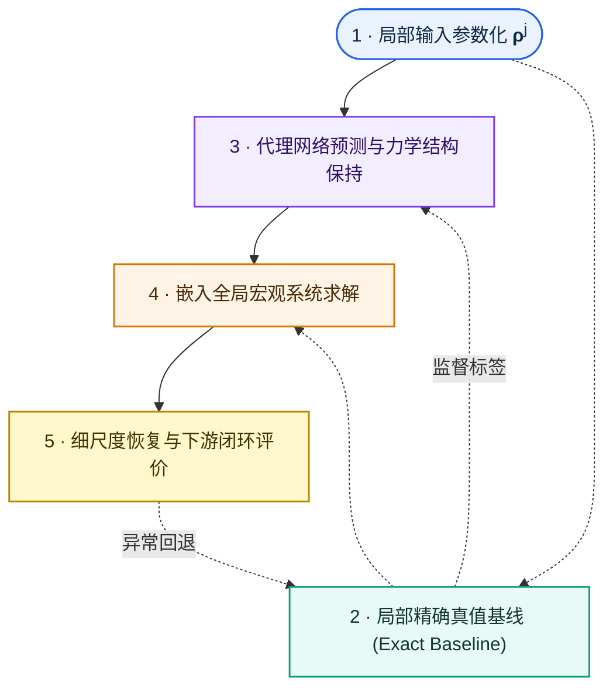
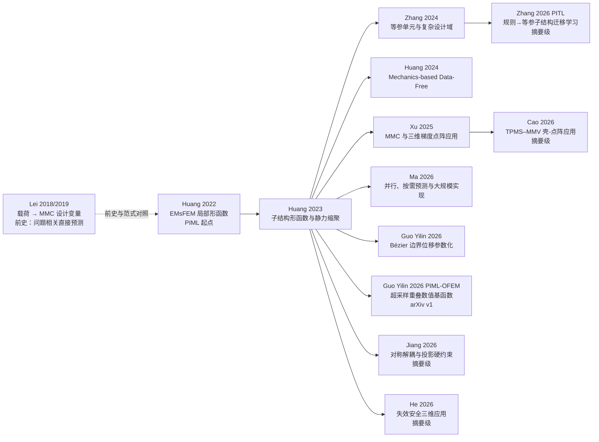

# 问题无关机器学习 (PIML)：分类与计算流程

> 问题无关机器学习（Problem-Independent Machine Learning, PIML）不预测宏观解场或最终拓扑，而是学习局部材料分布到可复用局部力学算子（多尺度形函数、缩聚刚度、数值基函数）的映射，训练一次后嵌入任意宏观问题的全局组装与求解。郭旭团队的工作从 EMsFEM 形函数出发，经子结构静力缩聚扩展到连续算子表示、几何感知输入、参数化边界位移、超采样重叠基函数，以及并行与三维点阵应用。适用范围目前限于小应变线弹性。

---

## 1. PIML 的定义与动机

### 1.1 PIML 的定义与问题无关性

PIML（Problem-Independent Machine Learning）是嵌入有限元求解链的局部代理方法：学习局部材料分布到可复用局部力学算子的映射，用网络预测替代反复发生的局部构造，全局平衡求解仍然保留。

“**问题无关**” 指固定局部几何、离散、本构与边界表示后，局部算子不依赖某次宏观问题的实际载荷和边界位移，可跨宏观问题复用。局部边界基或边界假设仍是表示的一部分；改变 PDE、本构或局部表示，不保证原模型继续适用。局部几何等若作为变量，需要纳入输入并由训练范围覆盖。

### 1.2 普通全尺度有限元的瓶颈与学习对象的筛选

为判断普通全尺度有限元中哪些计算适合由 PIML 替代，先考察单元刚度计算与全局位移求解两个环节。

拓扑优化每次更新材料分布后，都需要重新求解全局平衡方程

$$
\mathbf K(\boldsymbol\rho)\mathbf u=\mathbf f.
$$

大规模细网格系统的数值分解，或预条件构造与迭代求解，往往构成主要时间和内存开销。相比之下，在固定网格、固定泊松比、单元内密度恒定且仅插值 Young 模量的设置下，单元刚度为

$$
\mathbf K_e(\rho_e)
=\frac{E(\rho_e)}{E_0}\mathbf K_e^0,
\qquad
E(\rho_e)=E_{\min}+\rho_e^p(E_0-E_{\min}),
$$

其中 $\mathbf K_e^0$ 是实体材料模量 $E_0$ 下可预计算的参考刚度。每次设计更新只需缩放参考刚度；仅当单元几何与离散等条件相同时，才可全网格共用一份参考矩阵。

直接代理可以考虑以下两条学习路径：

**1. 学习单元刚度：用网络代替刚度公式。**

$$
\rho_e\xrightarrow{\text{网络}}\widehat{\mathbf K}_e.
$$

在上述设置下，原计算只是用一个系数缩放预计算的参考矩阵，已经很便宜。换成网络未必更快，还会引入预测误差；得到单元刚度后，仍需求解昂贵的全局方程 $\mathbf K\mathbf u=\mathbf f$。因此，这条路径容易学习和复用，但加速价值有限。

**2. 学习全局位移：用网络直接预测整个结构的位移。**

$$
(\boldsymbol\rho,\text{几何},\text{边界条件},\text{载荷})
\xrightarrow{\text{网络}}\widehat{\mathbf u}.
$$

这有望跳过昂贵的全局方程求解，潜在收益更大。但网络需要学习整个结构的响应规律：即使某个局部块的材料不变，改变远处材料、支承或载荷，也可能改变该块的位移。因此，不能只凭局部材料预测实际位移；模型需要覆盖不同的全局条件，训练和跨问题复用更困难。

在上述设置下，单元刚度容易复用但计算便宜，全局位移求解昂贵却依赖整个问题。由此，PIML 的局部学习对象应满足两个筛选条件：

1. **原局部求解足够昂贵**：相对于网络推理及后续算子构造，精确局部求解具有足够大的成本，且在线需要反复更新。
2. **局部算子不依赖具体宏观工况**：在固定局部表示下，算子由局部材料／几何描述确定，可在不同宏观载荷与约束下复用；实际边界位移仍需通过全局求解确定。

### 1.3 通过子结构分析引入 PIML

为构造符合上述条件的局部学习对象，这里限定考虑子结构分析，并假设外载荷仅作用于保留的边界自由度，各子结构内部无外载荷。PIML 的引入分为三个环节：

1. **划分子结构**：将细网格划分为若干非重叠子结构，每个子结构区分内部自由度与边界自由度，各子结构通过公共边界耦合。
2. **构造局部算子**：通过局部求解消去内部自由度，得到形函数与缩聚刚度。前者描述边界位移如何传递到内部，后者描述子结构在边界上的等效刚度。固定局部几何、离散、本构与边界表示后，两者由局部材料分布决定，无需预先知道实际边界位移。
3. **引入 PIML**：学习局部材料分布到形函数或缩聚刚度的映射，替代反复发生的局部算子构造；随后求解由各子结构耦合形成的全局边界自由度系统，确定各子结构的边界位移，再恢复内部位移。若仅预测缩聚刚度，需另配内部位移恢复方案。

这两类局部算子与前述筛选条件的对应关系是：

- **局部求解成本**：构造形函数与缩聚刚度需要求解内部方程，材料分布变化后通常需要重新构造，比普通单元刚度的标量缩放更昂贵，因此具有潜在的代理价值。
- **局部算子不依赖具体宏观工况**：固定局部几何、离散、本构与边界表示后，形函数和缩聚刚度由局部材料分布决定。改变宏观载荷或约束时，可复用这些算子，但仍需重新求解全局系统，确定实际边界位移。

子结构因此提供了候选学习对象，但局部求解是否比网络预测及后处理足够昂贵，仍取决于子结构规模与更新次数。实际加速收益应在可比精度下，计入预测、后处理、全局求解、内部恢复及离线成本摊销后验证。

### 1.4 与 PINN 的对比

以下比较针对单个边值问题训练的典型位移型 PINN：它直接逼近该问题的解场，而本页 PIML 学习可复用的局部算子。

| 维度 | PIML (Problem-Independent) | 典型单问题 PINN |
|---|---|---|
| 输入 | 局部材料／几何，连续表示可另含局部坐标；不含宏观载荷与约束 | 宏观域坐标，具体工况通过方程与边界条件进入训练 |
| 输出 | 形函数或缩聚刚度等局部算子 | 空间点上的位移 |
| 复用 | 在局部表示与训练适用范围内跨宏观工况复用 | 工况改变后通常需重新训练或调整参数 |
| 求解角色 | 替代局部算子构造，保留全局平衡求解 | 通过网络训练近似求解给定边值问题 |
| 物理约束 | 可通过适当构造保持对称半正定性与刚体零空间 | 通常以方程残差训练，边界条件可软约束或硬施加 |
| 可靠性检查 | 可配置异常检测与局部精确求解回退 | 需通过残差与误差检查判断结果是否可用 |

---

## 2. 分类维度

PIML 方法按五个相互独立的维度区分：局部力学载体、学习对象、输出表示、训练方式与结构保持、静力缩聚载体内的变体。

### 2.1 局部力学载体

按本文收录期刊工作采用的局部分析框架，载体归纳为以下两类；这是文献框架的分类，并非完全互斥的数学构造。

| 载体 | 局部构造与全局耦合 |
|---|---|
| EMsFEM 粗单元 | 在粗单元边界施加线性位移条件，求数值形函数，经能量投影构造粗刚度，再组装粗网格系统 |
| 非重叠静力缩聚子结构 | 消去内部自由度，构造形函数与缩聚刚度，再组装全局边界系统；可保留完整边界自由度，或采用线性、Bézier 等边界插值进一步降维 |

在相同局部材料、细网格离散与相同线性边界插值下，精确局部求解得到的 EMsFEM 形函数与缩聚子结构形函数可对应一致，并产生相同的局部刚度。这种等价不包括采用不同边界表示的情形；保留完整边界的精确缩聚也不能与边界降维近似混同。等参几何、连续输出、无标签训练及并行实现属于其他分类维度，不另列为载体类别。

### 2.2 学习对象

| 学习对象                   | 网络映射                                                                                                             | 局部刚度的构造                                                                                               | 细尺度恢复                                                              |
| ---------------------- | ---------------------------------------------------------------------------------------------------------------- | ----------------------------------------------------------------------------------------------------- | ------------------------------------------------------------------ |
| 形函数                    | $\boldsymbol{\rho}^j \to \widehat{\mathbf{N}}^j$                                                                 | $\widehat{\mathbf{K}}_s^j = (\widehat{\mathbf{N}}^j)^{\mathsf T} \mathbf{K}^j \widehat{\mathbf{N}}^j$ | $\boldsymbol{u}_i = \widehat{\mathbf{N}}\boldsymbol{u}_b$ 直接给出     |
| 缩聚刚度                   | $\boldsymbol{\rho}^j \to \widehat{\mathbf{K}}_s^j$                                                               | 网络直接输出                                                                                                | 需另配恢复网络                                                            |

路线 A、B 的取舍：

| 性质 | 路线 A：预测形函数 | 路线 B：直接预测刚度 |
|---|---|---|
| 对称半正定 | 由变分构造保证（$\mathbf{K}^j$ 正定且 $\widehat{\mathbf{N}}$ 满秩） | 需参数化约束，如 Cholesky 因子 |
| 能量一致性 | 形函数与刚度满足变分能量关系 | 预测刚度与恢复形函数可能不一致 |
| 在线开销 | 推理后需计算 $\mathbf{N}^{\mathsf T}\mathbf{K}\mathbf{N}$ | 推理直接给出矩阵元素，最快 |
| 适用场景 | 需要细尺度位移/应力恢复与严格能量保持 | 只需全局粗求解，对推理延迟敏感 |

### 2.3 输出表示

| 表示形式 | 典型对象 | 特征 |
|---|---|---|
| 有限维离散矩阵 | $\widehat{\mathbf{N}}^j \in \mathbb{R}^{n_i \times n_b}$、$\widehat{\mathbf{K}}_s^j$ | 输出维度受局部自由度编号锁定，换网格需重新映射；可直接代数装配进全局方程 |
| 坐标连续算子 | $\boldsymbol{\Phi}_k^j(\boldsymbol{x})$，$\boldsymbol{x}$ 作为网络输入 | 可在域内任意坐标求值，分辨率无关；输出一般不在有限元空间 $V_h$ 内，刚度须由应变能积分得到 |
| 网格场预测 | 细网格节点上的基函数值 | 以图像式场作输出（如 U-Net），与细网格分辨率绑定 |

连续算子的代表是 DeepONet。它由两支 MLP 组成，末端做内积给出场值：

$$
\boldsymbol{\Phi}_k^j(\boldsymbol{x}) \approx \sum_{q=1}^{Q} b_q(\boldsymbol{\rho}^j) \, t_q(\boldsymbol{x}) .
$$

branch net 输入子结构密度 $\boldsymbol{\rho}^j$ 在固定传感点上的采样值，输出 $Q$ 维系数；trunk net 输入子结构内的单个局部坐标 $\boldsymbol{x} \in \Omega^j$，输出 $Q$ 维基向量。对照有限元展开 $u_h(\boldsymbol{x}) = \sum_q c_q \boldsymbol{\phi}_q(\boldsymbol{x})$，trunk 对应基函数，branch 对应系数。区别在于 $\boldsymbol{\phi}_q$ 由网格事先给定，$t_q$ 由训练得到；$c_q$ 需解 $\mathbf{K}\mathbf{U} = \mathbf{F}$ 获得，$b_q$ 由 branch 从 $\boldsymbol{\rho}^j$ 直接映出。trunk 逐点求值是分辨率无关的来源，训练与推理的采样点可以不同；但 $t_q$ 是全局光滑函数而非分片多项式，张成空间与 $V_h$ 无包含关系，$\widehat{\mathbf{N}}^{\mathsf T} \mathbf{K} \widehat{\mathbf{N}}$ 式代数装配失效。

### 2.4 训练方式与结构保持

训练分两类。监督训练用局部有限元精确解作标签，以 MSE 为损失，标签生成需对每个样本做局部求解。Mechanics-based data-free 训练以局部总应变能或虚功原理残差为损失，不需预先生成标签（Huang 2024）。

结构保持指让网络输出由构造满足对称性、半正定性、秩与刚体零空间，而不是靠损失惩罚逼近。路线 A 的变分构造天然保持对称半正定，刚体零空间需另外参数化；路线 B 可预测 Cholesky 因子 $\mathbf{L}$，令 $\widehat{\mathbf{K}}_s = \mathbf{L}\mathbf{L}^{\mathsf T}$；也可预测 POD/PCA 低维流形系数。因子化与低秩表示在 §4.3 所列文献中尚无专门工作，属候选方案。子结构载体的共同结构要求见 [[piml-substructural#3.1 网络输出与力学约束|子结构总览 §3.1]]，具体形函数构造见其三个分支。

### 2.5 静力缩聚载体内的变体

静力缩聚载体内部沿以下方向继续分化：

| 变体轴 | 取值 |
|---|---|
| 边界降维 | 保留全部边界节点 / 线性变形假设 / Bézier 控制点插值 |
| 子结构几何 | 规则四边形/六面体 / 等参四边形 |
| 实现规模 | 串行 / MPI 并行按需预测与释放 |
| 宏观设计变量 | SIMP 密度 / MMC 几何参数 |

形函数的离散或连续表示已由 §2.3 覆盖，不再列为变体轴。

边界降维方式决定接口自由度数与全局缩聚矩阵的稀疏性，是与 Matrix-Free 路线的接口。保留全部边界节点被否定的理由是半带宽 $\beta$ 剧增、直接稀疏求解器复杂度按 $\mathcal{O}(N\beta^2)$ 缩放，这一理由只在显式装配下成立。

### 2.6 旧路线编号对照

本页此前按路线 A–F 平铺分类，各路线对应的维度如下。A、B 两个编号在 [[piml-substructural]] 中继续使用。

| 旧编号 | 原名称 | 对应维度与取值 |
|---|---|---|
| 路线 A | 预测形函数 | §2.2 学习对象：形函数 |
| 路线 B | 直接预测刚度 | §2.2 学习对象：缩聚刚度 |
| 路线 C | 因子化 / 低秩表示 | §2.4 结构保持：路线 B 的参数化方式 |
| 路线 D | 边界参数到内部响应场 | §2.2 学习对象：路线 A 在 Bézier 控制点迹基下的特例，兼 §2.5 边界降维 |
| 路线 E | 超采样重叠数值基函数（精确构造见 [[../substructure/oversampling-substructural\|超采样子结构分析]]） | §2.1 预印本扩展：超采样重叠子结构 |
| 路线 F | 连续场 Neural Operator | §2.3 输出表示：坐标连续算子 |

---

## 3. 通用 5 步计算流程

上述两类期刊框架可按以下计算骨架组织；PIML-OFEM 预印本扩展还需在全局耦合时引入重叠单位分解。

### 3.1 步骤 1：局部输入参数化

宏观设计域 $\Omega$ 剖分为 $M$ 个局部载体。第 $j$ 个载体 $\Omega^j$ 内的材料分布或几何以参数向量描述：

$$
\boldsymbol{\rho}^j = [\rho_1^j, \rho_2^j, \dots, \rho_m^j]^{\mathsf T} \in [0, 1]^m .
$$

该向量只描述局部介质状态，与宏观载荷和边界条件无关（§1.2 条件 2）。PIML-OFEM 扩展使用超采样域材料向量 $\boldsymbol{\rho}_{\mathrm{os}}^j$，覆盖目标子结构及其外扩区域。等参载体另含粗节点坐标（Zhang 2024），Bézier 边界参数化的网络输入仍只有 $\boldsymbol{\rho}^j$，控制点位移只在预测形函数作用时出现（Guo Yilin 2026 Bézier）。

### 3.2 步骤 2：局部精确真值

消除局部自由度或构造多尺度基需要求解局部边值子问题（§1.2 条件 1）。两类期刊框架及预印本扩展的局部构造见 §2.1：静力缩聚给出 $\mathbf{N}_{\text{exact}}^j = -(\mathbf{K}_{ii}^j)^{-1}\mathbf{K}_{ib}^j$ 与 Schur 补 $\mathbf{K}_{s,\text{exact}}^j$（推导见 [[../substructure/exact-substructural-full-trace#4.1 形函数表示与非零内部载荷|full-trace §4.1]]，此处学习对象是内部恢复矩阵 $\mathbf T_{\mathrm{full}}^j$），EMsFEM 给出粗基 $\boldsymbol{\Phi}_{\text{exact}}^j$ 与粗刚度 $\mathbf{K}_{H,\text{exact}}^j$，PIML-OFEM 扩展给出限制回目标子结构并经角点归一化的数值基函数。真值用作监督标签、离线验证基线和在线回退目标。

### 3.3 步骤 3：代理预测与结构保持

网络拟合 $\boldsymbol{\rho}^j$ 到局部算子的映射，学习对象、输出表示、训练方式与结构保持的选择见 §2.2–§2.4。

### 3.4 步骤 4：嵌入全局系统求解

对上述两类期刊框架，各局部刚度 $\widehat{\mathbf{K}}_H^j$ 装配进宏观粗尺度或全局边界平衡方程；PIML-OFEM 扩展需先通过重叠单位分解构造全局协调空间，不能直接拼接独立局部基函数：

$$
\mathbf{K}_{\text{global}} \boldsymbol{U}_H = \mathbf{F}_H, \quad \mathbf{K}_{\text{global}} = \sum_{j=1}^M \mathbf{A}_j^{\mathsf T} \widehat{\mathbf{K}}_H^j \mathbf{A}_j .
$$

该步也可按 Matrix-Free 方式在 GPU 上执行局部算子作用（Gather $\to$ Local Action $\to$ Scatter-Add），不显式存储全局稀疏矩阵（见 [[../gpu-hpc/performance-model|GPU/HPC 性能模型]]）。

### 3.5 步骤 5：细尺度恢复与下游评价

由全局解 $\boldsymbol{U}_H$ 恢复载体内部的细尺度位移与应力：

$$
\boldsymbol{u}_{\text{fine}}^j = \mathcal{R}^j(\boldsymbol{U}_H), \quad \text{子结构中为 } \boldsymbol{u}_i^j = \widehat{\mathbf{N}}^j \boldsymbol{u}_b^j .
$$

下游评价以全结构柔顺度误差、Krylov 迭代收敛行为和拓扑优化设计变量更新轨迹为验收标准，局部算子的 MSE 只是其中一项。在线检测到预测违反力学约束（如正定性失效）或残差超标时，对该载体回退到步骤 2 的精确计算。

### 3.6 通用 5 步与子结构专页章节的映射

载体限定为非重叠子结构时，5 步在 [[piml-substructural|总览]] 及三个形函数分支中的入口如下：

| 通用步骤 | 子结构专页章节 | 子结构载体中的具体内容 |
|---|---|---|
| 步骤 1：局部输入参数化 | [[piml-substructural#1. 方法定位与适用范围\|总览 §1]]、[[piml-substructural#3.2 材料样本与训练目标\|总览 §3.2]] | 固定几何、离散与材料参数域，选择边界表示及模型输入 |
| 步骤 2：局部精确真值 | [[piml-substructural#2. 接口表示与分支导航\|三个分支入口]]，各分支 §2 | 按所选接口空间生成内部映射标签；无标签训练使用材料刚度与能量目标 |
| 步骤 3：代理预测与结构保持 | [[piml-substructural#3. 共同训练与结构约束\|总览 §3]]，各分支 §2 | 训练并补全预测映射，按能量投影构造局部刚度 |
| 步骤 4：嵌入全局系统求解 | [[piml-substructural-full-trace#3. 求解与位移恢复\|完整接口页 §3]]、[[piml-substructural-lagrange#3.1 位移约束与全局求解\|Lagrange 页 §3.1]]、[[piml-substructural-bernstein#3.1 位移约束与全局求解\|Bernstein 页 §3.1]] | 组装预测全局边界系统，施加给定位移约束，核对相容性与可解性并求解边界位移 |
| 步骤 5：细尺度恢复与下游评价 | [[piml-substructural-full-trace#3.3 共同的位移恢复\|完整接口页 §3.3]]、[[piml-substructural-lagrange#3.2 边界与内部位移恢复\|Lagrange 页 §3.2]]、[[piml-substructural-bernstein#3.2 边界与内部位移恢复\|Bernstein 页 §3.2]] | 完整接口、Lagrange 与 Bernstein 形函数预测均用构造刚度的同一预测形函数恢复；直接预测刚度的恢复限制见总览 §1。核对内部平衡及能量一致性，具体下游评价在对应应用中处理 |

### 3.7 FEM 概念与 PIML 组件对照

| 经典计算力学 / FEM 概念 | PIML 对应组件 | 含义 |
|---|---|---|
| 单元/子结构材料密度分布 | 输入张量 $\boldsymbol{\rho}^j \in [0, 1]^m$ | 局部细观几何与拓扑分布 |
| 边界自由度 $\boldsymbol{u}_b$ / 内部自由度 $\boldsymbol{u}_i$ | 接口张量维度划分 | 决定网络输出矩阵的形状 |
| Schur 补 | 缩聚刚度标签 $\mathbf{K}_{s,\text{exact}}^j$ | 静力缩聚精确真值 |
| 内部位移插值基函数 | 多尺度形函数矩阵 $\mathbf{N}^j$ | 接口位移到内部细尺度位移的映射 |
| 整体粗网格刚度组装 | 预测算子作用 / Scatter-Add | 预测局部刚度进入全局平衡方程 |
| 子结构静力回代 | 恢复前向计算 $\boldsymbol{u}_i = \mathbf{N}\boldsymbol{u}_b$ | 细尺度位移与应力分布 |

---

## 4. 文献谱系

### 4.1 时间线

### 4.2 单篇贡献与局限

单篇的公式与算例见 `literature/topopt/<子类>/translations/` 下的中文译文；全文事实以 `sources/` 中的原始 PDF 为准，两者冲突时以 PDF 为准。

| 年份 | 工作 | 核心贡献 | 局限与开放问题 | 译文 |
|---|---|---|---|---|
| 2018 | Lei 2018/2019 | 前史对照：已知边界与载荷下直接预测最终设计，实现实时拓扑预测 | 强问题相关，载荷或设计域改变后须重新生成样本训练 | [[../../literature/topopt/mmc-mmv/translations/Lei2018-machinelearningdriven-zh\|Lei2018 译文]] |
| 2022 | Huang 2022 | PIML 起点：学习对象由最终设计改为局部力学构造，训练一次即可跨宏观 BVP 复用 | 依赖监督标签，输出维度随细分尺度增加，限于规则粗网格 | [[../../literature/topopt/piml/translations/Huang2022-problemindependentmachine-zh\|Huang2022 译文]] |
| 2023 | Huang 2023 | 载体由 EMsFEM 粗单元转到经典子结构静力缩聚，首次对比两种学习对象与两种边界降维方式 | 直接预测 $\mathbf{K}_s$ 可能破坏与 $\boldsymbol{N}$ 的能量一致性，依赖监督标签 | [[../../literature/topopt/piml/translations/Huang2023-PIML-substructure-zh\|Huang2023 译文]] |
| 2024 | Huang 2024 | 去掉监督标签，形函数由离散矩阵改为坐标连续表示 | 以规则立方体子结构为主，非连通材料分布下优化稳定性有待提升 | [[../../literature/topopt/piml/translations/Huang2024-PIML-datafree-zh\|Huang2024 译文]] |
| 2024 | Zhang 2024 | 子结构几何进入网络输入，由规则子结构推广到等参子结构以适配复杂设计域 | 基于线性边界假定与内角 $30^\circ \sim 150^\circ$ 筛选，三维扩展与保形边界受粗网格几何限制 | [[../../literature/topopt/piml/translations/Zhang2024-isoparametric-PIML-zh\|Zhang2024 译文]] |
| 2025 | Xu 2025 | 宏观设计变量由 SIMP 密度换成 MMC 几何参数，用于三维梯度点阵；B 样条 PCM 实现宏微观光滑过渡 | 受限于线性位移假定与规则包围盒体素化 | [[../../literature/topopt/piml/translations/Xu2025-PIML-lattice-MMC-zh\|Xu2025 译文]] |
| 2026 | Ma 2026 | 由方法验证推进到十亿单元规模的并行实现 | 粗网格缩聚系统仍需显式形成与求解，非完全全局无矩阵 | [[../../literature/topopt/piml/translations/Ma2026-highperformanceparallel-zh\|Ma2026 译文]] |
| 2026 | Guo Yilin 2026 Bézier（郭一麟等） | 以高阶边界插值替代线性边界假设 | 突破线性边界假设，保持刚体平移与转动不变性，支持小滤波半径高分辨率优化 | [[../../literature/topopt/piml/translations/Guo2026-highgeneralization-bezier-zh\|Guo2026 Bézier 译文]] |
| 2026 | Guo Yilin 2026 OFEM（郭一麟等） | 边界假设移出目标子结构，由重叠单位分解恢复全局协调 | 超采样消除目标子结构边界假设，重叠单位分解保证全局协调，支持小滤波半径高分辨率优化；arXiv v1 | [[../../literature/topopt/piml/translations/Guo2026-PIML-OFEM-zh\|Guo2026 OFEM 译文]] |
| 2026 | Cao 2026（ICCES 会议章节） | 把 PIML 作为加速器嵌入 MMV 外壳 + TPMS 梯度点阵填充的壳-点阵设计 | 仅一个算例；摘要级入库，方法细节待核 | [[../../literature/topopt/piml/translations/Cao2026-shell-graded-TPMS-MMV-PIML-zh\|Cao2026 译文]] |
| 2026 | Zhang 2026 PITL | 用迁移学习把规则三维子结构的潜在表示迁到等参子结构，输出层在构造上满足刚体不变、位移完备与刚度秩充分 | 仍为线性边界插值，局部应变能密度与应力偏差明显；作者将 Bézier/B 样条边界与 GPU 实现列为未来工作；摘要级入库 | [[../../literature/topopt/piml/translations/Zhang2026-PITL-complex-domain-zh\|Zhang2026 译文]] |
| 2026 | Jiang 2026（等变） | 利用立方体子结构点群对称只学习形函数基本分量，投影修正硬施加刚体模态且不破坏对称性 | 依赖子结构几何对称性，不规则或过渡子结构需重定义基本分量；直接学习缩聚刚度仅为展望；摘要级入库 | [[../../literature/topopt/piml/translations/Jiang2026-equivariant-PIML-substructure-zh\|Jiang2026 译文]] |
| 2026 | He 2026（失效安全） | 以 Huang 2022/2023 的 PIML 作固定加速器，完成百万至千万单元三维失效安全优化，发现三维失效安全设计趋向板壳或箱型 | PIML 本身无方法增量；多场景分析成本仍高，CPU 实现；摘要级入库 | [[../../literature/topopt/piml/translations/He2026-PIML-failsafe-3D-zh\|He2026 译文]] |

### 4.3 按分类维度归类

| 工作                    | 载体（§2.1）   | 学习对象（§2.2）             | 输出表示与网络（§2.3）        | 训练（§2.4）                  | 边界降维（§2.5）         | 其他扩展                        |
| --------------------- | ---------- | ---------------------- | -------------------- | ------------------------- | ------------------ | --------------------------- |
| Huang 2022            | EMsFEM 粗单元 | 形函数                    | 离散矩阵，全连接网络           | 监督                        | 线性边界条件             | 规则粗网格                       |
| Huang 2023            | 非重叠静力缩聚子结构    | 形函数与缩聚刚度对比             | 离散矩阵，15 隐藏层前馈网络      | 监督                        | 全部边界节点与线性变形假设对比    | 三维柔顺机构                      |
| Huang 2024            | 非重叠静力缩聚子结构    | 连续形函数                  | 坐标连续算子，DeepONet      | Mechanics-based data-free | 线性变形假设（其 §2.2）     | 规则立方体子结构                    |
| Zhang 2024            | 非重叠静力缩聚子结构    | 形函数                    | 离散矩阵，深度前馈网络，输入含粗节点坐标 | 监督                        | 线性边界假定             | 二维等参子结构                     |
| Xu 2025               | 非重叠静力缩聚子结构    | 形函数                    | 离散矩阵，15 隐藏层前馈网络      | 监督（待确认）                   | 线性位移假定             | 三维 MMC 点阵                   |
| Ma 2026               | 非重叠静力缩聚子结构    | 沿用已训练 PIML 模型（待确认具体对象） | 离散矩阵                 | 沿用已训练模型                   | 线性变形假设             | MPI 并行、并行多重网格、按需预测与释放、无矩阵实现 |
| Guo Yilin 2026 Bézier | 非重叠静力缩聚子结构    | 形函数（Bézier 控制点迹基）        | 坐标连续算子，DeepONet      | 待确认                       | 三次 Bézier 控制点      | 高阶边界插值                      |
| Guo Yilin 2026 OFEM（预印本扩展） | 超采样重叠子结构   | 超采样数值基函数               | 网格场预测，U-Net          | 监督，后期加刚度保真度约束            | 仅保留角节点，边界假设移出目标子结构 | 重叠单位分解                      |
| Cao 2026（摘要级） | 非重叠静力缩聚子结构（待确认） | 沿用已训练 PIML 模型（待确认具体对象） | 待确认 | 沿用已训练模型 | 待确认 | MMV 外壳、TPMS 梯度填充、PCM 与 NURBS 过渡 |
| Zhang 2026 PITL（摘要级） | 非重叠静力缩聚子结构，三维等参 | 形函数 | 离散矩阵，力学嵌入输出层（刚体不变、完备性、秩充分） | 监督 + 迁移学习（规则子结构预训练） | 线性边界插值 | 柔顺度、柔顺机构与应力最小化三类目标 |
| Jiang 2026（摘要级） | 非重叠静力缩聚子结构，立方体 | 形函数基本分量 | 离散矩阵，对称解耦轻量网络 + 投影补全刚体模态 | 监督（待确认） | 沿用标准 PIML 边界假设，可推广到不同假设 | 点群对称数据增强；梯度点阵优化 |
| He 2026（摘要级） | 非重叠静力缩聚子结构，$5\times5\times5$ | 形函数与缩聚刚度（四个网络分别预测） | 离散矩阵，15 隐藏层前馈网络 | 监督，后期加能量一致性约束 | 线性变形假设 + 边界模态降阶基 | KS 聚合失效安全 min–max 列式 |

---

## 5. 开放问题

1. 物理代数一致性：如何使预测形函数 $\widehat{\mathbf{N}}$、缩聚刚度 $\widehat{\mathbf{K}}_s$ 与应变能关系同时严格一致？
2. 硬结构保持参数化：如何让网络输出天然满足对称性、半正定性、秩保持和刚体模态约束？
3. Data-free 训练稳定性：纯力学能量损失能否完全替代监督标签，在极端稀疏材料下是否引入新的优化困难？
4. 复杂几何与非结构网格：如何从规则子结构高效扩展到非结构网格和复杂几何？
5. 全局求解与 GPU 融合：局部预测加速后，全局缩聚系统如何在不组装全局矩阵的前提下完成 GPU/Krylov 求解？

## 参考依据

- [[linear-elasticity|线弹性有限元]]：§1.2 的 SIMP 刚度缩放与参考矩阵复用条件。

- [[../../literature/topopt/mmc-mmv/translations/Lei2018-machinelearningdriven-zh|Lei 2018]]：问题相关直接预测的前史对照。
- [[../../literature/topopt/piml/translations/Huang2022-problemindependentmachine-zh|Huang 2022]]：PIML 概念首提，EMsFEM 粗单元形函数学习；引言与结论中的问题相关路线局限与问题无关学习动机（§1.1–§1.2）。
- [[../../literature/topopt/piml/translations/Huang2023-PIML-substructure-zh|Huang 2023]]：非重叠子结构静力缩聚，形函数与缩聚刚度两条预测路线，边界降维方式比较。
- [[../../literature/topopt/piml/translations/Huang2024-PIML-datafree-zh|Huang 2024]]：DeepONet 连续形函数与 mechanics-based data-free 训练；§2.2 线性边界缩聚与 EMsFEM 的等价。
- [[../../literature/topopt/piml/translations/Zhang2024-isoparametric-PIML-zh|Zhang 2024]]：等参子结构与几何感知输入。
- [[../../literature/topopt/piml/translations/Xu2025-PIML-lattice-MMC-zh|Xu 2025]]：MMC 参数化与三维点阵应用。
- [[../../literature/topopt/piml/translations/Ma2026-highperformanceparallel-zh|Ma 2026]]：MPI 并行、并行多重网格与按需预测。
- [[../../literature/topopt/piml/translations/Guo2026-highgeneralization-bezier-zh|Guo Yilin 2026 Bézier]]：Bézier 边界位移参数化与 DeepONet 预测控制点到内部的数值形函数。
- [[../../literature/topopt/piml/translations/Guo2026-PIML-OFEM-zh|Guo Yilin 2026 OFEM]]：超采样重叠数值基函数与重叠单位分解。
- [[../substructure/exact-substructural-full-trace|完整接口分析]]：分块平衡、Schur 补与离散调和延拓的代数依据。

- [Sukumar & Srivastava：Exact imposition of boundary conditions with distance functions in physics-informed deep neural networks](https://arxiv.org/abs/2104.08426)：§1.4 中 PINN 可硬施加边界条件的依据。
