> 上一版本快照：本文件是当前稿 [[high-order-huzhang-topopt-draft-zh]] 在 2026-10-13 任何修改之前的完整稿件。正文逐字取自 Codex checkpoint 中的草稿 blob `906eebf`（2026-10-10 15:19 至 2026-10-12 08:53 未变，`date_update` 为 2026-10-08），仅本说明与标题后缀为新增。与当前稿相比，本文件保留原 §3.1 全文与原 §3.4“角点顶点连续性的部分松弛”（含图 3.2），原 §3.5 及公式 (3.12)–(3.14) 未改编号；§5.2 导语、§5.2.3（含 LFEM 对照）与 §6.1 第 3 条均为同日重构前的表述；摘要、引言及第 5、6 节中的角点松弛表述亦为原文。本文件不再维护。

# High-Order Hu–Zhang Mixed Finite Element Methods for Density-Based Topology Optimization

## Abstract

在密度法拓扑优化中，位移有限元通过位移梯度和本构关系计算应力，通常不保证跨单元法向牵引连续性；标准低阶位移元在近不可压缩的平面应变或三维问题中还可能出现体积自锁。本文建立适用于单纯形网格的高阶 Hu–Zhang 混合有限元拓扑优化框架，以对称应力和位移为独立未知量，包含低阶跳跃稳定化与局部角点松弛，用于柔顺度最小化和局部应力约束下的体积最小化。本文推导一致伴随灵敏度，考虑牵引边界处理引入的载荷项随材料分布变化的影响，并基于 FEALPy 实现该框架。二维制造解算例的误差收敛阶与理论估计一致，优化算例展示了同一流程对所考察离散阶次的适用性。固支梁算例中，混合法与位移法得到相近的构型，以及统一再分析下接近的柔顺度。轴承全实体域的网格加密结果表明，Hu–Zhang 元在可压缩与近不可压缩条件下具有相近的柔顺度收敛表现，而线性位移元在近不可压缩条件下出现明显的精度退化。在该算例的近不可压缩拓扑优化中，Hu–Zhang 元减轻了自锁对优化结果的影响，所得构型和统一再分析柔顺度与二次位移元的结果接近。局部应力约束直接由混合离散中的总应力求值，无需从位移梯度恢复应力，且离散应力保持跨单元法向牵引连续性。

**Keywords:** Hu–Zhang mixed finite elements; high-order approximation; density-based topology optimization; nearly incompressible elasticity; local stress constraints

**AMS 主题分类 (AMS subject classifications)：** 65N30, 74S05, 74P05, 74B05

---

## 1 Introduction

拓扑优化（Topology Optimization, TO）通过在给定设计域内优化材料空间分布，为高性能轻量化结构提供了系统化的数值设计工具。Bendsøe [7] 的工作奠定了基于密度插值的拓扑优化方法的基础。以 SIMP（Solid Isotropic Material with Penalization）为代表的密度法因模型表述清晰、算法成熟且适用于多种工程问题，得到广泛应用 [8]。在常规密度法拓扑优化中，线弹性状态方程通常采用标准位移型 Lagrange 有限元（Lagrange finite element method, LFEM）离散，应力则在单元内部由离散位移梯度和本构关系计算。位移法广泛用于柔顺度最小化，但在局部应力约束或近不可压缩结构设计中，应力近似精度与体积自锁可能影响优化结果。

在逐单元施加局部应力约束的拓扑优化中，约束数量与单元数成正比，应力近似误差会直接影响约束评价。在单纯形网格上，当单元内材料系数为常数时，$p$ 次位移型 Lagrange 元计算得到的应力为至多 $p-1$ 次多项式，例如一次元给出分片常数应力；这种逐单元计算的应力一般不保证跨单元法向牵引连续性。已有研究通过应力插值与约束松弛 [23]、全局或区域应力度量及归一化 [31]、局部与聚合约束形式 [32]，以及增广拉格朗日方法 [33]，处理应力约束拓扑优化中的建模与求解问题。另一方面，对于各向同性线弹性材料，当泊松比趋于不可压缩极限（$\nu_0\to0.5$）时，体积模量与剪切模量之比趋于无穷大。在平面应变或三维问题中，这使体积变形受到强烈抑制，位移场趋于满足无散度条件（$\operatorname{div}\boldsymbol{u}=0$）。标准低阶位移元难以充分表示满足近不可压缩约束的变形，因此可能出现体积自锁（Volumetric Locking）[6]，高估结构刚度并降低结构响应计算的可靠性。已有研究采用混合有限元开展不可压缩材料的拓扑优化，以处理这一问题 [11]。

混合有限元通过引入独立的场变量，为线弹性问题提供不同于纯位移法的变分表述。在 Hellinger–Reissner 两场变分原理中，对称应力 $\boldsymbol{\sigma}$ 和位移 $\boldsymbol{u}$ 作为独立未知量。在本文采用的 $H(\operatorname{div})$ 协调应力离散中，对称应力场的法向牵引在单元界面上具有单值迹，平衡方程则通过位移测试函数以弱形式施加。若混合离散具有不随不可压缩极限退化的稳定性和相应的逼近性质，则可获得对材料参数一致的误差估计，从而避免体积自锁 [9]。Bruggi 与 Venini 将应力–位移混合有限元用于不可压缩材料的拓扑优化 [12] 和应力约束拓扑优化 [13]；Bruggi 随后进一步研究了不可压缩材料的应力约束设计 [11]。将应力–位移混合拓扑优化扩展至单纯形网格上的高阶逼近，需要构造适当的对称应力有限元空间。在三角形和四面体网格上，同时满足应力张量的对称性、$H(\operatorname{div})$ 协调性与离散稳定性，是混合有限元构造中的重要难点 [5, 1]。另一条路线是引入额外的乘子变量，以弱形式施加应力对称性 [4]。

Hu 与 Zhang [29] 构造了三角形网格上的高阶强对称协调混合有限元，Hu [27] 随后将这一构造推广至任意维数的单纯形网格。该单元在每个单纯形上采用 $\mathbb{P}_k(\mathbb{S})$ 应力空间与不连续的 $\mathbb{P}_{k-1}(\mathbb{R}^d)$ 位移空间；当 $k\ge d+1$ 时，这一配对满足离散稳定性，并保持应力的强对称性与跨单元法向牵引连续性，其中 $d$ 为空间维数。围绕这类混合元，已有研究进一步发展了稳定化与计算方法。Chen 等 [17] 基于离散位移的界面跳跃，为 $1\le k\le d$ 的低阶格式建立了稳定化方法。Hu 与 Ma [28] 提出了应力顶点连续性的局部松弛方法，并将其用于一般牵引边界条件的离散处理。Chen 等分别研究了快速辅助空间预条件子 [18] 和基于残差的后验误差估计 [19]。此外，Chen 等 [16] 研究了高阶 $H(\operatorname{div})$ 面元与 $H(\operatorname{curl})$ 棱元的几何分解及高效实现。将高阶 Hu–Zhang 混合有限元用于密度法拓扑优化，需要将混合状态方程、材料插值和设计灵敏度分析纳入一致的计算框架。该框架需考虑非齐次牵引边界处理引入的离散右端项随材料分布的变化，并在必要时局部松弛边界角点处的应力顶点连续性，以处理不相容的牵引数据。此外，还需为依赖离散应力的目标函数与约束推导与离散状态方程一致的伴随灵敏度。

本文建立了单纯形网格上的高阶 Hu–Zhang 混合有限元密度法拓扑优化框架，并基于 FEALPy [37] 及其中的拓扑优化模块 SOPTX [25] 实现。本文的主要贡献概括如下：
1. **混合拓扑优化的变分表述与一致伴随灵敏度**：采用牵引提升处理 Hellinger–Reissner 混合变分形式中的非齐次牵引边界条件，并计入由此引入的离散右端项对材料分布的依赖。基于重构总应力，推导余能目标及局部应力约束问题的增广拉格朗日目标的伴随灵敏度，使其与离散状态方程一致。
2. **不同阶次混合格式的统一离散实现**：统一处理共享界面上的应力自由度与标架约定，结合必要的边界角点应力顶点连续性松弛和低阶位移跳跃稳定化，使 $1\le k\le d$ 的稳定化格式与 $k\ge d+1$ 的原生格式采用同一拓扑优化流程。在固定网格、边界划分及稳定化尺度下，散度块与稳定化块不依赖设计变量，材料分布仅通过柔度块与牵引提升后的右端项进入离散状态方程。
3. **不同阶次离散的数值验证与拓扑优化评估**：通过制造解检验低阶稳定化格式与高阶原生格式的误差收敛率，并通过柔顺度最小化、近不可压缩材料设计和局部应力约束优化算例评估所提出的框架。采用固定设计的统一再分析比较不同离散所得设计的柔顺度，并结合全实体域的网格加密试验，考察体积自锁及其对优化结果的影响。

本文其余内容安排如下。第 2 节介绍线弹性方程、Hellinger–Reissner 混合变分形式及牵引提升。第 3 节介绍单纯形上的张量几何分解、混合有限元空间、低阶位移跳跃稳定化、角点应力顶点连续性松弛及离散状态方程。第 4 节建立材料插值、基于余能的柔顺度最小化与局部应力约束体积最小化模型，并介绍增广拉格朗日方法、一致伴随灵敏度及优化算法。第 5 节通过制造解检验误差收敛率，并给出三类拓扑优化基准算例。第 6 节总结主要结论并讨论未来工作。

---

## 2 Preliminaries

### 2.1 Notation and Simplicial Mesh

设 $\Omega \subset \mathbb{R}^d$（$d=2,3$）为有界多边形或多面体区域，边界记为 $\partial\Omega$。Dirichlet 位移边界 $\Gamma_D$ 与 Neumann 牵引边界 $\Gamma_N$ 为 $\partial\Omega$ 上互不相交的相对开集，满足 $\partial\Omega = \overline{\Gamma_D} \cup \overline{\Gamma_N}$。记 $\mathbb{S}$ 为 $d \times d$ 实对称二阶张量空间，$\boldsymbol{I}$ 为二阶单位张量。

对任意二阶对称张量 $\boldsymbol{\sigma}, \boldsymbol{\tau} \in \mathbb{S}$，张量双点积定义为 $\boldsymbol{\sigma} : \boldsymbol{\tau} = \sum_{i,j=1}^d \sigma_{ij}\tau_{ij} = \operatorname{tr}(\boldsymbol{\sigma}\boldsymbol{\tau})$，迹定义为 $\operatorname{tr}(\boldsymbol{\tau})=\sum_{i=1}^d\tau_{ii}$。约定向量场的梯度分量为 $(\nabla\boldsymbol{u})_{ij}=\partial u_i/\partial x_j$。对张量场 $\boldsymbol{\tau}$ 与向量场 $\boldsymbol{u}$，张量散度算子与对称梯度算子分别定义为：
$$
(\operatorname{div}\boldsymbol{\tau})_i = \sum_{j=1}^d \frac{\partial \tau_{ij}}{\partial x_j}, \qquad \boldsymbol{\varepsilon}(\boldsymbol{u}) = \frac{1}{2}\left(\nabla\boldsymbol{u} + (\nabla\boldsymbol{u})^{\mathsf T}\right).
$$

设 $\mathcal T_h$ 为 $\Omega$ 上与边界划分匹配的形状正则协调单纯形网格，记 $h_T=\operatorname{diam}(T)$，$h=\max_{T\in\mathcal T_h}h_T$。以 $\mathcal V_h$、$\mathcal E_h$ 和 $\mathcal F_h$ 分别表示顶点、边和面集合，其中二维时 $\mathcal F_h=\mathcal E_h$。面集合由内部面 $\mathcal F_h^i$、位移边界面 $\mathcal F_h^D$ 和牵引边界面 $\mathcal F_h^N$ 组成。对每个面 $F\in\mathcal F_h$，记 $h_F=\operatorname{diam}(F)$，$|F|$ 为其 $(d-1)$ 维测度。

记向量与对称张量的 $L^2$ 空间分别为 $L^2(\Omega;\mathbb{R}^d)$ 与 $L^2(\Omega;\mathbb{S})$，内积统一记为 $(\cdot,\cdot)_\Omega$。对称张量 $H(\operatorname{div})$ 空间定义为：
$$
H(\operatorname{div},\Omega;\mathbb{S}) = \left\{ \boldsymbol{\tau} \in L^2(\Omega;\mathbb{S}) : \operatorname{div}\boldsymbol{\tau} \in L^2(\Omega;\mathbb{R}^d) \right\},
$$
其中散度按分布意义理解，$\|\cdot\|_{0,\Omega}$ 表示相应的 $L^2$ 范数。该空间的范数满足 $\|\boldsymbol{\tau}\|_{H(\operatorname{div})}^2 = \|\boldsymbol{\tau}\|_{0,\Omega}^2 + \|\operatorname{div}\boldsymbol{\tau}\|_{0,\Omega}^2$。

### 2.2 Linear Elasticity and Hellinger–Reissner Variational Formulation

考虑小变形各向同性线弹性边值问题：
$$
\begin{aligned}
-\operatorname{div}\boldsymbol{\sigma} &= \boldsymbol{b} && \text{in } \Omega, \\
\mathcal{A}\boldsymbol{\sigma} &= \boldsymbol{\varepsilon}(\boldsymbol{u}) && \text{in } \Omega, \\
\boldsymbol{u} &= \boldsymbol{u}_D && \text{on } \Gamma_D, \\
\boldsymbol{\sigma}\boldsymbol{n} &= \boldsymbol{g} && \text{on } \Gamma_N,
\end{aligned} \tag{2.1}
$$
其中，$\boldsymbol{\sigma} \in \mathbb{S}$ 为对称 Cauchy 应力张量，$\boldsymbol{u}$ 为位移向量，$\boldsymbol{b}$ 为体积力，$\boldsymbol{u}_D$ 为给定的边界位移，$\boldsymbol{g}$ 为给定的边界牵引，$\boldsymbol{n}$ 为边界外单位法向量，$\boldsymbol{\varepsilon}(\boldsymbol{u})$ 为小变形应变张量。$\mathcal{A}$ 为线弹性各向同性柔度四阶张量，对任意对称二阶张量 $\boldsymbol{\tau}$ 作用为：
$$
\mathcal{A}\boldsymbol{\tau} = \frac{1}{2\mu}\left( \boldsymbol{\tau} - \frac{\lambda}{2\mu + d\lambda} \operatorname{tr}(\boldsymbol{\tau})\boldsymbol{I} \right), \tag{2.2}
$$
其中，$\lambda$ 和 $\mu$ 为 Lamé 参数。设 $E$ 和 $\nu$ 分别为材料的杨氏模量与泊松比，取 $\mu=E/[2(1+\nu)]$。三维及二维平面应变情形下，$\lambda=E\nu/[(1+\nu)(1-2\nu)]$；二维平面应力情形下，采用有效参数 $\lambda=E\nu/(1-\nu^2)$。

为了处理非齐次 Neumann 牵引边界条件 $\boldsymbol{\sigma}\boldsymbol{n} = \boldsymbol{g}$，引入非齐次应力试探集与齐次应力测试空间：
$$
\boldsymbol{\Sigma}_g = \left\{ \boldsymbol{\tau} \in H(\operatorname{div},\Omega;\mathbb{S}) : \boldsymbol{\tau}\boldsymbol{n} = \boldsymbol{g} \text{ on } \Gamma_N \right\}, \qquad
\boldsymbol{\Sigma}_0 = \left\{ \boldsymbol{\tau} \in H(\operatorname{div},\Omega;\mathbb{S}) : \boldsymbol{\tau}\boldsymbol{n} = \boldsymbol{0} \text{ on } \Gamma_N \right\},
$$
上述边界条件按 $H(\operatorname{div})$ 法向迹的意义理解。其中 $\boldsymbol{\Sigma}_0$ 是 $H(\operatorname{div},\Omega;\mathbb{S})$ 的闭子空间。假设 $\boldsymbol{\Sigma}_g\ne\varnothing$，则其为 $\boldsymbol{\Sigma}_0$ 的仿射平移；当牵引数据非零时，它不构成线性空间。位移试探与测试空间统一记为：
$$
\boldsymbol{V} = L^2(\Omega;\mathbb{R}^d).
$$
线弹性问题的 Hellinger–Reissner 两场混合变分形式为：求 $(\boldsymbol{\sigma},\boldsymbol{u}) \in \boldsymbol{\Sigma}_g \times \boldsymbol{V}$，使得：
$$
\begin{aligned}
a(\boldsymbol{\sigma},\boldsymbol{\tau}) + b(\boldsymbol{\tau},\boldsymbol{u}) &= \langle \boldsymbol{u}_D, \boldsymbol{\tau}\boldsymbol{n} \rangle_{\Gamma_D}, && \forall\,\boldsymbol{\tau}\in\boldsymbol{\Sigma}_0, \\
b(\boldsymbol{\sigma},\boldsymbol{v}) &= -(\boldsymbol{b},\boldsymbol{v})_\Omega, && \forall\,\boldsymbol{v}\in\boldsymbol{V},
\end{aligned} \tag{2.3}
$$
其中双线性型定义为：
$$
a(\boldsymbol{\sigma},\boldsymbol{\tau}) = (\mathcal{A}\boldsymbol{\sigma},\boldsymbol{\tau})_\Omega = \int_\Omega \mathcal{A}\boldsymbol{\sigma} : \boldsymbol{\tau} \,\mathrm{d}x, \qquad
b(\boldsymbol{\tau},\boldsymbol{v}) = (\operatorname{div}\boldsymbol{\tau},\boldsymbol{v})_\Omega = \int_\Omega (\operatorname{div}\boldsymbol{\tau})\cdot\boldsymbol{v}\,\mathrm{d}x,
$$
边界项 $\langle\boldsymbol{u}_D,\boldsymbol{\tau}\boldsymbol{n}\rangle_{\Gamma_D}$ 表示相应迹空间之间的对偶配对；当函数具有足够正则性时，可写为以下边界积分：
$$
\langle \boldsymbol{u}_D, \boldsymbol{\tau}\boldsymbol{n} \rangle_{\Gamma_D} = \int_{\Gamma_D} \boldsymbol{u}_D \cdot (\boldsymbol{\tau}\boldsymbol{n})\,\mathrm{d}s.
$$
由于位移 $\boldsymbol{u} \in \boldsymbol{V} = L^2(\Omega;\mathbb{R}^d)$，位移场在变分形式中不要求任何跨单元连续性；应力属于 $H(\operatorname{div},\Omega;\mathbb{S})$，在迹意义下满足跨单元法向牵引连续性。在边界约束排除刚体运动、边界数据满足相容性与正则性要求，且双线性型满足连续性、核空间强制性及连续 inf-sup 条件时，变分问题 (2.3) 存在唯一弱解 [9]。对于三维或平面应变问题，在近不可压缩极限（$\lambda\to\infty$、$\mu$ 固定）下，柔度双线性型 $a(\cdot,\cdot)$ 保持有界，但在静水应力方向上，其相对于 $L^2$ 范数的强制性常数随 $\lambda\to\infty$ 趋于零。混合离散的抗体积自锁性质需要在适当的边界或平均迹约束下，通过关于 $\lambda$ 一致的核空间估计与离散 inf-sup 条件建立。

### 2.3 Non-homogeneous Traction Lifting and Total Stress Formulation

在 Hellinger–Reissner 混合变分形式中，牵引条件 $\boldsymbol{\sigma}\boldsymbol n=\boldsymbol g$ 是约束应力法向迹的本质边界条件，而位移条件通过边界泛函 $\langle\boldsymbol u_D,\boldsymbol{\tau}\boldsymbol n\rangle_{\Gamma_D}$ 自然施加。为处理非齐次牵引条件，采用常规的边界数据提升（lifting）技术 [22]。假设 $\boldsymbol{\Sigma}_g\ne\varnothing$，选取一个满足给定牵引边界条件的应力场 $\boldsymbol{\sigma}_g\in\boldsymbol{\Sigma}_g$，作为边界数据 $\boldsymbol g$ 的提升。该场不必满足内部平衡方程或本构关系。于是
$$
\boldsymbol{\Sigma}_g=\boldsymbol{\sigma}_g+\boldsymbol{\Sigma}_0,
\qquad
\boldsymbol{\sigma}=\boldsymbol{\sigma}_0+\boldsymbol{\sigma}_g,
\qquad
\boldsymbol{\sigma}_0\in\boldsymbol{\Sigma}_0.
$$

将上述分解代入式 (2.3)，得到等价的混合变分问题：求 $(\boldsymbol{\sigma}_0,\boldsymbol u)\in\boldsymbol{\Sigma}_0\times\boldsymbol V$，使得
$$
\begin{aligned}
a(\boldsymbol{\sigma}_0,\boldsymbol{\tau})
+b(\boldsymbol{\tau},\boldsymbol u)
&=
\langle\boldsymbol u_D,\boldsymbol{\tau}\boldsymbol n\rangle_{\Gamma_D}
-a(\boldsymbol{\sigma}_g,\boldsymbol{\tau}),
&&\forall\,\boldsymbol{\tau}\in\boldsymbol{\Sigma}_0,\\
b(\boldsymbol{\sigma}_0,\boldsymbol v)
&=
-(\boldsymbol b,\boldsymbol v)_\Omega
-b(\boldsymbol{\sigma}_g,\boldsymbol v),
&&\forall\,\boldsymbol v\in\boldsymbol V.
\end{aligned}
\tag{2.4}
$$
求解后，总应力由 $\boldsymbol{\sigma}=\boldsymbol{\sigma}_0+\boldsymbol{\sigma}_g$ 重构。提升的选取并不唯一：若将 $\boldsymbol{\sigma}_g$ 替换为 $\boldsymbol{\sigma}_g+\boldsymbol{\tau}_0$，其中 $\boldsymbol{\tau}_0\in\boldsymbol{\Sigma}_0$，则齐次修正相应变为 $\boldsymbol{\sigma}_0-\boldsymbol{\tau}_0$，重构的总应力保持不变。

在离散层面，选取属于离散法向迹空间的牵引数据 $\boldsymbol g_h$，并在第 3 节所用的离散应力空间 $\boldsymbol{\Sigma}_h^k$ 中构造满足 $\boldsymbol{\sigma}_{g,h}\boldsymbol n=\boldsymbol g_h$ 的离散提升 $\boldsymbol{\sigma}_{g,h}$。重构的离散总应力精确满足该离散牵引条件，而 $\boldsymbol g-\boldsymbol g_h$ 构成边界数据逼近误差。

记 $\rho$ 为材料密度设计变量。本文采用固定设计域和网格，外载荷与给定位移均与设计无关，并选取与 $\rho$ 无关的牵引提升 $\boldsymbol{\sigma}_g$，故 $\partial\boldsymbol{\sigma}_g/\partial\rho=0$。记随材料分布变化的柔度双线性型为 $a_\rho(\cdot,\cdot)$。尽管外载荷与设计无关，式 (2.4) 的右端仍通过 $-a_\rho(\boldsymbol{\sigma}_g,\boldsymbol{\tau})$ 依赖设计变量。总应力形式 (2.3) 的载荷泛函与设计无关，但必须保留仿射约束 $\boldsymbol{\sigma}\in\boldsymbol{\Sigma}_g$。后文采用总应力评估目标函数和应力约束，并在伴随灵敏度推导中计入上述右端项的设计依赖。

---

## 3 High-Order Hu–Zhang Mixed Finite Elements

### 3.1 Geometric Tangential–Normal Decomposition on Simplices

设 $T \in \mathcal{T}_h$ 为 $d$ 维单纯形（二维三角形或三维四面体），记 $\mathbb{P}_k(T;\mathbb{S}) = \mathbb{P}_k(T)\otimes\mathbb{S}$ 为 $T$ 上次数不超过 $k$（$k \ge 1$）的局部对称张量多项式空间，其维数为 $\dim \mathbb{P}_k(T;\mathbb{S}) = \frac{d(d+1)}{2}\binom{k+d}{d}$。

Hu 与 Zhang [29] 构造了三角形网格上的高阶对称 $H(\operatorname{div})$ 协调混合有限元，Hu [27] 将这一构造推广至任意维数的单纯形网格。为组织这些单元的应力基函数及其自由度，本节采用基于子单形局部切向–法向标架的几何描述。相关的几何分解、局部标架与自由度管理思路可参见 Chen 等 [16] 关于高阶面元和棱元的研究；下文将说明对称张量分量的分解及其与应力法向迹和自由度共享规则的关系。

设 $f$ 为 $T$ 的某个 $\ell$ 维子单形（$\ell = 0, 1, \dots, d$），其切空间的正交基底为 $\{\boldsymbol{t}_i^f\}_{i=1}^{\ell}$，法空间的正交基底为 $\{\boldsymbol{n}_j^f\}_{j=1}^{d-\ell}$。基于上述标架，本文将对称张量空间分解为切向子空间 $\mathbb{T}_f(\mathbb{S})$ 与法向子空间 $\mathbb{N}_f(\mathbb{S})$：
$$
\begin{aligned}
\mathbb{T}_f(\mathbb{S}) &= \operatorname{span} \left\{ \operatorname{sym}(\boldsymbol{t}_i^f \otimes \boldsymbol{t}_j^f) \right\}_{1 \le i \le j \le \ell}, \\
\mathbb{N}_f(\mathbb{S}) &= \operatorname{span} \left\{ \operatorname{sym}(\boldsymbol{t}_i^f \otimes \boldsymbol{n}_j^f) \right\}_{1 \le i \le \ell,\, 1 \le j \le d-\ell}
\oplus \operatorname{span} \left\{ \operatorname{sym}(\boldsymbol{n}_i^f \otimes \boldsymbol{n}_j^f) \right\}_{1 \le i \le j \le d-\ell},
\end{aligned} \tag{3.1}
$$
这里的法向子空间包括切向–法向混合分量与法向–法向分量。其中对称张量积定义为 $\operatorname{sym}(\boldsymbol{a} \otimes \boldsymbol{b}) = \frac{1}{2}(\boldsymbol{a} \otimes \boldsymbol{b} + \boldsymbol{b} \otimes \boldsymbol{a})$。关于 2.1 节定义的张量双点积，对称张量空间 $\mathbb{S}$ 具有如下正交直和分解：
$$
\mathbb{S}=\mathbb{T}_f(\mathbb{S})\oplus\mathbb{N}_f(\mathbb{S}).
$$
空指标集的张成空间约定为 $\{0\}$。当 $\ell=d$ 时，$f=T$，其法空间为 $\{0\}$，故 $\mathbb{T}_T(\mathbb{S})=\mathbb{S}$、$\mathbb{N}_T(\mathbb{S})=\{0\}$。

$H(\operatorname{div})$ 协调性要求应力的法向迹在相邻单元的公共面上连续。在本文采用的、未作角点松弛的几何实体构造中，与 $\mathbb{N}_f(\mathbb{S})$ 对应的自由度在共享子单形 $f$ 的单元之间采用统一标架并全局共享；这是实现法向迹连续性的一种构造方式，并非所有协调应力元必须采用的共享规则。

对任意 $\boldsymbol{\tau}\in\mathbb{T}_f(\mathbb{S})$ 及 $f$ 的任意法向量 $\boldsymbol n$，均有 $\boldsymbol{\tau}\boldsymbol n=0$。将该张量与子单形 $f$ 内部节点对应的标量 Lagrange 基函数相乘，得到的张量基函数在整个 $\partial T$ 上具有零法向迹：在包含 $f$ 的边界面上，该性质由张量的切向性保证；在不包含 $f$ 的边界面上，则由标量基函数的零迹保证。因此，这些基函数属于 $T$ 上的 $H(\operatorname{div})$ 泡函数，其自由度由各单元独立编号，不在相邻单元之间共享。

以二维三角形单元为例，各维子单形局部正交标架选取与张量基元划分如图 3.1 所示：
1. 当 $\ell=0$（顶点）时，$\mathbb{T}_f(\mathbb{S})=\{0\}$ 且 $\mathbb{N}_f(\mathbb{S})=\mathbb{S}$，在每个顶点选取相邻单元共用的正交标架，定义三个独立的应力点值自由度；对非角点边界顶点，标架与所在边界边对齐，以便施加牵引条件；
2. 当 $\ell=1$（边）时，取沿边方向的单位切向 $\boldsymbol{t}_e$ 与统一选定的单位法向 $\boldsymbol{n}_e$。法向子空间 $\mathbb{N}_e(\mathbb{S})$ 由 $\operatorname{sym}(\boldsymbol{t}_e\otimes\boldsymbol{n}_e)$ 与 $\boldsymbol{n}_e\otimes\boldsymbol{n}_e$ 张成，对应的边内部节点自由度在相邻单元间共享；切向子空间 $\mathbb{T}_e(\mathbb{S})$ 由 $\boldsymbol{t}_e\otimes\boldsymbol{t}_e$ 张成，对应自由度由各单元独立编号；
3. 当 $\ell=2$（单元内部）时，$\mathbb{T}_T(\mathbb{S})=\mathbb{S}$ 且 $\mathbb{N}_T(\mathbb{S})=\{0\}$，所有内部自由度均为单元私有。

公共边的切向与法向对相邻单元采用同一方向约定：$\boldsymbol t_e$ 或 $\boldsymbol n_e$ 任一反向时，$\operatorname{sym}(\boldsymbol t_e\otimes\boldsymbol n_e)$ 对应的系数变号，而 $\operatorname{sym}(\boldsymbol n_e\otimes\boldsymbol n_e)$ 对应的系数不变，因此共享自由度须在统一标架下定义。计算单元外法向牵引时，根据单元外法向与所选边法向的关系引入正负号。图 3.1 中箭头表示所选局部标架，边法向不要求均指向图示单元外部；红色标记对应共享分量，黑色标记对应单元私有分量。

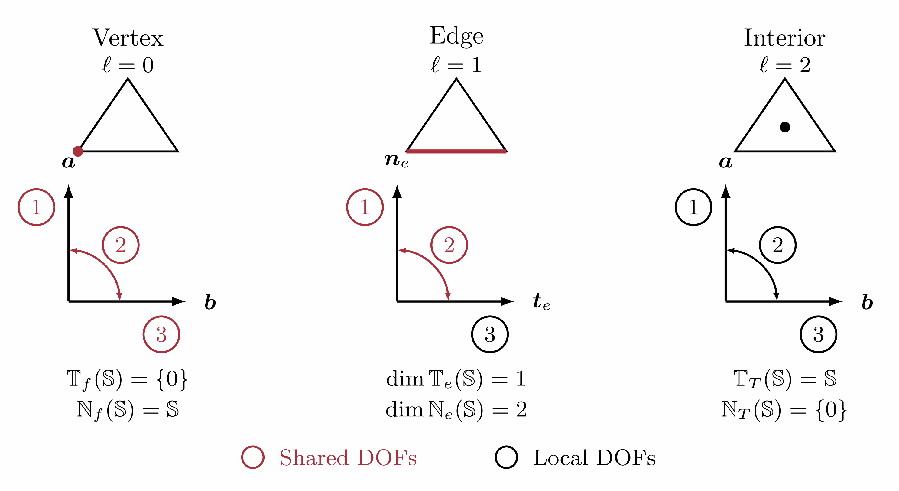

**图 3.1  三角形单元各子单形的局部标架与对称张量分量（角点松弛前）。①、②、③分别表示 $\boldsymbol a\otimes\boldsymbol a$、$\operatorname{sym}(\boldsymbol a\otimes\boldsymbol b)$ 和 $\boldsymbol b\otimes\boldsymbol b$；边上取 $(\boldsymbol a,\boldsymbol b)=(\boldsymbol n_e,\boldsymbol t_e)$。**

### 3.2 Finite Element Spaces and Standard Discrete Variational Formulation

记连续分片对称张量多项式空间与单元应力泡函数空间分别为
$$
\widetilde{\boldsymbol{\Sigma}}_h^k
=\left\{\boldsymbol{\tau}_h\in H^1(\Omega;\mathbb{S}):\boldsymbol{\tau}_h|_T\in\mathbb P_k(T;\mathbb{S}),\ \forall T\in\mathcal T_h\right\},
$$
$$
\begin{aligned}
\boldsymbol B_k(T)
&=\left\{\boldsymbol{\tau}\in\mathbb P_k(T;\mathbb{S}):\boldsymbol{\tau}\boldsymbol n_T=\boldsymbol0\text{ on }\partial T\right\},\\
\boldsymbol B_h^k
&=\left\{\boldsymbol{\tau}_h\in H(\operatorname{div},\Omega;\mathbb{S}):\boldsymbol{\tau}_h|_T\in\boldsymbol B_k(T),\ \forall T\in\mathcal T_h\right\},
\end{aligned}
$$
其中 $\boldsymbol n_T$ 为单元外法向。未作角点松弛的 $k$ 阶 Hu–Zhang 应力空间定义为 [27, 17]
$$
\boldsymbol{\Sigma}_h^k=\widetilde{\boldsymbol{\Sigma}}_h^k+\boldsymbol B_h^k.
$$
连续部分具有跨单元一致的应力迹，而泡函数的单元边界法向迹为零，因此 $\boldsymbol{\Sigma}_h^k\subset H(\operatorname{div},\Omega;\mathbb S)$，满足跨单元法向牵引连续性。该空间可按第 3.1 节的实体自由度共享规则组织。由于泡函数在单元顶点处为零，顶点处的全部应力分量仍为单值。

对应的 $(k-1)$ 阶分片不连续位移有限元空间为：
$$
\boldsymbol{V}_h^{k-1} = \left\{ \boldsymbol{v}_h \in L^2(\Omega;\mathbb{R}^d) : \boldsymbol{v}_h|_T \in \mathbb{P}_{k-1}(T;\mathbb{R}^d), \ \forall\,T \in \mathcal{T}_h \right\}.
$$
记 $\boldsymbol{\Sigma}_{h,0}^k = \boldsymbol{\Sigma}_h^k \cap \boldsymbol{\Sigma}_0$ 为齐次离散应力测试空间。采用上述应力–位移空间对的 Hu–Zhang 混合有限元方法（Hu–Zhang mixed finite element method, HZMFEM），其标准离散混合变分问题为：求 $(\boldsymbol{\sigma}_{0,h}, \boldsymbol{u}_h) \in \boldsymbol{\Sigma}_{h,0}^k \times \boldsymbol{V}_h^{k-1}$，使得
$$
\begin{aligned}
a(\boldsymbol{\sigma}_{0,h}, \boldsymbol{\tau}_h) + b(\boldsymbol{\tau}_h, \boldsymbol{u}_h) &= \langle \boldsymbol{u}_D, \boldsymbol{\tau}_h\boldsymbol{n} \rangle_{\Gamma_D} - a(\boldsymbol{\sigma}_{g,h}, \boldsymbol{\tau}_h), && \forall\,\boldsymbol{\tau}_h \in \boldsymbol{\Sigma}_{h,0}^k, \\
b(\boldsymbol{\sigma}_{0,h}, \boldsymbol{v}_h) &= -(\boldsymbol{b},\boldsymbol{v}_h)_\Omega - b(\boldsymbol{\sigma}_{g,h}, \boldsymbol{v}_h), && \forall\,\boldsymbol{v}_h \in \boldsymbol{V}_h^{k-1}.
\end{aligned} \tag{3.2}
$$
求解后，离散总应力由 $\boldsymbol{\sigma}_h=\boldsymbol{\sigma}_{0,h}+\boldsymbol{\sigma}_{g,h}$ 重构。

对于全边界齐次位移条件下的标准问题，Hu [27] 证明了上述空间对在 $k\ge d+1$ 时满足关于网格尺寸 $h$ 一致的离散 inf-sup 条件；二维情形对应 $k\ge3$。若精确解满足 $\boldsymbol{\sigma}\in H^{k+1}(\Omega;\mathbb S)$ 和 $\boldsymbol u\in H^k(\Omega;\mathbb R^d)$，则有如下最优阶先验误差估计：
$$
\|\boldsymbol{\sigma} - \boldsymbol{\sigma}_h\|_{H(\operatorname{div})} + \|\boldsymbol{u} - \boldsymbol{u}_h\|_0 \le C h^k \left( \|\boldsymbol{\sigma}\|_{k+1} + \|\boldsymbol{u}\|_k \right). \tag{3.3}
$$
此外，应力在 $L^2$ 范数下具有 $\mathcal{O}(h^{k+1})$ 的最优阶收敛性：
$$
\|\boldsymbol{\sigma} - \boldsymbol{\sigma}_h\|_0 \le C h^{k+1} \|\boldsymbol{\sigma}\|_{k+1}. \tag{3.4}
$$
其中，$C$ 为与网格尺寸 $h$ 无关的正常数。

### 3.3 Jump Stabilization for Low-Order Elements

对于低阶离散 $1\le k\le d$（二维中 $k=1,2$），第 3.2 节的高阶离散 inf-sup 稳定性结论不再直接适用。本文采用 Chen 等 [17] 的位移跳量稳定化方法，在不连续位移场上引入对称矩阵型跳量惩罚。对内部面 $F=T^+\cap T^-\in\mathcal F_h^i$，记 $\boldsymbol n^\pm$ 为单元 $T^\pm$ 在 $F$ 上的单位外法向，$\boldsymbol v^\pm$ 为对应的位移迹。位移的对称矩阵型跳量定义为：
$$
[\![ \boldsymbol{v} ]\!] = \frac{1}{2}\left( \boldsymbol{v}^+\otimes\boldsymbol{n}^+ + \boldsymbol{n}^+\otimes\boldsymbol{v}^+ + \boldsymbol{v}^-\otimes\boldsymbol{n}^- + \boldsymbol{n}^-\otimes\boldsymbol{v}^- \right). \tag{3.5}
$$
相应的矩阵型跳量稳定化项为：
$$
c_{\mathrm{mat},h}(\boldsymbol{u}_h,\boldsymbol{v}_h)
=\sum_{F\in\mathcal{F}_h}h_F\int_F[\![\boldsymbol{u}_h]\!]:[\![\boldsymbol{v}_h]\!]\,\mathrm ds. \tag{3.6}
$$
式 (3.6) 对全部面求和，对应原文的全边界齐次位移条件。对于本文的混合边界条件，实际参与惩罚的面取为 $\mathcal{F}_h^i\cup\mathcal{F}_h^D$；在 $\Gamma_D$ 上定义单侧跳量 $[\![\boldsymbol v]\!]=\operatorname{sym}(\boldsymbol v\otimes\boldsymbol n)$，并对位移偏差 $\boldsymbol u_h-\boldsymbol u_D$ 施加惩罚。

为使位移跳量稳定化项与混合变分方程具有一致的量纲，本文采用缩放系数 $\alpha=\mu/L_0^2$，其中 $\mu$ 为实体材料的剪切模量，$L_0$ 为固定的宏观特征长度。缩放后的稳定化项为：
$$
\alpha=\frac{\mu}{L_0^2},\qquad
c_h(\boldsymbol{u}_h,\boldsymbol{v}_h)
=\sum_{F\in\mathcal{F}_h^i\cup\mathcal{F}_h^D}\alpha h_F\int_F[\![\boldsymbol{u}_h]\!]:[\![\boldsymbol{v}_h]\!]\,\mathrm ds, \tag{3.7}
$$
在拓扑优化过程中，$\mu=E_0/[2(1+\nu_0)]$ 保持固定，不随材料密度变化；$L_0$ 取固定网格外接包围盒的最大边长，即 $L_0=\max_{1\le i\le d}(x_i^{\max}-x_i^{\min})$。因此，在固定网格和固定边界划分下，$\alpha$ 及稳定化矩阵均与设计变量无关，灵敏度计算中无需对稳定化矩阵求导。

非齐次位移边界数据产生的已知边界泛函为：
$$
\ell_h^D(\boldsymbol{v}_h)=\sum_{F\in\mathcal{F}_h^D}\alpha h_F\int_F[\![\boldsymbol{u}_D]\!]:[\![\boldsymbol{v}_h]\!]\,\mathrm ds. \tag{3.8}
$$

结合上述稳定化项，统一离散混合变分问题表述为：求 $(\boldsymbol{\sigma}_{0,h}, \boldsymbol{u}_h) \in \boldsymbol{\Sigma}_{h,0}^k \times \boldsymbol{V}_h^{k-1}$，使得
$$
\begin{aligned}
a(\boldsymbol{\sigma}_{0,h}, \boldsymbol{\tau}_h) + b(\boldsymbol{\tau}_h, \boldsymbol{u}_h) &= \langle \boldsymbol{u}_D, \boldsymbol{\tau}_h\boldsymbol{n} \rangle_{\Gamma_D} - a(\boldsymbol{\sigma}_{g,h}, \boldsymbol{\tau}_h), && \forall\,\boldsymbol{\tau}_h \in \boldsymbol{\Sigma}_{h,0}^k, \\
b(\boldsymbol{\sigma}_{0,h}, \boldsymbol{v}_h) - c_h(\boldsymbol{u}_h, \boldsymbol{v}_h) &= -(\boldsymbol{b},\boldsymbol{v}_h)_\Omega - b(\boldsymbol{\sigma}_{g,h}, \boldsymbol{v}_h) - \ell_h^D(\boldsymbol{v}_h), && \forall\,\boldsymbol{v}_h \in \boldsymbol{V}_h^{k-1},
\end{aligned} \tag{3.9}
$$
当 $1\le k\le d$ 时启用上述稳定化；当 $k\ge d+1$ 时取 $c_h=0$ 和 $\ell_h^D=0$，式 (3.9) 退化为标准混合格式 (3.2)。稳定化项仅施加于内部面和位移边界面；牵引条件作为应力法向迹的本质边界条件施加，因此不在 $\Gamma_N$ 上引入位移跳量惩罚。

对于全边界齐次位移条件下的原始稳定化格式，Chen 等 [17] 建立了 $1\le k\le d$ 时的离散 inf-sup 稳定性。若精确解满足 $\boldsymbol\sigma\in H^{k+1}(\Omega;\mathbb S)$ 和 $\boldsymbol u\in H^k(\Omega;\mathbb R^d)$，则有如下先验误差估计：
$$
\|\boldsymbol{\sigma} - \boldsymbol{\sigma}_h\|_{H(\operatorname{div},A)} + \|\boldsymbol{u} - \boldsymbol{u}_h\|_{0,c} \le C h^k \left( \|\boldsymbol{\sigma}\|_{k+1} + \|\boldsymbol{u}\|_k \right), \tag{3.10}
$$
其中，应力侧采用柔度加权范数 $\|\boldsymbol{\tau}\|_{H(\operatorname{div},A)}^2 = a(\boldsymbol{\tau},\boldsymbol{\tau}) + \|\operatorname{div}\boldsymbol{\tau}\|_0^2$，位移侧采用网格依赖范数 $\|\boldsymbol{v}\|_{0,c}^2 = \|\boldsymbol{v}\|_0^2 + c_{\mathrm{mat},h}(\boldsymbol{v},\boldsymbol{v})$。在剪切模量 $\mu$ 固定且满足零平均迹条件 $\int_\Omega\operatorname{tr}\boldsymbol\tau\,\mathrm dx=0$ 时，柔度加权应力范数与标准 $H(\operatorname{div})$ 范数关于 $\lambda$ 一致等价。上述分析给出的应力 $L^2$ 误差上界为 $\mathcal O(h^k)$，未达到 $k$ 次应力近似的 $\mathcal O(h^{k+1})$ 最优阶。

### 3.4 Partial Relaxation of Vertex Continuity at Corners

在二维多边形区域的角点 $x_c$，设两条牵引边界边 $e_+$ 与 $e_-$ 在此相交，单位外法向分别为 $\boldsymbol n_+$ 与 $\boldsymbol n_-$，给定牵引分别为 $\boldsymbol g_+$ 与 $\boldsymbol g_-$。这里的牵引角点值取沿各边的单侧极限。若离散应力在 $x_c$ 处由同一个对称张量表示，则同时匹配两侧牵引值要求 $\boldsymbol n_-\cdot\boldsymbol g_+(x_c)=\boldsymbol n_+\cdot\boldsymbol g_-(x_c)$。当两侧牵引值不满足这一兼容条件时，顶点应力全分量单值的约束使其无法在角点同时精确匹配两侧牵引数据 [28]。

为处理这一离散约束冲突，本文采用顶点应力连续性的部分松弛方法。这里考虑二维两单元角点构造：角点邻域由两个三角形 $T^+$ 与 $T^-$ 组成，公共边 $e$ 连接角点与区域内部；若角点原先仅属于单个三角形，可先将其细分为两个三角形。在保持公共边法向迹连续的同时，允许两侧单元在角点处相对于 $e$ 的纯切向应力分量独立。设 $\mathcal V_c$ 为采用该处理的角点集合，部分松弛后的应力空间定义为：
$$
\begin{aligned}
\boldsymbol{\Sigma}_{h,\mathrm{rel}}^k=\bigl\{
&\boldsymbol{\tau}_h\in H(\operatorname{div},\Omega;\mathbb{S}):
\ \boldsymbol{\tau}_h|_T\in\mathbb{P}_k(T;\mathbb{S}),
\quad\forall T\in\mathcal{T}_h,\\
&\text{在 }\mathcal{V}_h\setminus\mathcal{V}_c\text{ 的每个顶点处，各相邻单元的应力取值相同}
\bigr\}.
\end{aligned} \tag{3.11}
$$
对于上述两单元构造，公共边标架下的两个牵引分量保持共享，纯切向应力分量则分侧独立，从而使该角点的全局独立自由度数由 3 增加至 4。具体实施过程如图 3.2 所示：
1. **公共边标架**：为公共边 $e$ 选取统一的正交单位切向量 $\boldsymbol{t}_e$ 和法向量 $\boldsymbol{n}_e$；
2. **切向分量拆分**：将对应 $\boldsymbol{t}_e\otimes\boldsymbol{t}_e$ 的顶点自由度拆分为分别归属于 $T^+$ 与 $T^-$ 的两个独立自由度；
3. **法向迹保持**：对应 $\boldsymbol n_e\otimes\boldsymbol n_e$ 与 $\operatorname{sym}(\boldsymbol t_e\otimes\boldsymbol n_e)$ 的两个角点自由度保持共享，其余公共边法向迹自由度按原有规则装配；
4. **边界条件施加**：通过角点局部 $4\times4$ 线性变换，建立上述四个自由度与两条边界边 $e_+$、$e_-$ 上各两个角点牵引分量之间的对应关系，从而逐边施加牵引条件。当两条边界边不平行时，该变换可逆。该处理增加角点邻域的全局独立自由度数，不改变每个三角形的局部多项式空间。

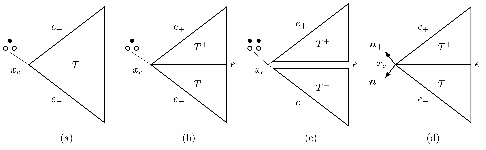

**图 3.2  二维角点应力连续性的部分松弛：(a) 原始单三角形；(b) 划分为共边 $e$ 的两个三角形，角点应力仍完全共享；(c) 松弛后，纯切向自由度分侧独立（实心点），两个法向迹自由度保持共享（空心圈）；(d) 两侧牵引边界的单位外法向 $\boldsymbol n_\pm$。(c) 中的间隙仅为示意。自由度标记的位置作示意性偏移，均关联于角点 $x_c$。**

对任意多项式次数 $k\ge1$，二维三角形上的局部对称应力空间维数为
$$
\dim \mathbb{P}_k(T;\mathbb{S})=\frac{3(k+1)(k+2)}{2}.
$$
自由度按几何实体组织如下：
- **顶点自由度**：每个单元在每个顶点具有 3 个局部应力自由度。未松弛顶点的对应自由度在相邻单元间共享；上述两单元松弛角点合计具有 4 个全局独立自由度；
- **边内部自由度**：每个单元的每条边具有 $2(k-1)$ 个法向牵引自由度和 $k-1$ 个切向正应力自由度。公共边上的法向牵引自由度在相邻单元间共享，切向正应力自由度由各单元独立编号；
- **单元内部自由度**：每个单元具有 $\frac{3(k-1)(k-2)}2$ 个内部应力自由度，均由该单元独立编号。

在二维情形下，下文的离散变分问题与矩阵装配采用上述部分松弛应力空间。为简化记号，将其仍记为 $\boldsymbol{\Sigma}_h^k$，相应的齐次离散应力测试空间记为 $\boldsymbol{\Sigma}_{h,0}^k=\boldsymbol{\Sigma}_h^k\cap\boldsymbol{\Sigma}_0$。

### 3.5 Discrete Saddle-Point System

设 $\{\boldsymbol{\Phi}_i\}_{i=1}^{N_\sigma}$ 与 $\{\boldsymbol{\psi}_p\}_{p=1}^{N_u}$ 分别为齐次离散应力空间 $\boldsymbol{\Sigma}_{h,0}^k$ 与分片不连续位移空间 $\boldsymbol{V}_h^{k-1}$ 的全局基。齐次应力修正与离散位移分别展开为：
$$
\boldsymbol{\sigma}_{0,h} = \sum_{j=1}^{N_\sigma} s_{0,j} \boldsymbol{\Phi}_j, \qquad \boldsymbol{u}_h = \sum_{q=1}^{N_u} u_q \boldsymbol{\psi}_q.
$$
将上述展开代入统一离散混合变分问题 (3.9)，得到如下对称不定的鞍点代数系统：
$$
\begin{bmatrix}
\boldsymbol{A} & \boldsymbol{B} \\
\boldsymbol{B}^{\mathsf T} & -\boldsymbol{C}
\end{bmatrix}
\begin{bmatrix}
\boldsymbol{s}_0 \\
\boldsymbol{u}
\end{bmatrix}
=
\begin{bmatrix}
\boldsymbol{f}_{\sigma} \\
\boldsymbol{f}_u
\end{bmatrix}, \tag{3.12}
$$
各分块矩阵的元素定义为：
$$
\begin{aligned}
A_{ij} &= a(\boldsymbol{\Phi}_j, \boldsymbol{\Phi}_i) = \int_\Omega \mathcal{A}\boldsymbol{\Phi}_j : \boldsymbol{\Phi}_i \,\mathrm{d}x, && i,j = 1, \dots, N_\sigma, \\
B_{ip} &= b(\boldsymbol{\Phi}_i, \boldsymbol{\psi}_p) = \int_\Omega (\operatorname{div}\boldsymbol{\Phi}_i) \cdot \boldsymbol{\psi}_p \,\mathrm{d}x, && i = 1, \dots, N_\sigma; \ p = 1, \dots, N_u, \\
C_{pq} &= c_h(\boldsymbol{\psi}_q, \boldsymbol{\psi}_p) = \sum_{F \in \mathcal{F}_h^i \cup \mathcal{F}_h^D} \alpha h_F \int_F [\![ \boldsymbol{\psi}_q ]\!] : [\![ \boldsymbol{\psi}_p ]\!] \,\mathrm{d}s, && p,q = 1, \dots, N_u.
\end{aligned} \tag{3.13}
$$
上述 $\boldsymbol C$ 的求和表达式用于低阶格式 $1\le k\le d$；高阶格式 $k\ge d+1$ 取 $\boldsymbol C=\boldsymbol0$。
右端载荷向量分量定义为：
$$
\begin{aligned}
(\boldsymbol{f}_{\sigma})_i &= \int_{\Gamma_D} \boldsymbol{u}_D \cdot (\boldsymbol{\Phi}_i\boldsymbol{n})\,\mathrm{d}s - \int_\Omega \mathcal{A}\boldsymbol{\sigma}_{g,h} : \boldsymbol{\Phi}_i \,\mathrm{d}x, && i = 1, \dots, N_\sigma, \\
(\boldsymbol{f}_u)_p &= -\int_\Omega \boldsymbol{b} \cdot \boldsymbol{\psi}_p \,\mathrm{d}x - \int_\Omega (\operatorname{div}\boldsymbol{\sigma}_{g,h}) \cdot \boldsymbol{\psi}_p \,\mathrm{d}x - \ell_h^D(\boldsymbol{\psi}_p), && p = 1, \dots, N_u,
\end{aligned} \tag{3.14}
$$
其中，$\boldsymbol{s}_0=(s_{0,1},\dots,s_{0,N_\sigma})^{\mathsf T}$ 为齐次应力修正的自由度向量，$\boldsymbol{u}=(u_1,\dots,u_{N_u})^{\mathsf T}$ 为位移自由度向量。

在牵引边界上，采用与边界对齐的局部标架及角点基底变换，使应力法向迹由相应的边界自由度表示。取 $\boldsymbol g_h$ 为 $\boldsymbol g$ 在各牵引边界边 $k+1$ 个等距 Lagrange 节点处的插值，并假设其属于离散法向迹空间。根据 $\boldsymbol g_h$ 的牵引分量确定对应自由度的系数，其余自由度置零，即可构造满足 $\boldsymbol{\sigma}_{g,h}\boldsymbol n=\boldsymbol g_h$ 的离散提升 $\boldsymbol{\sigma}_{g,h}\in\boldsymbol{\Sigma}_h^k$。将全空间基中对应齐次牵引条件的受约束自由度剔除后，剩余基函数构成 $\boldsymbol{\Sigma}_{h,0}^k$ 的基 $\{\boldsymbol{\Phi}_i\}_{i=1}^{N_\sigma}$。

---

## 4 Density-Based Topology Optimization with Independent Stress

### 4.1 Design Variables, Density Filter, Projection, and Dual-Parameter Material Interpolation

在第 2.1 节引入的单纯形网格 $\mathcal{T}_h = \{T_e\}_{e=1}^{N_e}$ 上离散设计密度，其中 $N_e$ 为单元总数。每个单元 $T_e$ 上的设计密度取常数 $\rho_e \in [0, 1]$，由此定义设计向量 $\boldsymbol{\rho} = (\rho_1, \dots, \rho_{N_e})^{\mathsf T}$。这些设计变量经下述密度过滤与投影映射得到用于材料插值的物理密度。

为减轻拓扑优化中的网格依赖性与棋盘格现象，并引入空间平滑尺度，采用线性密度过滤器 [10, 14] 将设计密度向量 $\boldsymbol{\rho}$ 映射为过滤密度向量 $\widetilde{\boldsymbol{\rho}}$，其单元分量为
$$
\widetilde{\rho}_e = \frac{\sum_{j \in \mathcal{N}_e} w_{ej} v_j \rho_j}{\sum_{j \in \mathcal{N}_e} w_{ej} v_j}, \tag{4.1}
$$
其中，$v_j = |T_j|$ 为单元 $T_j$ 的几何测度（二维面积或三维体积）。记
$$
\boldsymbol{x}_e = \frac{1}{|T_e|}\int_{T_e} \boldsymbol{x}\,\mathrm{d}x
$$
为单元 $T_e$ 的形心。给定过滤半径 $r_{\min}>0$，邻域索引集合定义为
$$
\mathcal{N}_e = \left\{j \in \{1, \dots, N_e\} : \|\boldsymbol{x}_e - \boldsymbol{x}_j\|_2 \le r_{\min}\right\}.
$$
权重随单元形心之间的距离线性衰减：
$$
w_{ej} = \max\!\left(0, \, r_{\min} - \|\boldsymbol{x}_e - \boldsymbol{x}_j\|_2\right).
$$

为减少过滤密度场中的中间密度，并使材料与空域之间的密度过渡更加陡峭，本文采用光滑 Heaviside 投影 [36]，形成设计密度、过滤密度与物理密度的三场表述：
$$
\boldsymbol{\rho}\xrightarrow{\text{密度过滤}}\widetilde{\boldsymbol{\rho}}\xrightarrow{\text{光滑投影}}\overline{\boldsymbol{\rho}},
\qquad
\overline{\rho}_e=P_{\beta,\eta_{\mathrm p}}(\widetilde{\rho}_e)
=\frac{\tanh(\beta\eta_{\mathrm p})+\tanh\!\left[\beta(\widetilde{\rho}_e-\eta_{\mathrm p})\right]}
{\tanh(\beta\eta_{\mathrm p})+\tanh\!\left[\beta(1-\eta_{\mathrm p})\right]}, \tag{4.2}
$$
其中 $\eta_{\mathrm p}\in(0,1)$ 为投影阈值，$\beta>0$ 控制投影的陡峭程度；$\eta_{\mathrm p}$ 与后文应力阈值函数 $\eta(\cdot)$ 含义不同。启用投影时，可通过逐阶段增大 $\beta$ 使密度过渡更加陡峭；未启用投影时，取恒等映射 $\overline{\rho}_e=\widetilde{\rho}_e$。后续材料插值、状态方程、体积评估及局部应力约束均以物理密度 $\overline{\rho}_e$ 为准。

对于三维或平面应变问题，若将泊松比固定为接近 $0.5$ 的 $\nu_0$ 而仅插值杨氏模量，则体积模量与剪切模量之比 $K/G=2(1+\nu_0)/[3(1-2\nu_0)]$ 与密度无关，其中 $K$ 和 $G$ 分别为三维材料的体积模量与剪切模量。因此，降低密度并不能消除材料的近不可压缩性，中低密度区域仍可能形成以压力传递为主的类流体承载路径。为使中低密度相表现为可压缩弱材料，参考 Bruggi 和 Venini [12] 对泊松比进行密度相关松弛的思路，本文采用如下带非零下界的杨氏模量与泊松比插值：

1. **杨氏模量插值（SIMP 模型）**：
$$
E(\overline{\rho}_e) = E_{\min} + (E_0 - E_{\min}) \overline{\rho}_e^{p_E}, \tag{4.3}
$$
式中 $E_0$ 为各向同性实体材料的 Young 模量，$E_{\min}>0$ 为材料模量下界，用于避免零模量导致柔度算子无定义，其具体取值在各算例中给出。$p_E$ 为刚度惩罚指数，柔顺度算例取 $p_E=3$，应力约束算例取 $p_E=3.5$。

2. **泊松比松弛插值**：
$$
\nu(\overline{\rho}_e) = \nu_{\mathrm{void}} + (\nu_0 - \nu_{\mathrm{void}}) \overline{\rho}_e^{p_\nu}, \tag{4.4}
$$
式中 $\nu_0$ 为实体材料的目标泊松比（如 $\nu_0 = 0.4999$），$\nu_{\mathrm{void}}$ 为弱材料参考泊松比。本文取 $\nu_{\mathrm{void}} = 0.3$、松弛指数 $p_\nu = 1$，使泊松比随物理密度由弱材料参考值线性过渡至实体材料值，从而提高中低密度相的可压缩性，减弱上述类流体承载效应。式 (4.4) 在第 5.2.2 节 $\nu_0=0.4999$ 的近不可压缩优化组中启用；其余优化算例保持泊松比为 $\nu_0$，此时只有杨氏模量按式 (4.3) 随密度变化。

将上述材料参数 $E(\overline\rho_e)$ 与 $\nu(\overline\rho_e)$ 代入第 2.2 节中相应的本构关系，得到单元 $T_e$ 上的柔度算子 $\mathcal A(\overline\rho_e)$。

### 4.2 State Equations and Complementary Energy Compliance Formulation

考虑齐次位移边界条件和设计无关外载荷作用下的最小柔顺度问题。本文采用的应力–位移混合格式以应力和位移为独立状态变量，材料分布通过密度相关的柔度算子进入离散方程 [12]。在 Hu–Zhang 离散框架中，总应力由状态方程直接求得，因此采用基于余能的柔顺度目标，可由总应力场与柔度算子进行单元积分计算。下文首先说明该目标与连续问题中外载功柔顺度的关系，再给出离散优化模型。

对于具有齐次位移边界条件的连续线弹性问题的解，由平衡方程、本构关系、边界条件与分部积分可得
$$
\int_\Omega\mathcal A\boldsymbol\sigma:\boldsymbol\sigma\,\mathrm dx
=\int_\Omega\boldsymbol b\cdot\boldsymbol u\,\mathrm dx
+\int_{\Gamma_N}\boldsymbol g\cdot\boldsymbol u\,\mathrm ds.
$$
因此，外载柔顺度等于应变能的两倍，也等于应变余能的两倍。在满足上述连续状态方程的设计集合上，最小化外载柔顺度与最小化应变余能等价。为与外载柔顺度采用相同的能量归一化，定义不含 $1/2$ 因子的离散目标
$$
C(\boldsymbol\rho,\boldsymbol\sigma_h)
=\int_\Omega\mathcal A(\overline{\boldsymbol\rho})\boldsymbol\sigma_h:\boldsymbol\sigma_h\,\mathrm dx
=\sum_{e=1}^{N_e}\boldsymbol s_e^{\mathsf T}\boldsymbol A_e(\overline\rho_e)\boldsymbol s_e, \tag{4.5}
$$
其中 $\overline{\boldsymbol\rho}=\overline{\boldsymbol\rho}(\boldsymbol\rho)$ 为第 4.1 节过滤与投影后的物理密度，$\boldsymbol s_e$ 为总应力 $\boldsymbol\sigma_h|_{T_e}$ 在单元局部应力基下的系数向量，包含牵引提升的贡献；$\boldsymbol A_e$ 为相应的局部柔度矩阵，其 $(a,b)$ 元素为 $\int_{T_e}\mathcal A(\overline\rho_e)\boldsymbol\phi_{e,b}:\boldsymbol\phi_{e,a}\,\mathrm dx$，其中 $\{\boldsymbol\phi_{e,a}\}_{a=1}^{n_e}$ 为 $\mathbb P_k(T_e;\mathbb S)$ 的基。式 (4.5) 为离散应变余能的两倍，可直接按单元积分并求和。

状态约束采用第 3.5 节的齐次应力未知量表述，总应力按 $\boldsymbol\sigma_h=\boldsymbol\sigma_{0,h}+\boldsymbol\sigma_{g,h}$ 重构。本节目标函数与后续应力约束均采用该总应力 $\boldsymbol\sigma_h$。在固定网格与第 3.3 节固定稳定化尺度下，$\boldsymbol A(\overline{\boldsymbol\rho})$ 通过 $E(\overline\rho_e)$ 和 $\nu(\overline\rho_e)$ 依赖设计变量，而 $\boldsymbol B$ 与 $\boldsymbol C$ 保持不变。状态变量由设计对应的离散状态方程确定。由此，基于余能的最小柔顺度模型写为
$$
\begin{aligned}
\min_{\boldsymbol\rho}\quad &C(\boldsymbol\rho,\boldsymbol\sigma_h)
=\sum_{e=1}^{N_e}\boldsymbol s_e^{\mathsf T}\boldsymbol A_e(\overline\rho_e)\boldsymbol s_e\\
\text{s.t.}\quad &
\begin{bmatrix}\boldsymbol A(\overline{\boldsymbol\rho})&\boldsymbol B\\\boldsymbol B^{\mathsf T}&-\boldsymbol C\end{bmatrix}
\begin{bmatrix}\boldsymbol s_0\\\boldsymbol u\end{bmatrix}
=\begin{bmatrix}\boldsymbol f_\sigma(\overline{\boldsymbol\rho})\\\boldsymbol f_u\end{bmatrix},\\
&\frac{\sum_{e=1}^{N_e}v_e\overline\rho_e}{\sum_{e=1}^{N_e}v_e}\le\bar V,\\
&0\le\rho_e\le1,\quad e=1,\dots,N_e,
\end{aligned}\tag{4.6}
$$
其中 $v_e=|T_e|$ 为式 (4.1) 中的单元测度，$\bar V\in(0,1)$ 为材料体积分数上限。右端由式 (3.14) 给出，齐次位移边界条件下，其中的 $\boldsymbol u_D$ 项与 $\ell_h^D$ 均为零。记 $\boldsymbol s_g$ 为牵引提升 $\boldsymbol\sigma_{g,h}$ 在完整应力空间 $\boldsymbol\Sigma_h^k$ 全局基下的系数向量，并将 $\boldsymbol s_0$ 在牵引边界受约束自由度处补零，得到 $\widetilde{\boldsymbol s}_0$。总应力的全局系数向量为 $\boldsymbol s=\widetilde{\boldsymbol s}_0+\boldsymbol s_g$。将总应力限制到单元 $T_e$，并在式 (4.5) 的局部应力基下表示，得到系数向量 $\boldsymbol s_e$。牵引提升取为与设计无关，但右端 $\boldsymbol f_\sigma$ 中的项 $-\int_\Omega\mathcal A(\overline{\boldsymbol\rho})\boldsymbol\sigma_{g,h}:\boldsymbol\Phi_i\,\mathrm dx$ 仍依赖材料分布，灵敏度分析须计入该依赖。

该模型直接利用总应力与局部柔度矩阵评估柔顺度，目标及其灵敏度的计算不要求显式构造位移形式的 Schur 补 $\boldsymbol B^{\mathsf T}\boldsymbol A(\overline{\boldsymbol\rho})^{-1}\boldsymbol B+\boldsymbol C$ 及其设计导数。在上述齐次位移边界条件、设计无关外载荷及固定牵引提升的假设下，若不含稳定化项，可利用离散混合状态方程消去目标灵敏度中的隐式应力导数项。低阶稳定化格式仍采用式 (4.5) 的目标函数，但上述简化一般不再成立，因此采用第 4.5 节的一般伴随公式计算其灵敏度。

### 4.3 Stress-Constrained Topology Optimization with a Relaxed Stress Threshold

本文考虑局部应力约束下的结构总体积最小化问题 [23, 13]。在一般模型中，对每个单元形心处的表观 von Mises 等效应力施加密度相关的松弛约束：
$$
g_e(\boldsymbol{\rho}, \boldsymbol{\sigma}_h) = \frac{\sigma_{\mathrm{vm}}(\boldsymbol{\sigma}_{h,e})}{\bar{\sigma}} - \eta(\overline{\rho}_e) \le 0, \quad e = 1, \dots, N_e, \tag{4.7}
$$
其中 $\bar{\sigma}$ 为实体材料的许用应力，$\boldsymbol\sigma_{h,e}$ 为单元形心处的表观应力，即插值材料所承受的应力，阈值函数 $\eta$ 在下文定义。为比较两类有限元离散，本文采用相同的体积目标、材料插值、松弛阈值函数及单元形心评价位置。LFEM 通过位移梯度和插值本构关系计算表观应力 $\mathcal A(\overline\rho_e)^{-1}\boldsymbol\varepsilon(\boldsymbol u_h)$；HZMFEM 则直接评价包含牵引提升贡献的重构总应力 $\boldsymbol\sigma_h=\boldsymbol\sigma_{0,h}+\boldsymbol\sigma_{g,h}$。

上述约束仅施加于单元形心，不保证单元内其他位置的应力满足相同限值。在平面应力条件下（$\sigma_{zz}=\sigma_{xz}=\sigma_{yz}=0$），等效应力取
$$
\sigma_{\mathrm{vm}}(\boldsymbol\sigma_{h,e})=\sqrt{\sigma_{xx}^2-\sigma_{xx}\sigma_{yy}+\sigma_{yy}^2+3\sigma_{xy}^2},
$$
其中 $\sigma_{xx},\sigma_{yy},\sigma_{xy}$ 为 $\boldsymbol\sigma_{h,e}$ 的分量。平面应变与三维情形须采用相应的 von Mises 表达式。各向同性平面应变下，$\sigma_{zz}=\nu(\overline\rho_e)(\sigma_{xx}+\sigma_{yy})$，因此当泊松比随密度变化时，即使固定面内应力，von Mises 应力仍显式依赖密度。

应力约束拓扑优化中，材料消失时相应的应力约束应随之解除。若低密度区域仍受实体材料许用应力条件限制，可能阻碍材料移除；经典应力约束模型中，与材料消失相关的约束变化还可能产生退化可行分支及奇异最优解 [35, 30, 21]。参考 $\epsilon$ 松弛 [20, 23] 以及混合有限元中采用的密度相关应力限值 [13]，本文采用以下带正下限的阈值：
$$
\eta(\overline{\rho}_e) = m_E(\overline{\rho}_e) + \epsilon\bigl(1 - m_E(\overline{\rho}_e)\bigr),
\qquad m_E(\overline{\rho}_e) = \frac{E(\overline{\rho}_e)}{E_0}, \tag{4.8}
$$
其中 $m_E$ 为相对刚度，$E(\overline\rho_e)$ 由式 (4.3) 给出，$\epsilon\in(0,1)$ 为松弛参数。记单元形心处的表观应力为 $\boldsymbol\sigma_e^{\mathrm{app}}:=\boldsymbol\sigma_{h,e}$。

在泊松比固定的情形下，定义实体材料应力 $\boldsymbol\sigma_e^{\mathrm{solid}}:=\boldsymbol\sigma_e^{\mathrm{app}}/m_E(\overline\rho_e)$。此时 $\mathcal A(\overline\rho_e)^{-1}=m_E(\overline\rho_e)\,\mathcal A(1)^{-1}$，$\boldsymbol\sigma_e^{\mathrm{solid}}$ 即同一应变下实体材料的应力，位移法中为 $\mathcal A(1)^{-1}\boldsymbol\varepsilon(\boldsymbol u_h)$。由 $\sigma_{\mathrm{vm}}$ 的一次齐次性，$\sigma_{\mathrm{vm}}(\boldsymbol\sigma_e^{\mathrm{app}})=m_E\,\sigma_{\mathrm{vm}}(\boldsymbol\sigma_e^{\mathrm{solid}})$，故对 $m_E>0$，式 (4.7) 等价于
$$
\frac{\sigma_{\mathrm{vm}}(\boldsymbol\sigma_e^{\mathrm{solid}})}{\bar\sigma}
\le 1+\epsilon\Bigl(\frac{1}{m_E(\overline\rho_e)}-1\Bigr), \tag{4.9}
$$
式 (4.9) 表明，该阈值在低刚度区域放宽实体材料应力上限，同时在实体区域保留原始许用应力条件。因此，式 (4.7) 可视为一种基于相对刚度的 $\epsilon$ 松弛形式；采用表观应力表达可避免在约束评价中显式除以较小的 $m_E$。

阈值满足 $\eta(1)=1$，保留实体材料的许用应力条件。在 $\overline\rho_e=0$ 时，令 $r=E_{\min}/E_0>0$，则 $\eta(0)=\epsilon+(1-\epsilon)r>0$；当 $r\ll\epsilon$ 时，$\eta(0)\approx\epsilon$。在上述固定泊松比的条件下，零密度单元的实体材料应力比允许上限为 $1-\epsilon+\epsilon/r$，当该应力比严格低于此上限时，约束不活跃。这表明松弛阈值放宽了零密度单元的应力限制，但不保证其约束必然不活跃。本文取固定松弛参数 $\epsilon=10^{-3}$，不进行 $\epsilon$ 延拓。

据此，Hu–Zhang 离散下的局部应力约束体积最小化问题为
$$
\begin{aligned}
\min_{\boldsymbol\rho}\quad &
f_V(\boldsymbol\rho)=\frac{\sum_{e=1}^{N_e}v_e\overline\rho_e}{\sum_{e=1}^{N_e}v_e}\\
\mathrm{s.t.}\quad &
\begin{bmatrix}\boldsymbol A(\overline{\boldsymbol\rho})&\boldsymbol B\\
\boldsymbol B^{\mathsf T}&-\boldsymbol C\end{bmatrix}
\begin{bmatrix}\boldsymbol s_0\\\boldsymbol u\end{bmatrix}
=\begin{bmatrix}\boldsymbol f_\sigma(\overline{\boldsymbol\rho})\\\boldsymbol f_u\end{bmatrix},\\
&g_e(\boldsymbol\rho,\boldsymbol\sigma_h)
=\frac{\sigma_{\mathrm{vm}}(\boldsymbol\sigma_{h,e})}{\bar\sigma}
-\eta(\overline\rho_e)\le0,\quad e=1,\dots,N_e,\\
&0\le\rho_e\le1,\quad e=1,\dots,N_e,
\end{aligned}\tag{4.10}
$$
其中，物理密度由第 4.1 节的过滤与投影确定。对给定设计变量 $\boldsymbol\rho$，状态变量 $(\boldsymbol s_0,\boldsymbol u)$ 由上述离散状态方程确定，总应力按第 4.2 节重构。由于设计域体积 $\sum_e v_e$ 固定，最小化体积分数 $f_V$ 等价于最小化结构总体积 $\sum_e v_e\overline\rho_e$。

LFEM 对照采用位移状态方程 $\boldsymbol K(\overline{\boldsymbol\rho})\boldsymbol u=\boldsymbol f$，其中刚度矩阵 $\boldsymbol K$ 由插值本构关系装配，载荷向量 $\boldsymbol f$ 与设计无关。单元形心处的表观应力由位移梯度和插值本构关系计算；体积目标、密度映射、松弛应力约束及设计变量边界与式 (4.10) 保持一致。

### 4.4 Augmented Lagrangian Formulation

式 (4.10) 在每个单元施加一个局部应力约束，约束数量随网格规模增长，直接处理大量约束会增加优化子问题的求解负担。为此，本文参考 Senhora 等 [33] 的增广拉格朗日方法（Augmented Lagrangian Method，ALM）及按约束数归一化的处理思路，将各局部约束通过增广项纳入目标函数，构建增广拉格朗日目标函数：
$$
\mathcal L(\boldsymbol{\rho}, \boldsymbol{\sigma}_h) = f_V(\boldsymbol{\rho}) + \frac{1}{N_e} \sum_{e=1}^{N_e} \mathcal{P}_e(g_e, \lambda_e, \mu_e), \tag{4.11}
$$
其中 $f_V$ 为式 (4.10) 的体积分数目标。在上述一般模型中，约束数为 $N_e$，因子 $1/N_e$ 将局部增广项之和按约束数平均，以减轻约束数量增加对增广项与体积目标相对量级的影响。各单元仍保留独立的局部约束及对应乘子。

对式 (4.7) 定义的局部约束，采用如下不等式约束增广项 [24]。定义截断约束量 $h_e=\max(g_e,-\lambda_e/\mu_e)$，则局部增广项 $\mathcal P_e=\lambda_e h_e+\frac{\mu_e}{2}h_e^2$ 可等价写为：
$$
\mathcal{P}_e = \begin{cases}
\lambda_e g_e + \frac{\mu_e}{2} g_e^2, & \text{if } g_e > -\frac{\lambda_e}{\mu_e}, \\
-\frac{\lambda_e^2}{2\mu_e}, & \text{if } g_e \le -\frac{\lambda_e}{\mu_e},
\end{cases} \tag{4.12}
$$
其中 $\lambda_e\ge0$ 为对应局部约束的拉格朗日乘子，$\mu_e>0$ 为罚因子。固定乘子与罚因子时，$\mathcal P_e$ 关于 $g_e$ 连续可微，其导数为 $\max(0,\lambda_e+\mu_e g_e)$；当 $g_e\le-\lambda_e/\mu_e$ 时，该增广项关于 $g_e$ 的导数为零。

在第 $k$ 次外层迭代中，固定乘子 $\boldsymbol\lambda^{(k)}$、罚因子 $\boldsymbol\mu^{(k)}$ 以及过滤、投影参数和稳定化尺度，近似求解仅显式保留设计变量上下界的增广子问题：
$$
\begin{aligned}
\min_{\boldsymbol\rho}\quad &
\mathcal L^{(k)}(\boldsymbol\rho)
=f_V(\boldsymbol\rho)+\frac{1}{N_e}\sum_{e=1}^{N_e}
\mathcal P_e\!\left(g_e(\boldsymbol\rho,\boldsymbol\sigma_h(\boldsymbol\rho)),\lambda_e^{(k)},\mu_e^{(k)}\right),\\
\mathrm{s.t.}\quad &0\le\rho_e\le1,\qquad e=1,\dots,N_e,
\end{aligned}\tag{4.13}
$$
其中 $\boldsymbol\sigma_h(\boldsymbol\rho)$ 由式 (4.10) 中的状态方程求解并重构得到。该子问题通过状态解映射隐式消去状态变量，将局部应力约束纳入增广目标，仅显式保留设计变量上下界；评价每个新设计的增广目标时，仍需求解相应的状态方程。

近似求解该子问题后，以子问题近似解处的约束值 $g_e$ 更新外层乘子，并投影到区间 $[0,\lambda_{\max}]$：
$$
\lambda_e^{(k+1)} = \min\left(\lambda_{\max},\,\max\left(0,\, \lambda_e^{(k)} + \mu_e^{(k)} g_e\right)\right), \tag{4.14}
$$
其中 $\lambda_{\max}>0$ 为乘子上界，参考 Andreani 等 [2] 将乘子估计限制在有界区间内的安全化处理思路。若某单元的乘子已达到上界且该单元仍违反约束，则后续正向更新被截断；若约束值随后变为负，乘子仍可下降。乘子截断本身不保证约束满足，因此需对最终设计逐单元复核式 (4.7) 的离散松弛约束。

内层采用移动渐近线法（Method of Moving Asymptotes，MMA）[34] 近似求解子问题 (4.13)。罚因子更新规则、约束复核范围与停止准则，以及完整求解流程见第 4.6 节。

### 4.5 Consistent Adjoint Sensitivity Analysis

本节先给出关于物理密度的灵敏度，再经密度映射传递至设计变量。推导固定网格、过滤及投影参数、稳定化尺度和增广目标的乘子与罚因子，假定载荷及牵引提升与设计无关，状态矩阵非奇异，且状态矩阵、右端项及目标函数在所考察设计及状态处可微。下文 $\partial/\partial\overline\rho_e$ 固定相应状态变量，$\mathrm d/\mathrm d\overline\rho_e$ 计入状态响应。

对于 HZMFEM 的目标 $J\in\{\mathcal L,C\}$，伴随变量满足

$$
\begin{bmatrix}\boldsymbol A(\overline{\boldsymbol\rho})&\boldsymbol B\\\boldsymbol B^{\mathsf T}&-\boldsymbol C\end{bmatrix}
\begin{bmatrix}\boldsymbol z_\sigma\\\boldsymbol z_u\end{bmatrix}
=\begin{bmatrix}\nabla_{\boldsymbol s_0}J\\\boldsymbol0\end{bmatrix}.
\tag{4.15}
$$

其中伴随应力为 $\boldsymbol\zeta_h=\sum_i(z_\sigma)_i\boldsymbol\Phi_i\in\boldsymbol\Sigma_{h,0}^k$。单元柔度算子的材料导数由式 (4.3)–(4.4) 给出：

$$
\mathcal A'_e:=\frac{\partial\mathcal A}{\partial\overline\rho_e}
=\frac{\partial\mathcal A}{\partial E}\frac{\mathrm dE}{\mathrm d\overline\rho_e}
+\frac{\partial\mathcal A}{\partial\nu}\frac{\mathrm d\nu}{\mathrm d\overline\rho_e}.
$$

泊松比固定时第二项为零。

对于增广目标，令 $\omega_e=\max(0,\lambda_e+\mu_e g_e)$，其伴随载荷与全导数为

$$
(\nabla_{\boldsymbol s_0}\mathcal L)_i
=\frac{1}{N_e\bar\sigma}\sum_{m=1}^{N_e}\omega_m
\frac{\partial\sigma_{\mathrm{vm}}(\boldsymbol\sigma_{h,m})}{\partial s_{0,i}},
$$

$$
\frac{\mathrm d\mathcal L}{\mathrm d\overline\rho_e}
=\frac{v_e}{\sum_mv_m}-\frac{\omega_e}{N_e}\eta'(\overline\rho_e)
-\int_{T_e}\mathcal A'_e\boldsymbol\sigma_h:\boldsymbol\zeta_h\,\mathrm dx,
\qquad \eta'(\overline\rho_e)=(1-\epsilon)m_E'(\overline\rho_e),
\tag{4.16}
$$

积分采用总应力 $\boldsymbol\sigma_h$，以计入牵引提升引起的右端密度依赖。应力及其对齐次应力自由度的导数按单元形心值评价。式 (4.16) 适用于平面应力、完整应力张量为状态变量的三维模型及固定泊松比的平面应变模型。泊松比随密度变化的平面应变模型还须加入

$$
\frac{\omega_e}{N_e\bar\sigma}
\left.\frac{\partial\sigma_{\mathrm{vm}}}{\partial\nu}\right|_{\sigma_{xx},\sigma_{yy},\sigma_{xy}}
\frac{\mathrm d\nu}{\mathrm d\overline\rho_e}.
$$

其中偏导固定面内应力，面外应力为 $\sigma_{zz}=\nu(\overline\rho_e)(\sigma_{xx}+\sigma_{yy})$。

对于余能目标 $C$，伴随载荷及全导数为

$$
(\nabla_{\boldsymbol s_0}C)_i
=2\int_\Omega\mathcal A(\overline{\boldsymbol\rho})\boldsymbol\sigma_h:\boldsymbol\Phi_i\,\mathrm dx.
$$

$$
\frac{\mathrm dC}{\mathrm d\overline\rho_e}
=\int_{T_e}\mathcal A'_e\boldsymbol\sigma_h:
(\boldsymbol\sigma_h-\boldsymbol\zeta_h)\,\mathrm dx.
\tag{4.17}
$$

无稳定化、齐次位移边界条件及设计无关载荷下，伴随解为 $\boldsymbol z_\sigma=\boldsymbol0$、$\boldsymbol z_u=-2\boldsymbol u$，无需单独伴随求解，梯度简化为

$$
\frac{\mathrm dC}{\mathrm d\overline\rho_e}
=\boldsymbol s_e^{\mathsf T}\frac{\partial\boldsymbol A_e}{\partial\overline\rho_e}\boldsymbol s_e,
\qquad c_h=0,
\tag{4.18}
$$

其中 $\boldsymbol s_e$ 为单元总应力系数，$\boldsymbol A_e$ 为单元柔度矩阵，定义见式 (4.5)。低阶稳定化格式采用式 (4.17)。

LFEM 采用 $\boldsymbol K(\overline{\boldsymbol\rho})\boldsymbol u=\boldsymbol f$。对增广目标，求解伴随方程 $\boldsymbol K\boldsymbol z=\nabla_{\boldsymbol u}\mathcal L$，得到

$$
\frac{\mathrm d\mathcal L}{\mathrm d\overline\rho_e}
=\left.\frac{\partial\mathcal L}{\partial\overline\rho_e}\right|_{\boldsymbol u}
-\boldsymbol z^{\mathsf T}\frac{\partial\boldsymbol K}{\partial\overline\rho_e}\boldsymbol u,
\tag{4.19}
$$

其中固定位移的显式偏导为

$$
\left.\frac{\partial\mathcal L}{\partial\overline\rho_e}\right|_{\boldsymbol u}
=\frac{v_e}{\sum_m v_m}-\frac{\omega_e}{N_e}\eta'(\overline\rho_e)
+\frac{\omega_e}{N_e\bar\sigma}
\left.\frac{\partial\sigma_{\mathrm{vm}}(\boldsymbol\sigma_e^{\mathrm{app}})}{\partial\overline\rho_e}\right|_{\boldsymbol u}.
$$

最后一项通过完整应力评价计入插值本构的密度依赖，包括平面应变下泊松比变化的贡献，不再另加上述面外应力补充项。

对外载功柔顺度 $C=\boldsymbol f^{\mathsf T}\boldsymbol u$，在齐次位移边界条件及设计无关载荷下，伴随解为 $\boldsymbol z=\boldsymbol u$ [8]，因此

$$
\frac{\mathrm dC}{\mathrm d\overline\rho_e}
=-\boldsymbol u^{\mathsf T}\frac{\partial\boldsymbol K}{\partial\overline\rho_e}\boldsymbol u.
\tag{4.20}
$$

最后，对 $J\in\{\mathcal L,C\}$，通过式 (4.1)–(4.2) 的链式法则得到设计变量梯度：

$$
\frac{\mathrm dJ}{\mathrm d\rho_j}
=\sum_{e:\,j\in\mathcal N_e}\frac{\mathrm dJ}{\mathrm d\overline\rho_e}
P'_{\beta,\eta_{\mathrm p}}(\widetilde\rho_e)
\frac{w_{ej}v_j}{\sum_{m\in\mathcal N_e}w_{em}v_m},
\tag{4.21}
$$

其中 $P'_{\beta,\eta_{\mathrm p}}$ 为式 (4.2) 的投影导数；采用恒等映射时取 $1$。体积分数采用同一规则，$\mathrm df_V/\mathrm d\overline\rho_e=v_e/\sum_m v_m$。

### 4.6 Optimization Algorithms and Numerical Workflows

式 (4.6) 采用 MMA 或最优性准则法（Optimality Criteria，OC）[8] 求解；式 (4.10) 采用第 4.4 节的 ALM–MMA 方法求解。

#### 4.6.1 Single-Loop Algorithm for Compliance Minimization

算法 1 给出式 (4.6) 的单层优化流程，仅采用密度过滤，不启用投影。

**算法 1：基于 MMA 或 OC 的单层优化流程**

**输入：** 初始设计 $\boldsymbol\rho^{(0)}$；过滤参数；优化器类型（MMA 或 OC）及其参数；体积分数上限 $\bar V$；移动极限 $m$；停止参数 $\varepsilon_\rho$、$N_{\max}$。

**输出：** 最终设计变量 $\boldsymbol\rho^*$ 及其物理密度 $\overline{\boldsymbol\rho}$、柔顺度 $C$、体积分数 $f_V$ 与终止状态。

1. 令 $n=0$、$\Delta_\rho^{(0)}=\infty$；采用 MMA 时初始化其渐近线与设计历史。
2. 对 $\boldsymbol\rho^{(0)}$ 过滤；求解状态方程；计算 $C^{(0)}$ 与 $f_V^{(0)}$。
3. **while** $n<N_{\max}$ 且 $\Delta_\rho^{(n)}>\varepsilon_\rho$ **do**
4. &emsp;按第 4.5 节计算当前设计 $\boldsymbol\rho^{(n)}$ 处的 $\mathrm dC/\mathrm d\rho_e$ 与 $\mathrm df_V/\mathrm d\rho_e$。
5. &emsp;在体积约束、设计变量界限与移动极限下由 MMA 或 OC 更新得到 $\boldsymbol\rho^{(n+1)}$。
6. &emsp;过滤；求解状态方程；计算 $C^{(n+1)}$ 与 $f_V^{(n+1)}$。
7. &emsp;计算 $\Delta_\rho^{(n+1)}=\|\boldsymbol\rho^{(n+1)}-\boldsymbol\rho^{(n)}\|_\infty$。
8. &emsp;令 $n\leftarrow n+1$。
9. **end while**
10. 返回 $\boldsymbol\rho^*=\boldsymbol\rho^{(n)}$ 及其对应结果；若 $\Delta_\rho^{(n)}\le\varepsilon_\rho$，报告达到设计变化容差，否则报告达到迭代上限；单独复核最终体积分数与上限的偏差。

算法 1 中，MMA 求解目标函数与体积约束的近似子问题；OC 采用阻尼乘法更新 [3]，并通过二分法调整乘子，体积按过滤后的物理密度计算。OC 二分求解的有限容差可能导致最终体积分数略超上限，故终态需单独复核。移动极限 $m$ 与 OC 阻尼指数 $\xi$ 在各算例中给出。

#### 4.6.2 Nested Two-Loop Algorithm for Stress-Constrained Volume Minimization

算法 2 给出式 (4.10) 局部应力约束体积最小化问题的双层迭代流程，外层更新 ALM 乘子与罚因子，内层采用 MMA 近似求解增广子问题。该流程采用密度过滤与投影，并分别采用 HZMFEM 或 LFEM 对应的离散状态方程。$\boldsymbol\rho^{k,j}$ 表示第 $k$ 个外层步中经 $j$ 次内层更新后的设计。

**算法 2：基于 ALM–MMA 的双层优化流程**

**输入：** $\boldsymbol\rho^{0,0}$；过滤、投影及延拓、MMA 参数；$m$；$\mu_0$、$\gamma_\mu$、$\mu_{\max}$、$\lambda_{\max}$；判据集合 $\mathcal E_{\mathrm{acc}}$ 的确定规则；$\delta_\rho$、$\delta_g$、$N_{\mathrm{hold}}$、$N_{\mathrm{out}}^{\max}$、$N_{\mathrm{in}}^{\max}$。

**输出：** $\boldsymbol\rho^*$、$\overline{\boldsymbol\rho}$、$\boldsymbol\sigma_h$、$f_V$、$g_{\max}$、$g_{\max,\mathrm{all}}$ 与终止状态。

1. 令 $k=0$、$q=0$、$\lambda_e^{(0)}=0$、$\mu_e^{(0)}=\mu_0$；初始化投影参数 $\beta$ 以及 MMA 的渐近线与设计历史。
2. 对 $\boldsymbol\rho^{0,0}$ 过滤并投影；求解状态方程；计算 $f_V$ 与 $g_e$。
3. **while** $q<N_{\mathrm{hold}}$ 且 $k<N_{\mathrm{out}}^{\max}$ **do**
4. 固定 $\boldsymbol\lambda^{(k)}$、$\boldsymbol\mu^{(k)}$、$\beta$；若投影参数改变，则重算密度、状态、$f_V$ 与 $g_e$；计算 $\mathcal L^{(k)}$；令 $j=0$。
5. **while** $j<N_{\mathrm{in}}^{\max}$ **do**
6. 求解伴随方程；经过滤与投影的链式法则计算 $\mathrm d\mathcal L^{(k)}/\mathrm d\rho_e$。
7. 在设计变量界限与移动极限内由 MMA 更新得到 $\boldsymbol\rho^{k,j+1}$。
8. 过滤并投影；求解状态方程；计算 $f_V$、$g_e$、$\mathcal L^{(k)}$；令 $j\leftarrow j+1$；若满足下述内层停止条件，则退出内循环。
9. **end while**
10. 令 $\boldsymbol\rho^{k+1,0}=\boldsymbol\rho^{k,j}$；计算 $g_{\max}^{k+1}$ 与 $\Delta_{\rho,\mathrm{out}}^{k+1}$。
11. 按式 (4.14) 更新并截断 $\lambda_e^{(k+1)}$；令 $\mu_e^{(k+1)}=\min(\gamma_\mu\mu_e^{(k)},\mu_{\max})$。
12. 按计划更新投影参数；若改变，则重置 MMA，并标记第 4 步需重算密度与状态。
13. 若延拓已完成、第 12 步未改变投影参数，且 $g_{\max}^{k+1}\le\delta_g$、$\Delta_{\rho,\mathrm{out}}^{k+1}<\delta_\rho$，则 $q\leftarrow q+1$；否则 $q=0$；令 $k\leftarrow k+1$。
14. **end while**
15. 取 $\boldsymbol\rho^*=\boldsymbol\rho^{k,0}$；按当前投影重算密度与状态；返回输出，并报告满足连续验收条件（$q\ge N_{\mathrm{hold}}$）或达到迭代上限。

外层乘子按式 (4.14) 更新，罚因子按算法 2 第 11 步增长并截断。由于各单元罚因子初值相同且同步更新，$\mu_e^{(k)}$ 对所有单元取同一值。投影参数改变时，乘子与罚因子不重置，但 MMA 渐近线与设计历史重置。

判据集合 $\mathcal E_{\mathrm{acc}}$ 按算例规定确定；若其成员依赖物理密度，则在每次约束验收时按当前设计重新确定。内层最多执行 $N_{\mathrm{in}}^{\max}$ 次 MMA 更新；若更新后的设计同时满足
$$
\frac{1}{N_e}\sum_{e=1}^{N_e}|\rho_e^{k,j}-\rho_e^{k,j-1}|<\delta_\rho,
\qquad
\max_{e\in\mathcal E_{\mathrm{acc}}}g_e\le\delta_g,
$$
则提前退出内循环。外层验收采用判据集合上的最大约束值与整个外层步首末的平均设计变化量：
$$
g_{\max}^{k+1}=\max_{e\in\mathcal E_{\mathrm{acc}}}g_e,
\qquad
\Delta_{\rho,\mathrm{out}}^{k+1}=\frac{1}{N_e}\sum_{e=1}^{N_e}\bigl|\rho_e^{k+1,0}-\rho_e^{k,0}\bigr|,
$$
其中 $g_e$ 在设计 $\boldsymbol\rho^{k+1,0}$、本外层步固定的投影参数下计算，平均设计变化量采用文献 [24] 中的形式。外层停止还须满足算法 2 第 13 步的投影条件，并连续通过 $N_{\mathrm{hold}}$ 次验收。

最终设计按当前投影参数重新评价，报告判据集合上的 $g_{\max}$ 及全域指标 $g_{\max,\mathrm{all}}=\max_{1\le e\le N_e}g_e$。两者均为带符号的最大约束值；$g_{\max,\mathrm{all}}\le0$ 表示全部单元均满足离散松弛应力限值。若算例排除了部分单元的应力约束，优化问题的应力可行性应在实际施加约束的单元集合上判断。

---

## 5 Numerical Results

本节首先通过制造解检验不同阶次离散格式的收敛性，随后通过三类拓扑优化算例考察所提方法在柔顺度最小化、近不可压缩材料设计及局部应力约束问题中的表现。所有算例基于开源有限元库 FEALPy 及其拓扑优化模块 SOPTX 实现。

### 5.1 Convergence Rate Verification via Manufactured Solutions

在单位正方形域 $\Omega=(0,1)^2$ 上构造各向同性平面应变制造解问题，取 $\lambda=1$、$\mu=0.5$，精确位移为
$$
\boldsymbol{u}(x,y) = \begin{bmatrix} \sin(\pi x)\sin(\pi y) \\ \sin(\pi x)\sin(\pi y) \end{bmatrix}.
$$
令 $\boldsymbol\sigma=\mathcal A^{-1}\boldsymbol\varepsilon(\boldsymbol u)$、$\boldsymbol b=-\operatorname{div}\boldsymbol\sigma$，在 $\Gamma_D=\{x=0\}\cup\{y=0\}$ 上施加齐次位移条件，在 $\Gamma_N=\{x=1\}\cup\{y=1\}$ 上施加牵引 $\boldsymbol g=\boldsymbol\sigma\boldsymbol n$。

采用对角线棋盘格交替的均匀直角三角形网格，取 $n_x=4,8,16,32,64$，对应 $h=\sqrt2/n_x$。四个角点各属于两个三角形，并采用第 3.4 节的角点松弛。表中总自由度为应力与位移自由度之和，观测收敛阶按 $\log_2(e_h/e_{h/2})$ 计算，$e_h$ 为相应误差范数。

#### 5.1.1 Higher-Order Convergence

高阶格式（$k=3,4$）不采用跳量稳定化，其误差与观测收敛阶如表 5.1 所示。

<b>
表 5.1  高阶 Hu–Zhang 混合有限元（阶次 3、4）制造解收敛误差与观测阶
</b>

| $k$ | $n_x$ | 总自由度 | $\|\boldsymbol{u}-\boldsymbol{u}_h\|_0$ | 观测阶 | $\|\boldsymbol{\sigma}-\boldsymbol{\sigma}_h\|_0$ | 观测阶 | $\|\boldsymbol{\sigma}-\boldsymbol{\sigma}_h\|_{H(\mathrm{div})}$ | 观测阶 |
|:---:|:---:|:---:|:---:|:---:|:---:|:---:|:---:|:---:|
| **3** | 4 | 975 | $3.0644\times10^{-3}$ | — | $4.0519\times10^{-3}$ | — | $8.8146\times10^{-2}$ | — |
| | 8 | 3 767 | $3.8850\times10^{-4}$ | 2.98 | $2.3422\times10^{-4}$ | 4.11 | $1.1180\times10^{-2}$ | 2.98 |
| | 16 | 14 823 | $4.8746\times10^{-5}$ | 2.99 | $1.4118\times10^{-5}$ | 4.05 | $1.4027\times10^{-3}$ | 2.99 |
| | 32 | 58 823 | $6.0991\times10^{-6}$ | 3.00 | $8.6802\times10^{-7}$ | 4.02 | $1.7550\times10^{-4}$ | 3.00 |
| | 64 | 234 375 | $7.6256\times10^{-7}$ | 3.00 | $5.3837\times10^{-8}$ | 4.01 | $2.1943\times10^{-5}$ | 3.00 |
| **4** | 4 | 1 631 | $2.6778\times10^{-4}$ | — | $2.7107\times10^{-4}$ | — | $7.7075\times10^{-3}$ | — |
| | 8 | 6 359 | $1.6969\times10^{-5}$ | 3.98 | $8.9171\times10^{-6}$ | 4.93 | $4.8836\times10^{-4}$ | 3.98 |
| | 16 | 25 127 | $1.0643\times10^{-6}$ | 3.99 | $2.8610\times10^{-7}$ | 4.96 | $3.0627\times10^{-5}$ | 4.00 |
| | 32 | 99 911 | $6.6579\times10^{-8}$ | 4.00 | $9.0347\times10^{-9}$ | 4.98 | $1.9158\times10^{-6}$ | 4.00 |
| | 64 | 398 471 | $4.1621\times10^{-9}$ | 4.00 | $2.8346\times10^{-10}$ | 4.99 | $1.1977\times10^{-7}$ | 4.00 |

表 5.1 显示，$k=3,4$ 时，位移 $L^2$ 误差与应力 $H(\operatorname{div})$ 误差的观测收敛阶趋于 $k$，应力 $L^2$ 误差的观测阶趋于 $k+1$。尽管本算例采用混合边界条件与角点松弛，仍观察到与标准问题误差估计 (3.3)–(3.4) 一致的收敛阶。

#### 5.1.2 Lower-Order Stabilized Convergence

低阶格式（$k=1,2$）采用式 (3.7) 的位移跳量稳定化，取 $L_0=1$、$\alpha=\mu/L_0^2=0.5$，其误差与观测收敛阶如表 5.2 所示。

<b>
表 5.2  低阶跳量稳定化 Hu–Zhang 混合有限元（阶次 1、2）制造解收敛误差与观测阶
</b>

|  $k$  | $n_x$ | 总自由度  | $\|\boldsymbol{u}-\boldsymbol{u}_h\|_0$ | 观测阶  | $\|\boldsymbol{\sigma}-\boldsymbol{\sigma}_h\|_0$ | 观测阶  | $\|\boldsymbol{\sigma}-\boldsymbol{\sigma}_h\|_{H(\mathrm{div})}$ | 观测阶  |
| :---: | :---: | :-----: | :-------------------------------------: | :--: | :-----------------------------------------------: | :--: | :---------------------------------------------------------------: | :--: |
| **1** |   4   |   143   |          $4.3496\times10^{-1}$          |  —   |               $7.9802\times10^{-1}$               |  —   |                       $5.4342\times10^{0}$                        |  —   |
|       |   8   |   503   |          $2.5631\times10^{-1}$          | 0.76 |               $2.5985\times10^{-1}$               | 1.62 |                       $2.7370\times10^{0}$                        | 0.99 |
|       |  16   |  1 895  |          $1.2408\times10^{-1}$          | 1.05 |               $8.8099\times10^{-2}$               | 1.56 |                       $1.3696\times10^{0}$                        | 1.00 |
|       |  32   |  7 367  |          $6.0154\times10^{-2}$          | 1.04 |               $3.0532\times10^{-2}$               | 1.53 |                       $6.8511\times10^{-1}$                       | 1.00 |
|       |  64   | 29 063  |          $2.9637\times10^{-2}$          | 1.02 |               $1.0721\times10^{-2}$               | 1.51 |                       $3.4265\times10^{-1}$                       | 1.00 |
| **2** |   4   |   479   |          $2.7735\times10^{-2}$          |  —   |               $5.4679\times10^{-2}$               |  —   |                       $7.9819\times10^{-1}$                       |  —   |
|       |   8   |  1 815  |          $7.0044\times10^{-3}$          | 1.99 |               $7.4165\times10^{-3}$               | 2.88 |                       $2.0267\times10^{-1}$                       | 1.98 |
|       |  16   |  7 079  |          $1.7574\times10^{-3}$          | 1.99 |               $9.6884\times10^{-4}$               | 2.94 |                       $5.0875\times10^{-2}$                       | 1.99 |
|       |  32   | 27 975  |          $4.3978\times10^{-4}$          | 2.00 |               $1.2343\times10^{-4}$               | 2.97 |                       $1.2733\times10^{-2}$                       | 2.00 |
|       |  64   | 111 239 |          $1.0997\times10^{-4}$          | 2.00 |               $1.5545\times10^{-5}$               | 2.99 |                       $3.1843\times10^{-3}$                       | 2.00 |

表 5.2 显示，$k=1,2$ 时，位移 $L^2$ 误差与应力 $H(\operatorname{div})$ 误差的观测收敛阶趋于 $k$，应力 $L^2$ 误差的观测阶分别约为 $1.5$ 和 $3$；其中 $k=2$ 达到插值最优阶 $k+1$，而 $k=1$ 尚未达到该阶。式 (3.10) 针对全位移边界的原始稳定化格式 [17]，本算例在混合边界、角点松弛及稳定化缩放下，仍观察到与其一致或更快的误差衰减。这里采用标准误差范数进行比较：固定材料参数时，柔度加权应力范数与标准 $H(\operatorname{div})$ 范数等价，位移 $L^2$ 范数不超过相应的网格依赖范数。

### 5.2 Benchmark Topology Optimization Cases

各算例中，LFEM 与 HZMFEM 采用相同的密度映射及材料插值，泊松比插值的启用范围见第 4.1 节。HZMFEM 均在矩形设计域的四个角点采用第 3.4 节的两单元角点松弛；$k=2$ 时采用第 3.3 节的位移跳量稳定化，其系数在优化与再分析中均保持固定。LFEM 采用 $p$ 次连续 Lagrange 位移近似，柔顺度按外载功评价；HZMFEM 的柔顺度按式 (4.5) 的余能评价，两者对同一设计的离散值一般不同（第 4.2 节）。第 5.2.1 与 5.2.2 节采用单层优化流程，分别以 MMA 与 OC 更新设计；第 5.2.3 节采用 ALM–MMA 双层流程，具体步骤见第 4.6 节。

#### 5.2.1 Compliance Minimization of Clamped Beam

考察两端固支梁柔顺度最小化算例（图 5.1）。设计域尺寸为 $160\,\mathrm{mm}\times20\,\mathrm{mm}$，采用平面应力模型，材料参数为 $E_0=30\,\mathrm{MPa}$、$\nu_0=0.4$，体积分数上限为 $\bar V=0.4$。为采用第 2.3 节的牵引施加方式并统一两类离散方法的载荷输入，将下边界中点处的集中力 $P=3\,\mathrm N$ 分布到以该点为中心、宽度为 $l=1\,\mathrm{mm}$ 的边界区间，取均布载荷强度 $\bar t=P/l=3\,\mathrm{N/mm}$。该载荷投影至连续 $\mathbb P_1$ 边界迹空间，所得离散牵引数据用于 LFEM 与 HZMFEM。

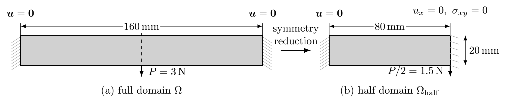

<b>
图 5.1  两端固支梁几何尺寸、载荷与对称边界条件示意图：(a) 完整设计域；(b) 左半计算域
</b>

利用几何与载荷的对称性，取左半计算域（$80\,\mathrm{mm}\times20\,\mathrm{mm}$），在对称边界 $x=80\,\mathrm{mm}$ 上施加 $u_x=0$ 与 $\sigma_{xy}=0$。LFEM 将 $u_x=0$ 作为本质条件施加；HZMFEM 中，$u_x=0$ 为自然条件，$\sigma_{xy}=0$ 则通过约束应力法向迹的切向分量施加，法向分量保持自由。$k=2$ 时，位移跳量惩罚仅作用于内部边与左端固支边界，对称边界不施加惩罚，$u_y$ 保持自由。半域载荷合力为 $P/2=1.5\,\mathrm N$，下文报告的柔顺度均为半域计算值的两倍，以对应完整结构。

半域采用 $80\times20$ 个小矩形按棋盘格交替对角线划分的直角三角形网格，共 $N_e=3\,200$ 个单元（全域等效 $6\,400$ 个），密度过滤半径为 $r_{\min}=2.4\,\mathrm{mm}$。两类方法均采用第 4.6.1 节的 MMA 单层流程，取均匀初始密度 $\rho_e^{(0)}=\bar V$、移动极限 $m=0.2$、设计变化容差 $\varepsilon_\rho=10^{-2}$、设计变量界限 $0\le\rho_e\le1$，以及 $E_{\min}=10^{-9}\,\mathrm{MPa}$、$p_E=3$。LFEM 取 $p=2,3,4$，HZMFEM 取 $k=2,3,4$。最终构型以全域对称镜像展示于图 5.2，收敛历史见图 5.3。

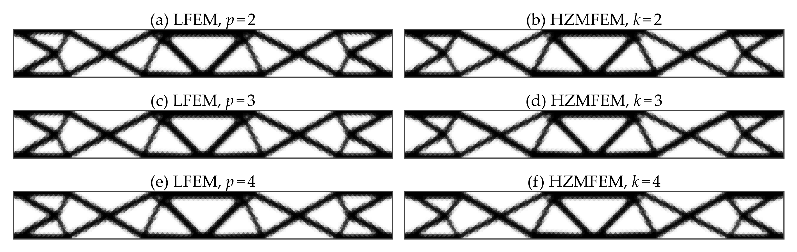

<b>
图 5.2  两端固支梁的最终物理密度分布（由半域结果对称镜像得到；左列：LFEM，$p$ 为位移阶次；右列：HZMFEM，$k$ 为应力阶次）
</b>

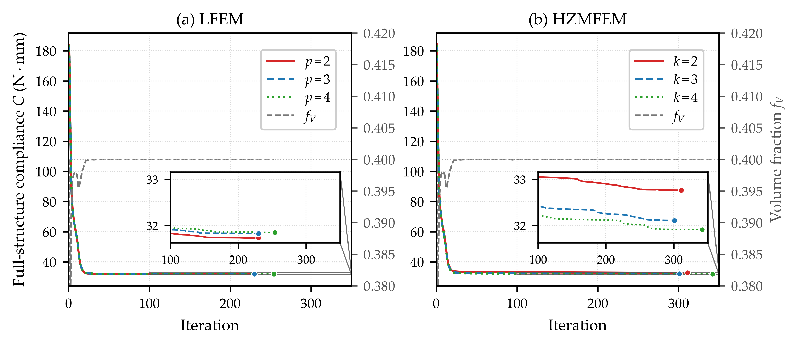

<b>
图 5.3  两端固支梁的 MMA 优化历史：（a）LFEM；（b）HZMFEM。彩色曲线为完整结构柔顺度，灰色曲线为体积分数，圆点标示各次运行的最终柔顺度；内嵌图为后期迭代放大。
</b>

图 5.2 显示，两类方法均得到以交叉斜杆为主要特征的构型，局部连接与杆件厚度存在差异。六组计算均满足算法 1 的停止条件，最终体积分数接近上限 $0.4$（图 5.3）。各组的迭代步数及按自身离散评价的最终完整结构柔顺度列于表 5.3，其中“优化所得柔顺度”指各次优化运行采用的目标泛函值，单位为 $\mathrm{N\cdot mm}$。

优化所得柔顺度的差异不能直接归因于最终设计：各组采用不同的离散格式与目标泛函，所得设计也不完全相同。为比较最终设计与离散评价的影响，固定六组最终物理密度，分别采用 LFEM $p=3,4$ 与 HZMFEM $k=3,4$ 进行再分析，并按各自的柔顺度泛函评价，结果列于表 5.3 后四列。同一列用于比较不同设计，同一行用于比较不同离散评价。

<b>
表 5.3  两端固支梁六组最终设计的优化所得柔顺度与不同离散格式的再分析柔顺度（完整结构，单位 $\mathrm{N\cdot mm}$）。
</b>

| 设计来源 | 迭代步数 | 优化所得柔顺度 | LFEM 再分析 $p=3$ | LFEM 再分析 $p=4$ | HZMFEM 再分析 $k=3$ | HZMFEM 再分析 $k=4$ |
|:---:|:---:|:---:|:---:|:---:|:---:|:---:|
| LFEM $p=2$ | 230 | 31.73 | 31.83 | 31.85 | 32.38 | 32.13 |
| LFEM $p=3$ | 230 | 31.83 | 31.83 | 31.85 | 32.38 | 32.13 |
| LFEM $p=4$ | 254 | 31.85 | 31.83 | 31.85 | 32.38 | 32.13 |
| HZMFEM $k=2$ | 311 | 32.76 | 31.60 | 31.63 | 32.13 | 31.88 |
| HZMFEM $k=3$ | 301 | 32.11 | 31.57 | 31.59 | 32.11 | 31.86 |
| HZMFEM $k=4$ | 342 | 31.91 | 31.61 | 31.64 | 32.17 | 31.91 |

表 5.3 显示，在同一再分析方法下，六组设计的柔顺度最大相对差约为 $0.86\%$，小于优化所得柔顺度的 $3.25\%$，其中相对差按最大值与最小值之差除以最小值计算。对固定设计，以 LFEM 结果为基准，两类方法的柔顺度相对差由三阶的 $1.66\%$–$1.78\%$ 缩小至四阶的 $0.82\%$–$0.89\%$。这些结果表明，优化所得柔顺度的差异主要反映离散评价的影响，六组最终设计在相同评价方法下的性能较为接近。结合图 5.2，HZMFEM 在本算例中获得了与 LFEM 相近的构型及再分析柔顺度，支持所提流程在柔顺度最小化问题中的适用性。

#### 5.2.2 Nearly Incompressible Topology Optimization (2D Bearing)

采用二维轴承算例（图 5.4）考察近不可压缩条件下的抗体积自锁表现。设计域尺寸为 $120\,\mathrm{mm}\times40\,\mathrm{mm}$，采用平面应变模型；底边固支（$u_x=u_y=0$），顶边施加竖直向下的均布牵引 $t_0=8\times10^{-2}\,\mathrm{N/mm}$，左右边界无牵引。取 $E_0=1\,\mathrm{MPa}$、$E_{\min}=10^{-9}\,\mathrm{MPa}$、$p_E=3$。可压缩基准组固定泊松比 $\nu=0.3$；近不可压缩组的实体材料泊松比为 $\nu_0=0.4999$，优化时按式 (4.4) 插值，取 $\nu_{\mathrm{void}}=0.3$、$p_\nu=1$。

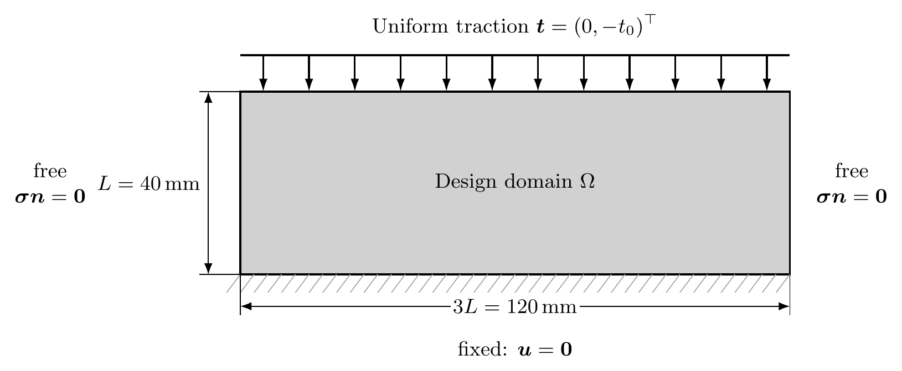

<b>
图 5.4  二维轴承算例的几何尺寸、载荷与边界条件
</b>

将设计域划分为 $120\times40$ 个矩形，每个矩形沿对角线分为两个三角形，共 $9\,600$ 个单元；对角线按左右半域镜像布置，以保持网格的左右对称性。体积分数上限为 $\bar V=0.35$，密度过滤半径为 $r_{\min}=2.0\,\mathrm{mm}$，初始密度取均匀值 $\rho_e^{(0)}=\bar V$。两组材料分别采用 LFEM $p=1,2$ 与 HZMFEM $k=2$ 求解，共六组优化，其中 HZMFEM $k=2$ 采用第 3.3 节的位移跳量稳定化。各组均采用第 4.6.1 节的 OC 更新，取移动极限 $m=0.2$、阻尼指数 $\xi=0.5$、设计变化容差 $\varepsilon_\rho=10^{-2}$；六组计算均达到设计变化容差，最终体积分数接近 $0.35$，最大超出量约为 $2.23\times10^{-5}$。

为考察体积自锁，先对全实体设计域进行网格加密测试，分别固定泊松比 $\nu=0.3$ 与 $\nu=0.4999$。网格由 $30\times10$ 逐级加密至 $240\times80$；LFEM $p=1,2$ 与 HZMFEM $k=2$ 计算四级，无需稳定化的 HZMFEM $k=4$ 计算前三级。对两组泊松比，分别利用 HZMFEM $k=4$ 在前三级网格上的柔顺度结果，按观测阶进行 Richardson 外推，以所得值作为参考值，外推方法见 Celik 等 [15]。图 5.5 给出各离散结果相对该值的偏差绝对值。分别对 LFEM $p=2$ 与 HZMFEM $k=2$ 的前三级结果进行同样的外推，所得值与参考值相差均不超过 $0.06\%$；考虑到参考值的估计性质，本文不对低于这一量级的偏差作定量解释。

在 $120\times40$ 网格上，泊松比由 $0.3$ 增至 $0.4999$ 时，LFEM $p=1$ 的柔顺度偏差绝对值由约 $0.04\%$ 增至 $16.82\%$，表现出明显的体积自锁。HZMFEM $k=2,4$ 的相应偏差分别由 $0.66\%$、$0.30\%$ 增至 $0.96\%$、$0.42\%$，增幅较小；在两组泊松比下，其偏差均随网格加密单调减小（图 5.5）。这些结果表明，本测试中 HZMFEM 的柔顺度评价对泊松比增大较不敏感。近不可压缩组中，LFEM $p=2$ 的偏差约为 $0.13\%$，小于两种混合离散。

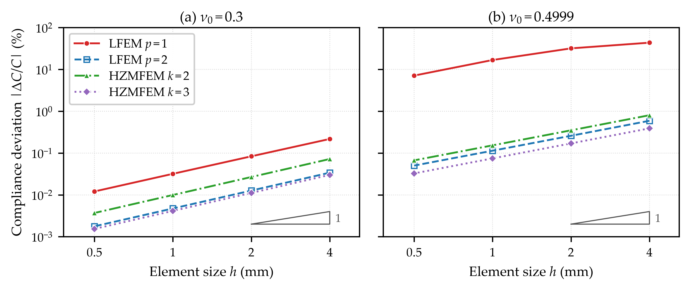

<b>
图 5.5  全实体设计域的柔顺度相对外推参考值的偏差绝对值：(a) $\nu=0.3$；(b) $\nu=0.4999$
</b>

六组优化的最终拓扑构型见图 5.6，均呈现以三个拱形为主要特征的构型。可压缩组中，三种离散所得构型整体相近；近不可压缩组中，LFEM $p=1$ 所得构型的局部杆件较粗，拱形轮廓与另外两种离散存在明显差异，而 LFEM $p=2$ 与 HZMFEM $k=2$ 的构型较为接近。结合图 5.5 的全实体测试结果，这些差异提示体积自锁可能影响 LFEM $p=1$ 的优化结果，其影响将在下文通过固定设计的再分析进一步考察。

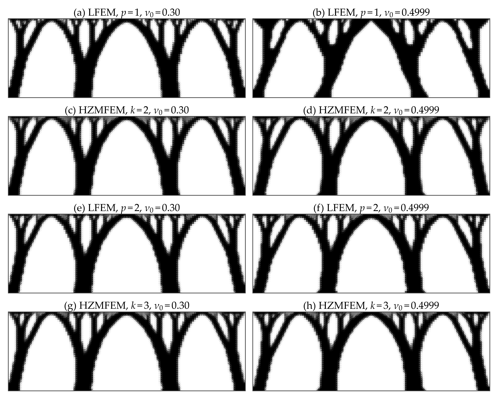

**图 5.6  二维轴承算例的最终拓扑构型：左列为实体材料泊松比 $\nu_0=0.3$，右列为 $\nu_0=0.4999$；自上而下为 LFEM $p=1$、LFEM $p=2$ 和 HZMFEM $k=2$**

为在共同评价方法下比较六个最终设计，固定各组物理密度，在 $120\times40$ 网格上分别采用 LFEM $p=1,2$ 与 HZMFEM $k=2,4$ 进行再分析。表 5.4 列出 HZMFEM $k=4$ 的柔顺度及其他离散相对该值的偏差。采用 HZMFEM $k=4$ 统一评价时，可压缩组三个设计的柔顺度最大相差约 $1.2\%$；近不可压缩组中，LFEM $p=1$ 所得设计的柔顺度比 HZMFEM $k=2$ 所得设计高约 $24.0\%$，而 LFEM $p=2$ 与 HZMFEM $k=2$ 所得设计仅相差约 $0.5\%$。另一方面，对同一固定设计，近不可压缩组 LFEM $p=1$ 的再分析柔顺度比 HZMFEM $k=4$ 低约 $17\%$–$38\%$，说明其较低的优化所得柔顺度不能作为设计更优的依据。结合全实体测试与构型比较，本算例表明，HZMFEM 减轻了线性位移元体积自锁对优化结果的影响，所得设计在共同评价方法下与二次位移元性能接近。

**表 5.4  二维轴承算例六组最终设计的迭代步数、优化所得柔顺度、HZMFEM $k=4$ 再分析柔顺度及其他离散再分析值相对 HZMFEM $k=4$ 的偏差（柔顺度单位为 $\mathrm{N\cdot mm}$）**

| 实体材料泊松比 $\nu_0$ | 设计来源         | 迭代步数 | 优化所得柔顺度  | HZMFEM $k=4$ 再分析柔顺度 | LFEM $p=1$ | LFEM $p=2$ | HZMFEM $k=2$ |
| :-------------: | :----------- | :--: | :------: | :-----------------: | :--------: | :--------: | :----------: |
|     $0.30$      | LFEM $p=1$   | 281  | $119.33$ |      $125.83$       |  $-5.2\%$  |  $-1.9\%$  |   $+4.9\%$   |
|     $0.30$      | LFEM $p=2$   | 351  | $122.73$ |      $124.64$       |  $-4.0\%$  |  $-1.5\%$  |   $+4.0\%$   |
|     $0.30$      | HZMFEM $k=2$ | 464  | $127.68$ |      $124.30$       |  $-3.5\%$  |  $-1.2\%$  |   $+2.7\%$   |
|    $0.4999$     | LFEM $p=1$   | 372  | $76.43$  |      $123.49$       | $-38.1\%$  |  $-2.6\%$  |   $+4.9\%$   |
|    $0.4999$     | LFEM $p=2$   | 245  | $98.06$  |      $100.01$       | $-17.8\%$  |  $-1.9\%$  |   $+4.0\%$   |
|    $0.4999$     | HZMFEM $k=2$ | 343  | $102.37$ |       $99.56$       | $-16.8\%$  |  $-1.6\%$  |   $+2.8\%$   |

#### 5.2.3 Local Stress-Constrained Cantilever Beam

考察悬臂梁局部应力约束优化算例（图 5.7）。设计域尺寸为 $80\,\mathrm{mm}\times40\,\mathrm{mm}$，采用平面应力模型，左边界固支。右边界中点处的竖直合力 $P=400\,\mathrm N$ 分布于宽度为 $l=6\,\mathrm{mm}$ 的边界区间，取均布牵引强度 $\bar t=P/l$，区间端点与网格节点对齐。LFEM 通过边界积分、HZMFEM 通过应力法向迹施加同一载荷，载荷区间端点附近的被动实体区在下文说明。实体材料参数为 $E_0=70\,000\,\mathrm{MPa}$、$\nu_0=0.25$，许用应力为 $\bar\sigma=180\,\mathrm{MPa}$；取 $E_{\min}=10^{-9}E_0$、$p_E=3.5$。

将设计域划分为 $80\times40$ 个矩形，采用棋盘式交替对角线形成三角形网格，共 $6\,400$ 个单元；密度过滤半径为 $r_{\min}=6.0\,\mathrm{mm}$，初始密度为 $\rho_e^{(0)}=0.5$。在固定密度与泊松比、载荷保持不变且位移边界条件齐次时，弹性模量整体同比缩放不改变应力响应。因此，计算中取 $E_0^{\mathrm{calc}}=1\,\mathrm{MPa}$，并将 $E_{\min}$ 及后文 $k=2$ 格式的稳定化系数同比缩放，载荷与许用应力保持物理值。

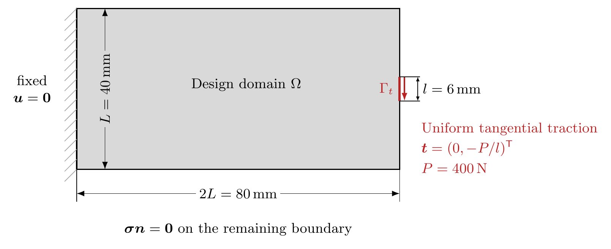

<b>
图 5.7  悬臂梁局部应力约束算例的几何尺寸、载荷与边界条件
</b>

两类方法采用相同的网格、载荷与优化参数，LFEM 取 $p=3$，HZMFEM 取无需跳量稳定化的 $k=3$ 高阶格式。密度过滤后采用 tanh 投影，取 $\eta_{\mathrm p}=0.5$，$\beta$ 从 $1$ 起每 5 个外层步增加 $1$，直至 $10$。局部应力约束采用第 4.3 节的模型，松弛参数固定为 $\epsilon=10^{-3}$。

在接触区两端点周围设置半径为 $r_{\mathrm{pad}}=1.5\,\mathrm{mm}$ 的被动实体区 $\Omega_{\mathrm{pad}}$，共含 16 个单元，占设计域面积的 $0.25\%$。参考 Bruggi 与 Venini [13] 对载荷附近单元的处理，该区不施加局部应力约束，也不计入增广应力约束项；参考 Holmberg 等 [26] 的被动区处理，其物理密度在过滤与投影后固定为 $1$，对应的密度映射导数置零。该区体积计入总体积分数，增广项仍按网格总单元数 $N_e$ 归一化。停止判据集合取 $\mathcal E_{\mathrm{acc}}=\{e\notin\Omega_{\mathrm{pad}}:\overline\rho_e\geq0.5\}$；被动实体区外 $\overline\rho_e<0.5$ 的单元仍施加松弛应力约束，但不纳入停止判断。

优化采用第 4.6.2 节的 ALM–MMA 流程，取 $\mu_0=50$、$\gamma_\mu=1.1$、$\mu_{\max}=10^4$、$\lambda_{\max}=3000$，移动极限 $m=0.15$，渐近线最小间距为 $10^{-4}$，$N_{\mathrm{out}}^{\max}=200$、$N_{\mathrm{in}}^{\max}=5$。停止参数为 $\delta_\rho=0.002$、$\delta_g=0.005$、$N_{\mathrm{hold}}=3$。

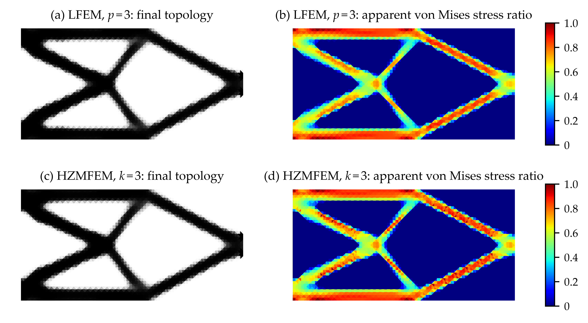

**图 5.8  三次离散下悬臂梁的最终拓扑构型与表观 von Mises 应力比 $\sigma_{\mathrm{vm}}/\bar\sigma$：（a、b）LFEM $p=3$；（c、d）HZMFEM $k=3$**

图 5.8 显示，两类离散得到相近的桁架状拓扑，主要杆件包括上下缘杆件与交叉斜杆，表观 von Mises 应力的空间分布也较为接近。

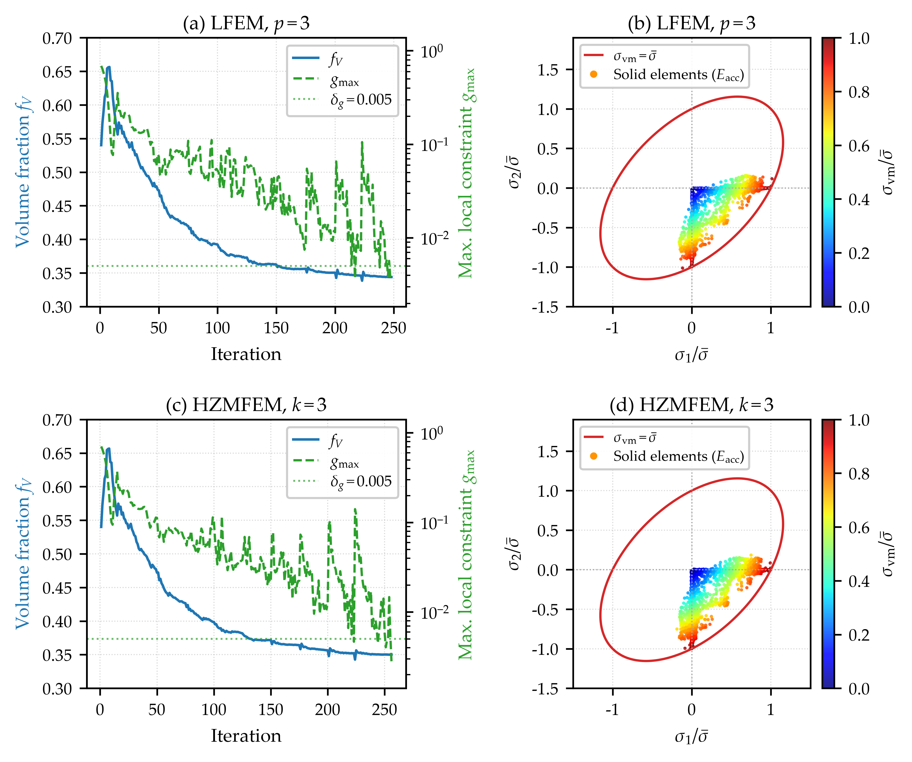

**图 5.9  三次离散下悬臂梁的优化历史与终态主应力分布：（a、b）LFEM $p=3$；（c、d）HZMFEM $k=3$。$g_{\max}$ 与应力点均在判据集合 $\mathcal E_{\mathrm{acc}}$ 上评价。**

图 5.9(a、c) 给出体积分数与判据集合 $\mathcal E_{\mathrm{acc}}$ 上最大局部约束值的迭代历史，约束按各自离散评价。LFEM 与 HZMFEM 分别经过 248 与 256 次 MMA 更新后达到算法 2 的停止准则；最终体积分数分别为 $34.39\%$ 与 $35.01\%$，$g_{\max}$ 分别为 $3.92\times10^{-3}$ 与 $2.82\times10^{-3}$，均低于 $\delta_g=0.005$。

图 5.9(b、d) 给出终态 $\mathcal E_{\mathrm{acc}}$ 内单元形心处的归一化表观主应力 $\sigma_i/\bar\sigma$（$\sigma_1\geq\sigma_2$），散点按表观 von Mises 应力比着色，红线表示 $\sigma_{\mathrm{vm}}=\bar\sigma$。两类离散的应力点分布相近，主要位于 $\sigma_1\geq0\geq\sigma_2$ 区域；靠近坐标轴的点对应近似单轴拉伸或压缩状态，该区域内部的点对应拉压双轴状态，部分应力点接近许用应力等值椭圆。

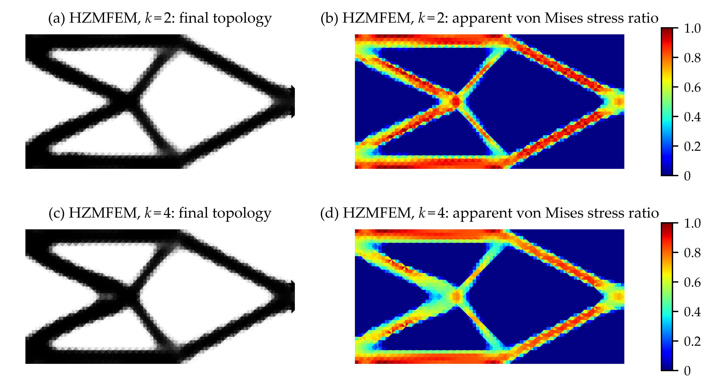
**图 5.10  不同阶次 Hu–Zhang 混合离散下悬臂梁的最终拓扑构型与表观 von Mises 应力比 $\sigma_{\mathrm{vm}}/\bar\sigma$：（a、b）$k=2$；（c、d）$k=4$**

在相同的载荷与优化设置下，另采用稳定化格式 $k=2$ 和无需稳定化的高阶格式 $k=4$ 求解，结果见图 5.10。对 $k=2,3,4$，MMA 更新次数分别为 253、256、258，最终体积分数分别为 $34.86\%$、$35.01\%$、$35.30\%$，判据集合 $\mathcal E_{\mathrm{acc}}$ 上的 $g_{\max}$ 分别为 $2.79\times10^{-3}$、$2.82\times10^{-3}$、$4.92\times10^{-3}$；三组均达到算法 2 的停止准则。结合图 5.8，三个阶次得到相近的主要承载构型，表明该流程在本算例中适用于低阶稳定化与高阶非稳定化格式。

对各组最终设计，进一步复核被动实体区外全部受约束单元的约束满足情况。LFEM $p=3$ 与 HZMFEM $k=2,3,4$ 的最大约束值 $\max_{e\notin\Omega_{\mathrm{pad}}}g_e$ 分别为 $6.365\times10^{-3}$、$7.276\times10^{-3}$、$4.800\times10^{-3}$、$1.250\times10^{-2}$。其中，LFEM $p=3$ 与 HZMFEM $k=2,4$ 分别有 2、5、6 个单元超过 $\delta_g=0.005$，均位于 $\overline\rho_e<0.5$ 的低密度区域；HZMFEM $k=3$ 的全部受约束单元均满足该容差。因此，基于 $\mathcal E_{\mathrm{acc}}$ 的停止判据不能保证低密度区域同样满足约束容差，所得终态也不应视为严格满足 $g_e\leq0$ 的可行解。

为量化跨单元牵引连续性的差别，对 LFEM $p=2,3,4$ 与 HZMFEM $k=2,3,4$ 的最终设计，分别采用优化时的离散格式进行再分析；其中 LFEM $p=2,4$ 的设计另按相同设置与停止准则求得。对内部面 $F$，以固定单位法向定义牵引跳量，并构造归一化指标：

$$
A_F=\frac{1}{\bar\sigma}\Big(\frac{1}{|F|}\int_F\big\|[\![\boldsymbol{\sigma}^{\mathrm{app}}_h\boldsymbol{n}]\!]\big\|^2\,\mathrm{d}s\Big)^{1/2},\qquad A_e=\max_{F\subset\partial T_e\cap\Omega}A_F. \tag{5.1}
$$

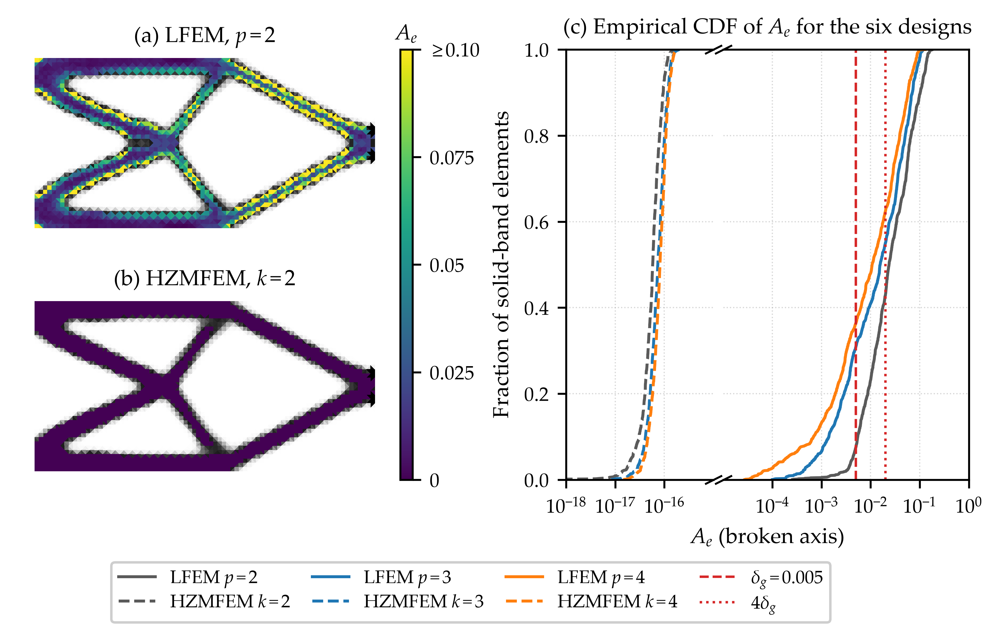

**图 5.11  最终设计实体带上的牵引跳量指标 $A_e$：（a）LFEM $p=2$；（b）HZMFEM $k=2$，共用色标，超过色标上限的值按上限着色；（c）六个设计的经验累积分布，采用断轴，左段为 HZMFEM $k=2$–$4$（虚线），右段为 LFEM $p=2$–$4$（实线）。竖线为数值尺度参照 $\delta_g$ 与 $4\delta_g$。**

图 5.11 给出实体带（$\overline\rho_e>0.9$，且位于被动实体区外）上的牵引跳量统计。HZMFEM 三个阶次的指标均处于浮点舍入误差量级，最大约为 $2\times10^{-16}$；LFEM 的中位数为 $0.011$–$0.024$，第 95 百分位数为 $0.072$–$0.13$，较大跳量主要分布于杆件边缘。这一差别体现了 Hu–Zhang 应力空间的法向牵引连续性。

---

## 6 Concluding Remarks

### 6.1 Key Conclusions

本文建立了面向密度法拓扑优化的高阶 Hu–Zhang 混合有限元框架，主要结论如下：

1. **统一的混合有限元拓扑优化框架。** 结合牵引提升、局部角点松弛与低阶跳量稳定化，实现低阶稳定化与高阶非稳定化格式的统一优化流程，并给出计入离散右端设计依赖的一致伴随灵敏度。制造解算例的观测收敛阶与理论估计一致；柔顺度优化中，两类离散所得构型及统一再分析柔顺度接近。

2. **近不可压缩条件下的数值表现。** 轴承算例中，Hu–Zhang 离散在可压缩与近不可压缩条件下具有相近的全实体柔顺度收敛表现，未出现线性位移元的明显精度退化。统一再分析表明，其近不可压缩优化设计的柔顺度低于线性位移元所得设计，与二次位移元接近。

3. **基于独立应力的局部应力约束优化。** 局部应力约束直接由 Hu–Zhang 应力变量评价，无需从位移梯度恢复应力。悬臂梁算例中，低阶稳定化与高阶非稳定化格式均达到所设停止准则，三次混合离散与三次位移离散得到相近的构型与应力分布。Hu–Zhang 应力的跨单元牵引跳量处于舍入误差量级，体现了其法向牵引连续性。

### 6.2 Future Work and Outlook

本文的数值研究限于二维小变形线弹性问题，后续可从以下三个方面进一步拓展：

1. **三维扩展与高效求解。** 将局部角点松弛与牵引边界处理扩展至三维 Hu–Zhang 离散，并结合块预条件与并行求解，降低高阶混合系统及高材料刚度对比下的计算成本。

2. **误差驱动的自适应优化。** 发展面向柔顺度与局部应力约束的后验误差估计，指导网格与阶次自适应，并协调设计变量转移、过滤与投影，保持设计长度尺度的一致性。

3. **有限变形与非线性材料。** 面向近不可压缩超弹性问题，研究相应的混合离散、材料插值与一致伴随灵敏度，并处理低密度区域的大变形及非线性求解困难。

---

## References

1. S. Adams and B. Cockburn. A mixed finite element method for elasticity in three dimensions. *Journal of Scientific Computing*, 25:515–521, 2005.
2. R. Andreani, E. G. Birgin, J. M. Martínez, and M. L. Schuverdt. On augmented Lagrangian methods with general lower-level constraints. *SIAM Journal on Optimization*, 18(4):1286–1309, 2008.
3. E. Andreassen, A. Clausen, M. Schevenels, B. S. Lazarov, and O. Sigmund. Efficient topology optimization in MATLAB using 88 lines of code. *Structural and Multidisciplinary Optimization*, 43(1):1–16, 2011.
4. D. N. Arnold, R. S. Falk, and R. Winther. Mixed finite element methods for linear elasticity with weakly imposed symmetry. *Mathematics of Computation*, 76(260):1699–1723, 2007.
5. D. N. Arnold and R. Winther. Mixed finite elements for elasticity. *Numerische Mathematik*, 92(3):401–419, 2002.
6. I. Babuška and M. Suri. Locking effects in the finite element approximation of elasticity problems. *Numerische Mathematik*, 62(1):439–463, 1992.
7. M. P. Bendsøe. Optimal shape design as a material distribution problem. *Structural Optimization*, 1(4):193–202, 1989.
8. M. P. Bendsøe and O. Sigmund. *Topology Optimization: Theory, Methods, and Applications*. Springer, 2004.
9. D. Boffi, F. Brezzi, and M. Fortin. *Mixed Finite Element Methods and Applications*, volume 44 of *Springer Series in Computational Mathematics*. Springer, 2013.
10. B. Bourdin. Filters in topology optimization. *International Journal for Numerical Methods in Engineering*, 50(9):2143–2158, 2001.
11. M. Bruggi. Topology optimization with mixed finite elements on regular grids. *Computer Methods in Applied Mechanics and Engineering*, 305:133–153, 2016.
12. M. Bruggi and P. Venini. Topology optimization of incompressible media using mixed finite elements. *Computer Methods in Applied Mechanics and Engineering*, 196(33–34):3151–3164, 2007.
13. M. Bruggi and P. Venini. A mixed FEM approach to stress-constrained topology optimization. *International Journal for Numerical Methods in Engineering*, 73(12):1693–1714, 2008.
14. T. E. Bruns and D. A. Tortorelli. Topology optimization of non-linear elastic structures and compliant mechanisms. *Computer Methods in Applied Mechanics and Engineering*, 190(26–27):3443–3459, 2001.
15. I. B. Celik, U. Ghia, P. J. Roache, C. J. Freitas, H. Coleman, and P. E. Raad. Procedure for estimation and reporting of uncertainty due to discretization in CFD applications. *Journal of Fluids Engineering*, 130(7):078001, 2008.
16. C. Chen, L. Chen, X. Huang, and H. Wei. Geometric decomposition and efficient implementation of high order face and edge elements. *Communications in Computational Physics*, 35(4):1045–1072, 2024.
17. L. Chen, J. Hu, and X. Huang. Stabilized mixed finite element methods for linear elasticity on simplicial grids in $\mathbb{R}^n$. *Computational Methods in Applied Mathematics*, 17(1):17–31, 2017.
18. L. Chen, J. Hu, and X. Huang. Fast auxiliary space preconditioners for linear elasticity in mixed form. *Mathematics of Computation*, 87(312):1601–1633, 2018.
19. L. Chen, J. Hu, X. Huang, and H. Man. Residual-based a posteriori error estimates for symmetric conforming mixed finite elements for linear elasticity problems. *Science China Mathematics*, 61(6):973–992, 2018.
20. G. Cheng and X. Guo. $\epsilon$-relaxed approach in structural topology optimization. *Structural Optimization*, 13(4):258–266, 1997.
21. G. Cheng and Z. Jiang. Study on topology optimization with stress constraints. *Engineering Optimization*, 20(2):129–148, 1992.
22. R. Codina, I. Castañar, and J. Baiges. Finite element approximation of stabilized mixed models in finite strain hyperelasticity involving displacements and stresses and/or pressure—an overview of alternatives. *International Journal for Numerical Methods in Engineering*, 125(18):e7540, 2024.
23. P. Duysinx and M. P. Bendsøe. Topology optimization of continuum structures with local stress constraints. *International Journal for Numerical Methods in Engineering*, 43(8):1453–1478, 1998.
24. O. Giraldo-Londoño and G. H. Paulino. PolyStress: a Matlab implementation for local stress-constrained topology optimization using the augmented Lagrangian method. *Structural and Multidisciplinary Optimization*, 63(4):2065–2097, 2021.
25. L. He, H. Wei, and T. Tian. SOPTX: A modular and extensible framework for topology optimization with multi-backend support. *Communications in Computational Physics*, 40(2):525–572, 2026.
26. E. Holmberg, B. Torstenfelt, and A. Klarbring. Stress constrained topology optimization. *Structural and Multidisciplinary Optimization*, 48(1):33–47, 2013.
27. J. Hu. Finite element approximations of symmetric tensors on simplicial grids in $\mathbb{R}^n$: the higher order case. *Journal of Computational Mathematics*, 33(3):283–296, 2015.
28. J. Hu and R. Ma. Partial relaxation of $C^0$ vertex continuity of stresses of conforming mixed finite elements for the elasticity problem. *Computational Methods in Applied Mathematics*, 21(1):89–108, 2021.
29. J. Hu and S. Zhang. A family of conforming mixed finite elements for linear elasticity on triangular grids. *arXiv preprint arXiv:1406.7457*, 2014.
30. U. Kirsch. On singular topologies in optimum structural design. *Structural Optimization*, 2(3):133–142, 1990.
31. C. Le, J. Norato, T. Bruns, C. Ha, and D. Tortorelli. Stress-based topology optimization for continua. *Structural and Multidisciplinary Optimization*, 41(4):605–620, 2010.
32. J. París, F. Navarrina, I. Colominas, and M. Casteleiro. Topology optimization of continuum structures with local and global stress constraints. *Structural and Multidisciplinary Optimization*, 39(4):419–437, 2009.
33. F. V. Senhora, O. Giraldo-Londoño, I. F. M. Menezes, and G. H. Paulino. Topology optimization with local stress constraints: a stress aggregation-free approach. *Structural and Multidisciplinary Optimization*, 62(4):1639–1668, 2020.
34. K. Svanberg. The method of moving asymptotes—a new method for structural optimization. *International Journal for Numerical Methods in Engineering*, 24(2):359–373, 1987.
35. G. Sved and Z. Ginos. Structural optimization under multiple loading. *International Journal of Mechanical Sciences*, 10(10):803–805, 1968.
36. F. Wang, B. S. Lazarov, and O. Sigmund. On projection methods, convergence and robust formulations in topology optimization. *Structural and Multidisciplinary Optimization*, 43(6):767–784, 2011.
37. Y. Zheng, H. Wei, Y. Huang, C. Chen, T. Tian, H. Liu, W. Wang, and L. He. FEALPy: A cross-platform intelligent numerical simulation engine. *Communications in Computational Physics*, 40(5):1676–1704, 2026.
