# High-Order Hu–Zhang Mixed Finite Element Methods for Density-Based Topology Optimization

## Abstract

在采用位移有限元的密度法拓扑优化中，由位移梯度和本构关系计算的应力通常不满足跨单元法向牵引连续性。在近不可压缩条件下，标准低阶位移元还可能出现体积自锁。本文将高阶 Hu–Zhang 混合有限元引入非结构化单纯形网格上的密度法拓扑优化，以对称应力和位移作为独立未知量。所提出的框架支持柔顺度最小化和局部应力约束下的体积最小化，并对低阶格式引入位移跳量稳定化。应力约束直接由离散应力评价，无需从位移梯度恢复应力。伴随灵敏度分析被纳入优化求解流程并基于 FEALPy 实现。二维数值算例验证了不同多项式阶次下的收敛表现。对于可压缩材料，混合法与位移法给出了相近的主要承载构型，且在统一再分析下具有可比的柔顺度。在所考察的近不可压缩条件下，相较于线性位移元，Hu–Zhang 离散减轻了体积自锁的影响。应力约束设计在容差内满足离散松弛应力约束，并保持跨单元法向牵引连续性。含斜边与凹角的设计域算例进一步表明了该框架在非结构化三角形网格上的适用性。

**Keywords:** Hu–Zhang mixed finite elements; high-order approximation; density-based topology optimization; nearly incompressible elasticity; local stress constraints

**AMS 主题分类 (AMS subject classifications)：** 65N30, 74S05, 74P05, 74B05

---

## 1 Introduction

拓扑优化（Topology Optimization, TO）通过在给定设计域内优化材料的空间分布，为轻量化结构设计提供了系统化的数值方法。Bendsøe [7] 采用连续密度变量及密度相关的材料性质，将结构形状设计表述为材料分布问题。以 SIMP（Solid Isotropic Material with Penalization）为代表的密度法已广泛用于结构拓扑优化 [8]。在密度法拓扑优化中，线弹性状态方程通常采用位移型有限元离散，其中标准 Lagrange 有限元（Lagrange finite element method, LFEM）通过离散位移梯度和本构关系在单元内计算应力。对于局部应力约束问题，应力近似的精度会影响约束评价。在近不可压缩条件下，标准低阶位移元还可能出现体积自锁，进而影响结构响应与优化结果。

在逐单元施加局部应力约束的拓扑优化中，约束数量随受约束单元数线性增长，应力近似误差会直接影响约束评价。在直边单纯形网格上，当单元内材料系数为常数时，$p$ 次位移型 Lagrange 元计算得到的应力为至多 $p-1$ 次多项式，例如线性元给出分片常数应力。这种逐单元计算的应力一般不满足跨单元法向牵引连续性。已有研究通过应力插值与约束松弛 [24]、全局或区域应力度量及归一化 [32]、局部与聚合约束形式 [33]，以及增广拉格朗日方法 [34]，处理应力约束拓扑优化中的建模与求解问题。另一方面，对于各向同性线弹性材料，当泊松比趋于不可压缩极限（$\nu_0\to0.5$）时，体积模量与剪切模量之比趋于无穷大。在平面应变或三维问题中，这使体积变形受到强烈抑制，位移场趋于满足无散度条件（$\operatorname{div}\boldsymbol{u}=0$）。标准低阶位移元可能难以充分逼近满足近不可压缩约束的位移场，从而出现体积自锁 [6]，高估结构刚度并降低结构响应计算的可靠性。

混合有限元通过引入独立的场变量，为线弹性问题提供不同于纯位移法的变分表述。在 Hellinger–Reissner 两场变分原理中，对称应力 $\boldsymbol{\sigma}$ 和位移 $\boldsymbol{u}$ 作为独立未知量。在本文采用的 $H(\operatorname{div})$ 协调应力离散中，对称应力场的法向牵引在单元界面上具有单值迹，平衡方程则通过位移测试函数以弱形式施加。若混合离散的稳定性与逼近估计中的常数不随材料趋于不可压缩而退化，则可获得关于不可压缩参数的一致误差估计，从而避免体积自锁 [9]。Bruggi 与 Venini 将应力–位移混合有限元用于不可压缩材料的拓扑优化 [12] 和应力约束拓扑优化 [13]。Bruggi 随后进一步研究了不可压缩材料的应力约束设计 [11]。为在单纯形网格上实现应力–位移混合拓扑优化的高阶离散，需要构造适当的对称应力有限元空间，并配以相容的位移空间。在三角形和四面体网格上，构造满足应力张量对称性和 $H(\operatorname{div})$ 协调性的应力空间，并使其与位移空间的配对满足离散稳定性，是应力–位移混合有限元构造中的重要难点 [1, 5]。除在应力空间中直接满足对称性外，另一类混合方法通过引入额外的拉格朗日乘子，以弱形式施加应力对称性 [4]。

Hu 与 Zhang [30] 在三角形网格上构造了高阶混合有限元，其应力空间满足张量对称性和 $H(\operatorname{div})$ 协调性。Hu [28] 随后将这一构造推广至任意维数的单纯形网格。该类单元采用分片 $\mathbb{P}_k(\mathbb{S})$ 应力近似与分片 $\mathbb{P}_{k-1}(\mathbb{R}^d)$ 位移近似，位移在单元之间不要求连续。其中，应力空间的构造保证了应力张量的对称性和跨单元法向牵引连续性；当 $k\ge d+1$ 时，应力与位移空间的配对满足离散稳定性，$d$ 为空间维数。围绕这类混合元，已有研究进一步发展了稳定化与计算方法。Chen 等 [17] 基于离散位移的界面跳跃，为 $1\le k\le d$ 的低阶格式建立了稳定化方法。Hu 与 Ma [29] 提出了应力顶点连续性的局部松弛方法，并将其用于一般牵引边界条件的离散处理。在求解算法与误差分析方面，已有研究分别发展了快速辅助空间预条件子 [18] 和基于残差的后验误差估计 [19]。此外，Chen 等 [16] 研究了高阶 $H(\operatorname{div})$ 面元与 $H(\operatorname{curl})$ 棱元的几何分解及高效实现，本文在实现 Hu–Zhang 混合有限元时借鉴了其中的方法。将高阶 Hu–Zhang 混合有限元用于密度法拓扑优化，需要统一混合状态方程、材料插值与设计灵敏度分析，并一致处理牵引边界条件和应力相关目标与约束。

本文将高阶 Hu–Zhang 混合有限元引入密度法拓扑优化，并基于 FEALPy [38, 40] 及其拓扑优化模块 SOPTX [26] 实现。主要贡献如下：
1. **统一的 Hu–Zhang 混合离散**：基于切法向几何分解，在非结构化单纯形网格上实现了高阶 Hu–Zhang 混合元（$k\ge d+1$），保证应力对称性与跨单元法向牵引连续性。通过引入与设计无关的位移跳量稳定化项，在同一鞍点系统下兼容了低阶情形（$1\le k\le d$）。
2. **应力–位移混合拓扑优化建模**：基于统一的 Hu–Zhang 离散建立柔顺度最小化与局部应力约束下的体积最小化模型，减轻近不可压缩设计中的体积自锁。余能柔顺度目标与松弛局部应力约束均直接由离散应力评价，无需从位移梯度恢复应力。
3. **一致伴随灵敏度与优化求解流程**：直接基于混合鞍点系统推导伴随灵敏度，无需组装等效位移刚度矩阵。将该灵敏度分析纳入单循环 MMA/OC 与嵌套 ALM–MMA 求解流程，并在可压缩、近不可压缩及非结构化网格应力约束基准算例上完成了跨阶次验证。

本文其余内容安排如下。第 2 节介绍线弹性的混合变分形式。第 3 节介绍 Hu–Zhang 有限元离散及稳定化方法。第 4 节给出拓扑优化模型、灵敏度分析与求解算法。第 5 节通过制造解检验离散格式的收敛性，并通过四个拓扑优化基准算例评估所提出的框架。第 6 节总结全文并讨论未来工作。

---

## 2 Preliminaries

### 2.1 Notation and Simplicial Mesh

设 $\Omega \subset \mathbb{R}^d$（$d=2,3$）为有界多边形或多面体区域，边界记为 $\partial\Omega$。Dirichlet 位移边界 $\Gamma_D$ 与 Neumann 牵引边界 $\Gamma_N$ 为 $\partial\Omega$ 上互不相交的相对开集，满足 $\partial\Omega = \overline{\Gamma_D} \cup \overline{\Gamma_N}$。记 $\mathbb{S}$ 为 $d \times d$ 实对称二阶张量空间，$\boldsymbol{I}$ 为二阶单位张量。

对任意二阶对称张量 $\boldsymbol{\sigma}, \boldsymbol{\tau} \in \mathbb{S}$，张量双点积定义为 $\boldsymbol{\sigma} : \boldsymbol{\tau} = \sum_{i,j=1}^d \sigma_{ij}\tau_{ij} = \operatorname{tr}(\boldsymbol{\sigma}\boldsymbol{\tau})$，迹定义为 $\operatorname{tr}(\boldsymbol{\tau})=\sum_{i=1}^d\tau_{ii}$。约定向量场的梯度分量为 $(\nabla\boldsymbol{u})_{ij}=\partial u_i/\partial x_j$。对张量场 $\boldsymbol{\tau}$ 与向量场 $\boldsymbol{u}$，张量散度算子与对称梯度算子分别定义为：
$$
(\operatorname{div}\boldsymbol{\tau})_i = \sum_{j=1}^d \frac{\partial \tau_{ij}}{\partial x_j}, \qquad \boldsymbol{\varepsilon}(\boldsymbol{u}) = \frac{1}{2}\left(\nabla\boldsymbol{u} + (\nabla\boldsymbol{u})^{\mathsf T}\right).
$$

设 $\mathcal T_h$ 为 $\Omega$ 上与边界划分匹配的形状正则协调单纯形网格，各单元均由参考单纯形经仿射映射得到，记 $h_T=\operatorname{diam}(T)$，$h=\max_{T\in\mathcal T_h}h_T$。以 $\mathcal V_h$、$\mathcal E_h$ 和 $\mathcal F_h$ 分别表示顶点、边和面集合，其中二维时 $\mathcal F_h=\mathcal E_h$。面集合划分为内部面集合 $\mathcal F_h^i$、位移边界面集合 $\mathcal F_h^D$ 和牵引边界面集合 $\mathcal F_h^N$。对每个面 $F\in\mathcal F_h$，记 $h_F=\operatorname{diam}(F)$，$|F|$ 为其 $(d-1)$ 维测度。

记向量与对称张量的 $L^2$ 空间分别为 $L^2(\Omega;\mathbb{R}^d)$ 与 $L^2(\Omega;\mathbb{S})$，内积统一记为 $(\cdot,\cdot)_\Omega$。对称张量 $H(\operatorname{div})$ 空间定义为：
$$
H(\operatorname{div},\Omega;\mathbb{S}) = \left\{ \boldsymbol{\tau} \in L^2(\Omega;\mathbb{S}) : \operatorname{div}\boldsymbol{\tau} \in L^2(\Omega;\mathbb{R}^d) \right\},
$$
其中，散度按分布意义理解，$\|\cdot\|_{0,\Omega}$ 表示相应的 $L^2$ 范数。该空间的范数定义为
$$
\|\boldsymbol{\tau}\|_{H(\operatorname{div})} = \left(\|\boldsymbol{\tau}\|_{0,\Omega}^2 + \|\operatorname{div}\boldsymbol{\tau}\|_{0,\Omega}^2\right)^{1/2}.
$$

### 2.2 Linear Elasticity and Hellinger–Reissner Variational Formulation

考虑小应变各向同性线弹性边值问题：
$$
\begin{aligned}
-\operatorname{div}\boldsymbol{\sigma} &= \boldsymbol{b} && \text{in } \Omega, \\
\mathcal{A}\boldsymbol{\sigma} &= \boldsymbol{\varepsilon}(\boldsymbol{u}) && \text{in } \Omega, \\
\boldsymbol{u} &= \boldsymbol{u}_D && \text{on } \Gamma_D, \\
\boldsymbol{\sigma}\boldsymbol{n} &= \boldsymbol{g} && \text{on } \Gamma_N,
\end{aligned} \tag{2.1}
$$
其中，$\boldsymbol{\sigma}$ 为取值于 $\mathbb{S}$ 的对称 Cauchy 应力场，$\boldsymbol{u}$ 为位移场，$\boldsymbol{b}$ 为单位体积的体力，$\boldsymbol{u}_D$ 为给定的边界位移，$\boldsymbol{g}$ 为给定的边界牵引，$\boldsymbol{n}$ 为边界外单位法向量，$\boldsymbol{\varepsilon}(\boldsymbol{u})$ 为小应变张量。$\mathcal{A}$ 为各向同性线弹性材料的四阶柔度张量，其对任意对称二阶张量 $\boldsymbol{\tau}$ 的作用为：
$$
\mathcal{A}\boldsymbol{\tau} = \frac{1}{2\mu}\left( \boldsymbol{\tau} - \frac{\lambda}{2\mu + d\lambda} \operatorname{tr}(\boldsymbol{\tau})\boldsymbol{I} \right), \tag{2.2}
$$
其中，$\lambda$ 和 $\mu$ 为 Lamé 参数。设 $E$ 和 $\nu$ 分别为材料的杨氏模量与泊松比，取 $\mu=E/[2(1+\nu)]$。三维及二维平面应变情形下，$\lambda=E\nu/[(1+\nu)(1-2\nu)]$，而在二维平面应力情形下则采用有效参数 $\lambda=E\nu/(1-\nu^2)$。

为处理非齐次牵引边界条件 $\boldsymbol{\sigma}\boldsymbol{n} = \boldsymbol{g}$，引入非齐次应力试探集与齐次应力测试空间：
$$
\begin{aligned}
\boldsymbol{\Sigma}_g &= \left\{ \boldsymbol{\tau} \in H(\operatorname{div},\Omega;\mathbb{S}) : \boldsymbol{\tau}\boldsymbol{n} = \boldsymbol{g} \text{ on } \Gamma_N \right\}, \\
\boldsymbol{\Sigma}_0 &= \left\{ \boldsymbol{\tau} \in H(\operatorname{div},\Omega;\mathbb{S}) : \boldsymbol{\tau}\boldsymbol{n} = \boldsymbol{0} \text{ on } \Gamma_N \right\}.
\end{aligned}
$$
上述边界条件按 $H(\operatorname{div})$ 法向迹的意义理解。$\boldsymbol{\Sigma}_0$ 是 $H(\operatorname{div},\Omega;\mathbb{S})$ 的闭子空间。假设 $\boldsymbol{\Sigma}_g\ne\varnothing$，则 $\boldsymbol{\Sigma}_g$ 是 $\boldsymbol{\Sigma}_0$ 的仿射平移，因此当牵引数据非零时不构成线性空间。位移试探与测试空间均取为 $\boldsymbol{V} = L^2(\Omega;\mathbb{R}^d)$。

线弹性问题的 Hellinger–Reissner 两场混合变分形式为：求 $(\boldsymbol{\sigma},\boldsymbol{u}) \in \boldsymbol{\Sigma}_g \times \boldsymbol{V}$，使得
$$
\begin{aligned}
a(\boldsymbol{\sigma},\boldsymbol{\tau}) + b(\boldsymbol{\tau},\boldsymbol{u}) &= \langle \boldsymbol{u}_D, \boldsymbol{\tau}\boldsymbol{n} \rangle_{\Gamma_D}, && \forall\,\boldsymbol{\tau}\in\boldsymbol{\Sigma}_0, \\
b(\boldsymbol{\sigma},\boldsymbol{v}) &= -(\boldsymbol{b},\boldsymbol{v})_\Omega, && \forall\,\boldsymbol{v}\in\boldsymbol{V},
\end{aligned} \tag{2.3}
$$
其中，双线性型定义为
$$
\begin{aligned}
a(\boldsymbol{\sigma},\boldsymbol{\tau}) &= (\mathcal{A}\boldsymbol{\sigma},\boldsymbol{\tau})_\Omega = \int_\Omega \mathcal{A}\boldsymbol{\sigma} : \boldsymbol{\tau} \,\mathrm{d}x, \\
b(\boldsymbol{\tau},\boldsymbol{v}) &= (\operatorname{div}\boldsymbol{\tau},\boldsymbol{v})_\Omega = \int_\Omega (\operatorname{div}\boldsymbol{\tau})\cdot\boldsymbol{v}\,\mathrm{d}x.
\end{aligned}
$$
边界项 $\langle\boldsymbol{u}_D,\boldsymbol{\tau}\boldsymbol{n}\rangle_{\Gamma_D}$ 表示相应迹空间之间的对偶配对；当函数具有足够正则性时，可表示为
$$
\langle \boldsymbol{u}_D, \boldsymbol{\tau}\boldsymbol{n} \rangle_{\Gamma_D} = \int_{\Gamma_D} \boldsymbol{u}_D \cdot (\boldsymbol{\tau}\boldsymbol{n})\,\mathrm{d}s.
$$

由于 $\boldsymbol{V} = L^2(\Omega;\mathbb{R}^d)$，相应的有限元离散无需对位移施加跨单元连续性约束。应力采用 $H(\operatorname{div},\Omega;\mathbb{S})$ 协调离散，从而在迹意义下保持跨单元法向牵引连续性。在边界约束排除刚体运动、边界数据满足相容性与正则性要求，且双线性型 $a$ 和 $b$ 连续、$a$ 在 $b$ 对应的核空间上满足强制性、$b$ 满足连续 inf-sup 条件时，变分问题 (2.3) 存在唯一弱解 [9]。

---

## 3 High-Order Hu–Zhang Mixed Finite Elements

### 3.1 Geometric Tangential–Normal Decomposition on Simplices

本节在 Hu 与 Zhang [30] 及 Hu [28] 提出的混合有限元基础上，利用子单纯形上的局部切向–法向标架组织应力基函数及其自由度。相关的张量分解与高阶有限元实现方法可参见 Chen 与 Huang [20] 及 Chen 等 [16]。

设 $T \in \mathcal{T}_h$ 为 $d$ 维单纯形（二维三角形或三维四面体），记 $\mathbb{P}_k(T;\mathbb{S}) = \mathbb{P}_k(T)\otimes\mathbb{S}$ 为 $T$ 上总次数不超过 $k$（$k \ge 1$）的局部对称张量多项式空间，其维数为 $\dim \mathbb{P}_k(T;\mathbb{S}) = \frac{d(d+1)}{2}\binom{k+d}{d}$。设 $f$ 为 $T$ 的某个 $\ell$ 维子单形（$\ell = 0, 1, \dots, d$），分别选取其切空间和法空间的正交基 $\{\boldsymbol{t}_i^f\}_{i=1}^{\ell}$ 与 $\{\boldsymbol{n}_j^f\}_{j=1}^{d-\ell}$，构成局部切向–法向标架。

定义对称张量积 $\operatorname{sym}(\boldsymbol{a} \otimes \boldsymbol{b}) = \frac{1}{2}(\boldsymbol{a} \otimes \boldsymbol{b} + \boldsymbol{b} \otimes \boldsymbol{a})$。基于上述标架，对称张量空间 $\mathbb{S}$ 可作如下关于第 2.1 节所定义张量双点积的正交直和分解，其中 $\mathbb{T}_f(\mathbb{S})$ 与 $\mathbb{N}_f(\mathbb{S})$ 分别表示切向子空间与法向子空间：
$$
\begin{aligned}
\mathbb{S} &= \mathbb{T}_f(\mathbb{S})\oplus\mathbb{N}_f(\mathbb{S}), \\
\mathbb{T}_f(\mathbb{S}) &= \operatorname{span} \left\{ \operatorname{sym}(\boldsymbol{t}_i^f \otimes \boldsymbol{t}_j^f) \right\}_{1 \le i \le j \le \ell}, \\
\mathbb{N}_f(\mathbb{S}) &= \operatorname{span} \left\{ \operatorname{sym}(\boldsymbol{t}_i^f \otimes \boldsymbol{n}_j^f) \right\}_{1 \le i \le \ell,\, 1 \le j \le d-\ell} \\
&\quad\oplus \operatorname{span} \left\{ \operatorname{sym}(\boldsymbol{n}_i^f \otimes \boldsymbol{n}_j^f) \right\}_{1 \le i \le j \le d-\ell}.
\end{aligned} \tag{3.1}
$$
这里的法向子空间包含切向–法向混合分量和法向–法向分量。空指标集的张成空间约定为 $\{0\}$。当 $\ell=d$ 时，$f=T$，其法空间为 $\{0\}$，故 $\mathbb{T}_T(\mathbb{S})=\mathbb{S}$、$\mathbb{N}_T(\mathbb{S})=\{0\}$。

$H(\operatorname{div})$ 协调性要求在采用同一法向约定时，应力法向迹在相邻单元的公共面上连续。在未进行顶点连续性局部松弛的几何实体构造中，与 $\mathbb{N}_f(\mathbb{S})$ 对应的自由度在统一的局部标架下定义，并由包含同一子单形 $f$ 的各单元共享同一组全局自由度。

对于切向部分，任意 $\boldsymbol{\tau}\in\mathbb{T}_f(\mathbb{S})$ 及 $f$ 的任意法向量 $\boldsymbol n$ 均满足 $\boldsymbol{\tau}\boldsymbol n=\boldsymbol0$。设 $\phi$ 为单元 $T$ 上与 $f$ 相对内部节点对应的标量 Lagrange 基函数，则 $\phi\boldsymbol{\tau}$ 在整个 $\partial T$ 上具有零法向迹：在包含 $f$ 的边界面上，该性质由张量的切向性保证；在不包含 $f$ 的边界面上，则由 $\phi$ 的零迹保证。因此，这些张量基函数是 $T$ 上的 $H(\operatorname{div})$ 应力泡函数，其对应自由度由各单元独立编号，无需在相邻单元之间共享。

以二维三角形单元为例，各维子单形上的局部标架、张量分量及自由度共享规则如图 3.1 所示：
1. 当 $\ell=0$（顶点）时，$\mathbb{T}_f(\mathbb{S})=\{0\}$，$\mathbb{N}_f(\mathbb{S})=\mathbb{S}$。在每个顶点选取所有包含该顶点的单元共用的正交标架，并在该标架下定义三个独立的应力点值自由度，由这些单元共享。对牵引边界上的非角点顶点，标架与所在边界边对齐，以便施加牵引条件。
2. 当 $\ell=1$（边）时，选取单位切向量 $\boldsymbol{t}_e$ 与统一定向的单位法向量 $\boldsymbol{n}_e$。法向子空间 $\mathbb{N}_e(\mathbb{S})$ 由 $\operatorname{sym}(\boldsymbol{t}_e\otimes\boldsymbol{n}_e)$ 和 $\boldsymbol{n}_e\otimes\boldsymbol{n}_e$ 张成，其对应的边相对内部节点自由度在相邻单元之间共享；切向子空间 $\mathbb{T}_e(\mathbb{S})$ 由 $\boldsymbol{t}_e\otimes\boldsymbol{t}_e$ 张成，其对应自由度由各单元独立编号。
3. 当 $\ell=2$（单元内部）时，$\mathbb{T}_T(\mathbb{S})=\mathbb{S}$，$\mathbb{N}_T(\mathbb{S})=\{0\}$。与单元内部节点对应的全部应力自由度均由各单元独立编号。

相邻单元在公共边上采用一致的切向与法向约定。在保持所表示应力张量不变的情况下，仅将 $\boldsymbol t_e$ 或 $\boldsymbol n_e$ 中的一个反向时，$\operatorname{sym}(\boldsymbol t_e\otimes\boldsymbol n_e)$ 对应的系数变号，而 $\boldsymbol n_e\otimes\boldsymbol n_e$ 和 $\boldsymbol t_e\otimes\boldsymbol t_e$ 对应的系数不变。因此，共享自由度须在统一标架下定义。计算单元外法向牵引时，根据单元外法向与所选边法向的同向或反向关系引入相应符号。图 3.1 中的直箭头表示所选局部标架的方向，所选边法向不必与图示单元的外法向一致；红色和黑色编号分别表示相应张量分量的自由度在单元间共享或由各单元独立编号。

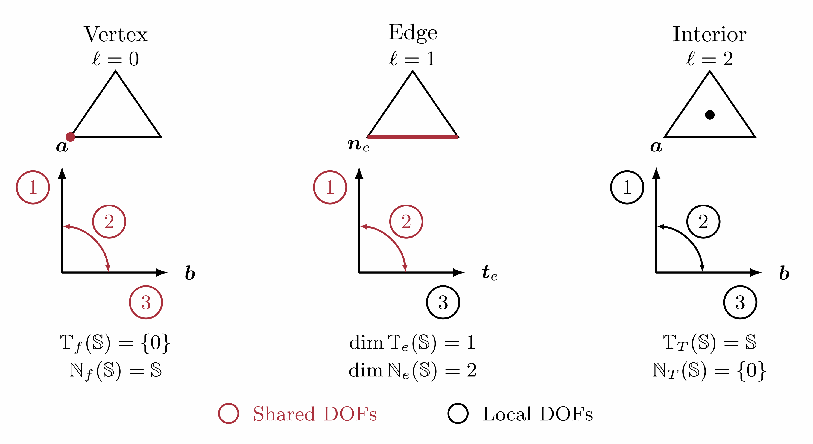

**图 3.1  三角形单元各子单形上的局部标架与对称张量分量。①、②、③分别表示 $\boldsymbol a\otimes\boldsymbol a$、$\operatorname{sym}(\boldsymbol a\otimes\boldsymbol b)$ 和 $\boldsymbol b\otimes\boldsymbol b$；在边上取 $(\boldsymbol a,\boldsymbol b)=(\boldsymbol n_e,\boldsymbol t_e)$。**

### 3.2 Finite Element Spaces and Standard Discrete Variational Formulation

记连续分片对称张量多项式空间为
$$
\widetilde{\boldsymbol{\Sigma}}_h^k
:=\left\{\boldsymbol{\tau}_h\in H^1(\Omega;\mathbb{S}):\boldsymbol{\tau}_h|_T\in\mathbb P_k(T;\mathbb{S}),\ \forall T\in\mathcal T_h\right\}.
$$
单元应力泡函数空间及相应的全局泡函数空间分别定义为
$$
\begin{aligned}
\boldsymbol B_k(T)
&:=\left\{\boldsymbol{\tau}\in\mathbb P_k(T;\mathbb{S}):\boldsymbol{\tau}\boldsymbol n_T=\boldsymbol0\text{ on }\partial T\right\},\\
\boldsymbol B_h^k
&:=\left\{\boldsymbol{\tau}_h\in H(\operatorname{div},\Omega;\mathbb{S}):\boldsymbol{\tau}_h|_T\in\boldsymbol B_k(T),\ \forall T\in\mathcal T_h\right\},
\end{aligned}
$$
其中，$\boldsymbol n_T$ 为单元 $T$ 的外单位法向量。$k$ 阶 Hu–Zhang 应力空间定义为 [17, 28]
$$
\boldsymbol{\Sigma}_h^k:=\widetilde{\boldsymbol{\Sigma}}_h^k+\boldsymbol B_h^k.
$$
连续部分的应力张量在单元界面上连续，而泡函数在单元边界上的法向迹为零，因此 $\boldsymbol{\Sigma}_h^k\subset H(\operatorname{div},\Omega;\mathbb S)$，满足跨单元法向牵引连续性。

对应的分片不连续位移空间定义为
$$
\boldsymbol{V}_h^{k-1} := \left\{ \boldsymbol{v}_h \in L^2(\Omega;\mathbb{R}^d) : \boldsymbol{v}_h|_T \in \mathbb{P}_{k-1}(T;\mathbb{R}^d), \ \forall\,T \in \mathcal{T}_h \right\}.
$$
记 $\boldsymbol{\Sigma}_{h,0}^k := \boldsymbol{\Sigma}_h^k \cap \boldsymbol{\Sigma}_0$ 为齐次离散应力测试空间。基于上述应力–位移空间对的离散方法记为 Hu–Zhang 混合有限元方法（Hu–Zhang mixed finite element method, HZMFEM）。

基于 Hu [28] 给出的应力空间与自由度构造，并结合 Chen 与 Huang [20] 的切向–法向几何分解框架，本文按第 3.1 节的分解构造局部应力基函数并组织全局自由度。对位于子单形 $f$ 相对内部的标量 Lagrange 节点，将其对应的标量基函数分别与 $\mathbb N_f(\mathbb S)$ 和 $\mathbb T_f(\mathbb S)$ 的张量基相乘，得到局部应力基函数。法向部分对应的自由度在统一标架下定义，并由所有包含 $f$ 的单元共享同一组全局编号，以保持法向迹的单值性；纯切向部分对应在整个单元边界上具有零法向迹的应力泡函数，其自由度按单元独立编号。由此建立局部到全局的自由度映射，并据此组装离散系统。

等价地，$\boldsymbol\Sigma_h^k$ 由满足以下共享条件的分片 $\mathbb P_k(T;\mathbb S)$ 张量场组成：在每个共享子单形的相对内部 Lagrange 节点处，法向部分的展开系数在统一标架下保持单值，纯切向部分的系数允许逐单元独立取值。

为施加非齐次牵引条件，采用边界数据提升的方法 [23]。选取牵引数据的离散近似 $\boldsymbol g_h$，使其属于 $\boldsymbol{\Sigma}_h^k$ 在 $\Gamma_N$ 上的法向迹值域，并构造已知离散提升场 $\boldsymbol{\sigma}_{g,h}\in\boldsymbol{\Sigma}_h^k$，使其在 $\Gamma_N$ 上满足 $\boldsymbol{\sigma}_{g,h}\boldsymbol n=\boldsymbol g_h$。令 $\boldsymbol{\sigma}_h=\boldsymbol{\sigma}_{0,h}+\boldsymbol{\sigma}_{g,h}$，其中 $\boldsymbol{\sigma}_{0,h}\in\boldsymbol{\Sigma}_{h,0}^k$，从而使离散总应力满足给定的离散牵引条件。提升场无需满足内部平衡方程或本构关系。

标准离散混合变分问题为：求 $(\boldsymbol{\sigma}_{0,h}, \boldsymbol{u}_h) \in \boldsymbol{\Sigma}_{h,0}^k \times \boldsymbol{V}_h^{k-1}$，使得
$$
\begin{aligned}
a(\boldsymbol{\sigma}_{0,h}, \boldsymbol{\tau}_h) + b(\boldsymbol{\tau}_h, \boldsymbol{u}_h) &= \langle \boldsymbol{u}_D, \boldsymbol{\tau}_h\boldsymbol{n} \rangle_{\Gamma_D} - a(\boldsymbol{\sigma}_{g,h}, \boldsymbol{\tau}_h), && \forall\,\boldsymbol{\tau}_h \in \boldsymbol{\Sigma}_{h,0}^k, \\
b(\boldsymbol{\sigma}_{0,h}, \boldsymbol{v}_h) &= -(\boldsymbol{b},\boldsymbol{v}_h)_\Omega - b(\boldsymbol{\sigma}_{g,h}, \boldsymbol{v}_h), && \forall\,\boldsymbol{v}_h \in \boldsymbol{V}_h^{k-1}.
\end{aligned} \tag{3.2}
$$
求解后，由 $\boldsymbol{\sigma}_h=\boldsymbol{\sigma}_{0,h}+\boldsymbol{\sigma}_{g,h}$ 重构离散总应力。

对于全边界齐次位移条件下的标准问题，Hu [28] 证明了上述空间对在 $k\ge d+1$ 时满足离散 inf-sup 条件，其稳定性常数与网格尺寸 $h$ 无关；二维情形对应 $k\ge3$。若精确解满足 $\boldsymbol{\sigma}\in H^{k+1}(\Omega;\mathbb S)$ 和 $\boldsymbol u\in H^k(\Omega;\mathbb R^d)$，则有最优阶先验误差估计
$$
\|\boldsymbol{\sigma} - \boldsymbol{\sigma}_h\|_{H(\operatorname{div})} + \|\boldsymbol{u} - \boldsymbol{u}_h\|_0 \le C h^k \left( \|\boldsymbol{\sigma}\|_{k+1} + \|\boldsymbol{u}\|_k \right). \tag{3.3}
$$
此外，应力的 $L^2$ 误差满足
$$
\|\boldsymbol{\sigma} - \boldsymbol{\sigma}_h\|_0 \le C h^{k+1} \|\boldsymbol{\sigma}\|_{k+1}. \tag{3.4}
$$
在上述估计中，$\|\cdot\|_m$ 表示相应的 $H^m(\Omega)$ 范数，$C$ 为与网格尺寸 $h$ 无关的正常数。

上述空间构造保持顶点应力全分量单值。在二维牵引边界角点处，若两条相交边界边上的牵引数据不能由同一个对称应力张量同时表示，则这一约束会阻碍两侧牵引条件的同时精确施加。Hu 与 Ma [29] 提出了应力顶点连续性的局部松弛方法。当角点邻域由共享一条内边的两个三角形组成时，可将该内边对应的纯切向应力自由度拆分为两个单元各自独立的自由度。这使该角点关联的应力自由度由 3 个增至 4 个，同时保持跨内边的法向牵引连续性及应力空间的 $H(\operatorname{div})$ 协调性。

### 3.3 Jump Stabilization for Low-Order Elements

对于低阶离散 $1\le k\le d$（二维中 $k=1,2$），第 3.2 节给出的高阶离散 inf-sup 稳定性结论不直接适用。本文采用 Chen 等 [17] 的位移跳量稳定化方法，对不连续位移场的对称矩阵型跳量施加惩罚。

对于内部面 $F=T^+\cap T^-\in\mathcal F_h^i$，记 $\boldsymbol n^\pm$ 为单元 $T^\pm$ 在 $F$ 上的单位外法向，$\boldsymbol v^\pm$ 为相应的位移迹，定义
$$
[\![ \boldsymbol{v} ]\!] = \frac{1}{2}\left( \boldsymbol{v}^+\otimes\boldsymbol{n}^+ + \boldsymbol{n}^+\otimes\boldsymbol{v}^+ + \boldsymbol{v}^-\otimes\boldsymbol{n}^- + \boldsymbol{n}^-\otimes\boldsymbol{v}^- \right). \tag{3.5}
$$
对于边界面，记 $\boldsymbol n$ 为该面上的区域外单位法向量，定义单侧跳量为 $[\![\boldsymbol v]\!]=\operatorname{sym}(\boldsymbol v\otimes\boldsymbol n)$。在全边界齐次位移条件下，原始稳定化项为
$$
c_{\mathrm{mat},h}(\boldsymbol{u}_h,\boldsymbol{v}_h)
=\sum_{F\in\mathcal{F}_h}h_F\int_F[\![\boldsymbol{u}_h]\!]:[\![\boldsymbol{v}_h]\!]\,\mathrm ds. \tag{3.6}
$$

对于本文考虑的混合边界条件，惩罚仅施加于内部面和位移边界面，即 $F\in\mathcal F_h^i\cup\mathcal F_h^D$；在位移边界上，惩罚作用于位移偏差 $\boldsymbol u_h-\boldsymbol u_D$ 的单侧跳量。为使位移跳量稳定化项与混合变分方程具有一致的量纲，引入缩放系数 $\alpha=\mu/L_0^2$，其中 $\mu=E_0/[2(1+\nu_0)]$ 为实体材料的剪切模量，在拓扑优化过程中保持固定，不随材料密度变化；$L_0$ 为固定的宏观特征长度。缩放后的稳定化项为
$$
c_h(\boldsymbol{u}_h,\boldsymbol{v}_h)
=\sum_{F\in\mathcal{F}_h^i\cup\mathcal{F}_h^D}\alpha h_F\int_F[\![\boldsymbol{u}_h]\!]:[\![\boldsymbol{v}_h]\!]\,\mathrm ds. \tag{3.7}
$$
本文取 $L_0$ 为固定网格的轴对齐包围盒的最大边长，即 $L_0=\max_{1\le i\le d}(x_i^{\max}-x_i^{\min})$。因此，在固定网格和固定边界划分下，$\alpha$ 及稳定化矩阵均与设计变量无关，灵敏度计算中无需对稳定化矩阵求导。

对 $\Gamma_D$ 上位移偏差 $\boldsymbol u_h-\boldsymbol u_D$ 的单侧跳量施加惩罚后，给定位移数据 $\boldsymbol u_D$ 对应的已知边界泛函为
$$
\ell_h^D(\boldsymbol{v}_h)=\sum_{F\in\mathcal{F}_h^D}\alpha h_F\int_F[\![\boldsymbol{u}_D]\!]:[\![\boldsymbol{v}_h]\!]\,\mathrm ds. \tag{3.8}
$$

结合上述稳定化项与边界泛函，统一离散混合变分问题表述为：求 $(\boldsymbol{\sigma}_{0,h}, \boldsymbol{u}_h) \in \boldsymbol{\Sigma}_{h,0}^k \times \boldsymbol{V}_h^{k-1}$，使得
$$
\begin{aligned}
a(\boldsymbol{\sigma}_{0,h}, \boldsymbol{\tau}_h) + b(\boldsymbol{\tau}_h, \boldsymbol{u}_h) &= \langle \boldsymbol{u}_D, \boldsymbol{\tau}_h\boldsymbol{n} \rangle_{\Gamma_D} - a(\boldsymbol{\sigma}_{g,h}, \boldsymbol{\tau}_h), && \forall\,\boldsymbol{\tau}_h \in \boldsymbol{\Sigma}_{h,0}^k, \\
b(\boldsymbol{\sigma}_{0,h}, \boldsymbol{v}_h) - c_h(\boldsymbol{u}_h, \boldsymbol{v}_h) &= -(\boldsymbol{b},\boldsymbol{v}_h)_\Omega - b(\boldsymbol{\sigma}_{g,h}, \boldsymbol{v}_h) - \ell_h^D(\boldsymbol{v}_h), && \forall\,\boldsymbol{v}_h \in \boldsymbol{V}_h^{k-1}.
\end{aligned} \tag{3.9}
$$
当 $1\le k\le d$ 时启用上述稳定化；当 $k\ge d+1$ 时取 $c_h=0$ 和 $\ell_h^D=0$，式 (3.9) 退化为标准混合格式 (3.2)。牵引条件通过应力法向迹的本质边界条件施加，不在 $\Gamma_N$ 上引入位移跳量惩罚。

对于全边界齐次位移条件下的原始稳定化格式，Chen 等 [17] 证明了其稳定化混合双线性型在 $1\le k\le d$ 时满足离散 inf-sup 条件。若精确解满足 $\boldsymbol\sigma\in H^{k+1}(\Omega;\mathbb S)$ 和 $\boldsymbol u\in H^k(\Omega;\mathbb R^d)$，则有如下先验误差估计：
$$
\|\boldsymbol{\sigma} - \boldsymbol{\sigma}_h\|_{H(\operatorname{div},A)} + \|\boldsymbol{u} - \boldsymbol{u}_h\|_{0,c} \le C h^k \left( \|\boldsymbol{\sigma}\|_{k+1} + \|\boldsymbol{u}\|_k \right). \tag{3.10}
$$
在上述估计中，柔度加权应力范数和网格依赖位移范数分别定义为
$$
\|\boldsymbol{\tau}\|_{H(\operatorname{div},A)}^2 = a(\boldsymbol{\tau},\boldsymbol{\tau}) + \|\operatorname{div}\boldsymbol{\tau}\|_0^2, \qquad \|\boldsymbol{v}\|_{0,c}^2 = \|\boldsymbol{v}\|_0^2 + c_{\mathrm{mat},h}(\boldsymbol{v},\boldsymbol{v}).
$$
其中，$C$ 为与网格尺寸 $h$ 无关的正常数。

### 3.4 Discrete Saddle-Point System

设 $\{\boldsymbol{\Phi}_i\}_{i=1}^{N_\sigma}$ 与 $\{\boldsymbol{\psi}_p\}_{p=1}^{N_u}$ 分别为齐次离散应力空间 $\boldsymbol{\Sigma}_{h,0}^k$ 与分片不连续位移空间 $\boldsymbol{V}_h^{k-1}$ 的全局基。其中，$N_\sigma=\dim\boldsymbol\Sigma_{h,0}^k$，$N_u=\dim\boldsymbol V_h^{k-1}$。齐次应力修正与离散位移分别展开为
$$
\boldsymbol{\sigma}_{0,h} = \sum_{j=1}^{N_\sigma} s_{0,j} \boldsymbol{\Phi}_j, \qquad \boldsymbol{u}_h = \sum_{q=1}^{N_u} u_q \boldsymbol{\psi}_q.
$$
记 $\boldsymbol{s}_0=(s_{0,1},\dots,s_{0,N_\sigma})^{\mathsf T}$ 和 $\boldsymbol{u}=(u_1,\dots,u_{N_u})^{\mathsf T}$ 分别为齐次应力修正与位移的自由度向量。

将上述展开代入统一离散混合变分问题 (3.9)，得到对称不定的鞍点代数系统
$$
\begin{bmatrix}
\boldsymbol{A} & \boldsymbol{B} \\
\boldsymbol{B}^{\mathsf T} & -\boldsymbol{C}
\end{bmatrix}
\begin{bmatrix}
\boldsymbol{s}_0 \\
\boldsymbol{u}
\end{bmatrix}
=
\begin{bmatrix}
\boldsymbol{f}_{\sigma} \\
\boldsymbol{f}_u
\end{bmatrix}. \tag{3.11}
$$

各分块矩阵的元素定义为
$$
\begin{aligned}
A_{ij} &= a(\boldsymbol{\Phi}_j, \boldsymbol{\Phi}_i) = \int_\Omega \mathcal{A}\boldsymbol{\Phi}_j : \boldsymbol{\Phi}_i \,\mathrm{d}x, && i,j = 1, \dots, N_\sigma, \\
B_{ip} &= b(\boldsymbol{\Phi}_i, \boldsymbol{\psi}_p) = \int_\Omega (\operatorname{div}\boldsymbol{\Phi}_i) \cdot \boldsymbol{\psi}_p \,\mathrm{d}x, && i = 1, \dots, N_\sigma; \quad p = 1, \dots, N_u, \\
C_{pq} &= c_h(\boldsymbol{\psi}_q, \boldsymbol{\psi}_p) = \sum_{F \in \mathcal{F}_h^i \cup \mathcal{F}_h^D} \alpha h_F \int_F [\![ \boldsymbol{\psi}_q ]\!] : [\![ \boldsymbol{\psi}_p ]\!] \,\mathrm{d}s, && p,q = 1, \dots, N_u.
\end{aligned} \tag{3.12}
$$
上述 $\boldsymbol C$ 的求和表达式适用于低阶格式 $1\le k\le d$；对于高阶格式 $k\ge d+1$，取 $\boldsymbol C=\boldsymbol0$。

右端向量的分量定义为
$$
\begin{aligned}
(\boldsymbol{f}_{\sigma})_i &= \int_{\Gamma_D} \boldsymbol{u}_D \cdot (\boldsymbol{\Phi}_i\boldsymbol{n})\,\mathrm{d}s - \int_\Omega \mathcal{A}\boldsymbol{\sigma}_{g,h} : \boldsymbol{\Phi}_i \,\mathrm{d}x, && i = 1, \dots, N_\sigma, \\
(\boldsymbol{f}_u)_p &= -\int_\Omega \boldsymbol{b} \cdot \boldsymbol{\psi}_p \,\mathrm{d}x - \int_\Omega (\operatorname{div}\boldsymbol{\sigma}_{g,h}) \cdot \boldsymbol{\psi}_p \,\mathrm{d}x - \ell_h^D(\boldsymbol{\psi}_p), && p = 1, \dots, N_u.
\end{aligned} \tag{3.13}
$$

在 $\Gamma_N$ 上，采用与边界对齐的局部标架（必要时结合角点基底变换）通过相应的边界自由度表示应力法向迹。由离散牵引数据 $\boldsymbol g_h$ 给定这些受约束自由度并将其他自由度置零，即得到离散提升场 $\boldsymbol\sigma_{g,h}$，而将受约束自由度置零则保留 $\boldsymbol\sigma_{0,h}\in\boldsymbol\Sigma_{h,0}^k$ 的未受约束自由度 $\boldsymbol s_0$。

---

## 4 Density-Based Topology Optimization with Independent Stress

### 4.1 Design Parameterization and Material Interpolation

在第 2.1 节引入的单纯形网格 $\mathcal T_h=\{T_e\}_{e=1}^{N_e}$ 上，将设计密度离散为单元分片常数，其中 $N_e$ 为单元总数。每个单元 $T_e$ 的设计密度为 $\rho_e\in[0,1]$，相应的设计向量为 $\boldsymbol\rho=(\rho_1,\dots,\rho_{N_e})^{\mathsf T}$。设计密度经下述过滤与投影映射得到用于材料插值的物理密度。

为减轻网格依赖性与棋盘格现象，并引入空间平滑尺度，采用线性密度过滤器 [10, 14]，将设计密度映射为过滤密度：
$$
\widetilde{\rho}_e = \frac{\displaystyle\sum_{j \in \mathcal{N}_e} w_{ej} v_j \rho_j}{\displaystyle\sum_{j \in \mathcal{N}_e} w_{ej} v_j}, \tag{4.1}
$$
其中，$v_j=|T_j|$ 为单元 $T_j$ 的几何测度（二维面积或三维体积），$\boldsymbol x_e=|T_e|^{-1}\int_{T_e}\boldsymbol x\,\mathrm dx$ 为单元 $T_e$ 的形心。给定过滤半径 $r_{\min}>0$，邻域索引集合定义为
$$
\mathcal{N}_e = \left\{j \in \{1, \dots, N_e\} : \|\boldsymbol{x}_e - \boldsymbol{x}_j\|_2 \le r_{\min}\right\}.
$$
权重随单元形心之间的距离线性衰减：
$$
w_{ej} = \max\!\left(0, \, r_{\min} - \|\boldsymbol{x}_e - \boldsymbol{x}_j\|_2\right).
$$

为减少中间密度并使材料与空域之间的密度过渡更加陡峭，采用光滑 Heaviside 投影 [37]，构建设计密度、过滤密度与物理密度的三场表述：
$$
\boldsymbol{\rho}\xrightarrow{\text{密度过滤}}\widetilde{\boldsymbol{\rho}}\xrightarrow{\text{光滑投影}}\overline{\boldsymbol{\rho}}.
$$
物理密度由下式给出：
$$
\overline{\rho}_e=P_{\beta,\eta_{\mathrm p}}(\widetilde{\rho}_e)
=\frac{\tanh(\beta\eta_{\mathrm p})+\tanh\!\left[\beta(\widetilde{\rho}_e-\eta_{\mathrm p})\right]}
{\tanh(\beta\eta_{\mathrm p})+\tanh\!\left[\beta(1-\eta_{\mathrm p})\right]}, \tag{4.2}
$$
其中，$\eta_{\mathrm p}\in(0,1)$ 为投影阈值，$\beta>0$ 控制投影的陡峭程度；$\eta_{\mathrm p}$ 与后文应力阈值函数 $\eta(\cdot)$ 含义不同。启用投影时，可采用逐阶段增大 $\beta$ 的延续策略；未启用投影时，取恒等映射 $\overline{\rho}_e=\widetilde{\rho}_e$。后续材料插值、状态方程、体积评估及局部应力约束均采用物理密度 $\overline{\rho}_e$。

对于三维或平面应变问题，若泊松比固定为接近 $0.5$ 的 $\nu_0$，则仅对杨氏模量进行密度插值不会改变体积模量与剪切模量之比
$$
\frac{K}{G}=\frac{2(1+\nu_0)}{3(1-2\nu_0)},
$$
其中，$K$ 和 $G$ 分别为三维材料的体积模量与剪切模量，仅降低密度不能消除近不可压缩性。本文采用带正刚度下限的 SIMP 插值，并在需要时参考 Bruggi 和 Venini [12] 对泊松比进行松弛，使中低密度相表现为可压缩弱材料：

1. **杨氏模量插值（SIMP 模型）**：
$$
E(\overline{\rho}_e) = E_{\min} + (E_0 - E_{\min}) \overline{\rho}_e^{p_E}, \tag{4.3}
$$
其中，$E_0$ 为各向同性实体材料的杨氏模量，$E_{\min}>0$ 为杨氏模量的正下界，用于避免零模量导致柔度算子无定义，其具体取值在各算例中给出。$p_E$ 为 SIMP 惩罚指数，柔顺度算例取 $p_E=3$，应力约束算例取 $p_E=3.5$。

2. **泊松比松弛插值**：
$$
\nu(\overline{\rho}_e) = \nu_{\mathrm{void}} + (\nu_0 - \nu_{\mathrm{void}}) \overline{\rho}_e^{p_\nu}, \tag{4.4}
$$
其中，$\nu_0$ 和 $\nu_{\mathrm{void}}$ 分别为实体材料和弱材料的泊松比，$p_\nu$ 为插值指数。启用松弛时取 $\nu_{\mathrm{void}}=0.3$、$p_\nu=1$；否则取 $\nu=\nu_0$，仅杨氏模量随密度变化。

### 4.2 State Equations and Complementary Energy Compliance Formulation

考虑齐次位移边界条件及设计无关载荷下的柔顺度最小化。应力和位移为独立状态变量，材料依赖通过柔度算子进入离散方程 [12]，目标由重构总应力的余能定义。

对于齐次位移边界条件下的连续线弹性问题，由平衡方程、本构关系及分部积分可得
$$
\int_\Omega\mathcal A\boldsymbol\sigma:\boldsymbol\sigma\,\mathrm dx
=\int_\Omega\boldsymbol b\cdot\boldsymbol u\,\mathrm dx
+\int_{\Gamma_N}\boldsymbol g\cdot\boldsymbol u\,\mathrm ds.
$$
连续问题的外载柔顺度因此等于应变能或应变余能的两倍。采用相同归一化，定义离散目标
$$
C(\boldsymbol\rho,\boldsymbol\sigma_h)
=\int_\Omega\mathcal A(\overline{\boldsymbol\rho})\boldsymbol\sigma_h:\boldsymbol\sigma_h\,\mathrm dx
=\sum_{e=1}^{N_e}\boldsymbol s_e^{\mathsf T}\boldsymbol A_e(\overline\rho_e)\boldsymbol s_e, \tag{4.5}
$$
其中，$\overline{\boldsymbol\rho}=\overline{\boldsymbol\rho}(\boldsymbol\rho)$ 为第 4.1 节过滤与投影后的物理密度，$\boldsymbol s_e$ 为重构总应力 $\boldsymbol\sigma_h|_{T_e}=(\boldsymbol\sigma_{0,h}+\boldsymbol\sigma_{g,h})|_{T_e}$ 在局部应力基下的系数向量，因此包含牵引提升的贡献。局部柔度矩阵 $\boldsymbol A_e$ 的元素定义为
$$
(\boldsymbol A_e)_{ab}=\int_{T_e}\mathcal A(\overline\rho_e)\boldsymbol\phi_{e,b}:\boldsymbol\phi_{e,a}\,\mathrm dx,
$$
其中，$\{\boldsymbol\phi_{e,a}\}_{a=1}^{n_e}$ 为 $\mathbb P_k(T_e;\mathbb S)$ 的基。上述连续能量恒等式并不意味着，对于同一密度场，该离散目标与采用 LFEM 计算的外载柔顺度相等。

状态方程采用第 3.4 节的离散系统，以齐次应力修正和位移为未知量。固定网格、边界划分及第 3.3 节的稳定化尺度时，三个分块矩阵中仅 $\boldsymbol A$ 依赖密度。柔顺度最小化问题为
$$
\begin{aligned}
\min_{\boldsymbol\rho}\quad &C(\boldsymbol\rho,\boldsymbol\sigma_h)
=\sum_{e=1}^{N_e}\boldsymbol s_e^{\mathsf T}\boldsymbol A_e(\overline\rho_e)\boldsymbol s_e\\
\text{s.t.}\quad &
\begin{bmatrix}\boldsymbol A(\overline{\boldsymbol\rho})&\boldsymbol B\\\boldsymbol B^{\mathsf T}&-\boldsymbol C\end{bmatrix}
\begin{bmatrix}\boldsymbol s_0\\\boldsymbol u\end{bmatrix}
=\begin{bmatrix}\boldsymbol f_\sigma(\overline{\boldsymbol\rho})\\\boldsymbol f_u\end{bmatrix},\\
&\frac{\sum_{e=1}^{N_e}v_e\overline\rho_e}{\sum_{e=1}^{N_e}v_e}\le\bar V,\\
&0\le\rho_e\le1,\quad e=1,\dots,N_e,
\end{aligned}\tag{4.6}
$$
其中，$v_e=|T_e|$ 为单元测度，$\bar V\in(0,1)$ 为材料体积分数上限。状态方程的右端由式 (3.13) 给出；在本节的齐次位移边界条件下，与 $\boldsymbol u_D$ 和 $\ell_h^D$ 对应的项均为零。

沿用第 3.4 节边界处理后的全局应力基，记 $\boldsymbol s_g$ 为牵引提升场在该完整基下的系数向量。将齐次应力修正系数向量 $\boldsymbol s_0$ 在受约束自由度处补零，得到 $\widetilde{\boldsymbol s}_0$，则总应力系数向量为
$$
\boldsymbol s=\widetilde{\boldsymbol s}_0+\boldsymbol s_g.
$$
将总应力限制到单元 $T_e$，并在式 (4.5) 所用的局部应力基下表示，即得到目标函数中的系数向量 $\boldsymbol s_e$。

尽管外载荷与牵引提升场 $\boldsymbol\sigma_{g,h}$ 与设计无关，但式 (3.13) 中的 $\boldsymbol f_\sigma(\overline{\boldsymbol\rho})$ 仍通过柔度算子 $\mathcal A(\overline{\boldsymbol\rho})$ 依赖于物理密度 $\overline{\boldsymbol\rho}$。

### 4.3 Stress-Constrained Topology Optimization with a Relaxed Stress Threshold

本文考虑局部应力约束下的结构总体积最小化问题 [13, 24]，对每个单元形心处的表观 von Mises 等效应力施加密度相关的松弛约束：
$$
g_e(\boldsymbol{\rho}, \boldsymbol{\sigma}_h) = \frac{\sigma_{\mathrm{vm}}(\boldsymbol{\sigma}_{h,e})}{\bar{\sigma}} - \eta(\overline{\rho}_e) \le 0, \quad e = 1, \dots, N_e, \tag{4.7}
$$
其中，$\bar{\sigma}$ 为实体材料的许用应力，$\boldsymbol\sigma_{h,e}$ 为单元形心处插值材料的表观应力，$\eta$ 为松弛阈值。在形心处，LFEM 评价 $\mathcal A(\overline\rho_e)^{-1}\boldsymbol\varepsilon(\boldsymbol u_h)$，HZMFEM 评价第 4.2 节重构的总应力。

上述形心约束不保证单元内其他位置满足相同的应力限值。在平面应力条件下（$\sigma_{zz}=\sigma_{xz}=\sigma_{yz}=0$），von Mises 等效应力为
$$
\sigma_{\mathrm{vm}}(\boldsymbol\sigma_{h,e})=\sqrt{\sigma_{xx}^2-\sigma_{xx}\sigma_{yy}+\sigma_{yy}^2+3\sigma_{xy}^2},
$$
其中，$\sigma_{xx},\sigma_{yy},\sigma_{xy}$ 为 $\boldsymbol\sigma_{h,e}$ 的面内分量。平面应变与三维问题采用包含面外应力分量的 von Mises 表达式。对于各向同性平面应变问题，$\sigma_{zz}=\nu(\overline\rho_e)(\sigma_{xx}+\sigma_{yy})$；因此，当泊松比随密度变化时，即使面内应力固定，von Mises 等效应力仍通过 $\sigma_{zz}$ 显式依赖密度；相应的灵敏度项见第 4.5 节。

理想材料—空域模型中的材料移除可能产生退化可行分支及奇异最优解 [22, 31, 36]。本文的正刚度下限使零密度单元仍表示弱材料。为减轻应力约束对材料移除的阻碍，参考 $\epsilon$ 松弛 [21, 24] 及混合有限元中的应力限值 [13]，定义密度相关阈值
$$
\eta(\overline{\rho}_e) = m_E(\overline{\rho}_e) + \epsilon\bigl(1 - m_E(\overline{\rho}_e)\bigr),
\qquad m_E(\overline{\rho}_e) = \frac{E(\overline{\rho}_e)}{E_0}, \tag{4.8}
$$
其中，$m_E$ 为归一化杨氏模量，$E(\overline\rho_e)$ 由式 (4.3) 给出，$\epsilon\in(0,1)$ 为松弛参数。为便于下文讨论，记单元形心处的表观应力为 $\boldsymbol\sigma_e^{\mathrm{app}}:=\boldsymbol\sigma_{h,e}$。

泊松比固定时，$\boldsymbol\sigma_e^{\mathrm{solid}}:=\boldsymbol\sigma_e^{\mathrm{app}}/m_E$ 表示实体材料在应变 $\mathcal A(\overline\rho_e)\boldsymbol\sigma_e^{\mathrm{app}}$ 下的应力。由 von Mises 应力的正一次齐次性，式 (4.7)–(4.8) 等价于
$$
\frac{\sigma_{\mathrm{vm}}(\boldsymbol\sigma_e^{\mathrm{solid}})}{\bar\sigma}
\le 1+\epsilon\Bigl(\frac{1}{m_E(\overline\rho_e)}-1\Bigr). \tag{4.9}
$$
该约束在低刚度区域放宽实体材料应力上限，并在 $\overline\rho_e=1$ 时恢复原始许用应力条件。因此，式 (4.7) 可解释为基于归一化杨氏模量的 $\epsilon$ 松弛；采用表观应力形式可避免在约束评价中显式除以较小的 $m_E$。

阈值满足 $\eta(1)=1$ 和 $\eta(0)=\epsilon+(1-\epsilon)r>0$，其中 $r=E_{\min}/E_0$，故当 $r\ll\epsilon$ 时有 $\eta(0)\approx\epsilon$。物理密度为零并不自动使应力约束不活跃。本文固定取 $\epsilon=10^{-3}$，不采用延续策略。

据此，Hu–Zhang 离散下的局部应力约束体积最小化问题为
$$
\begin{aligned}
\min_{\boldsymbol\rho}\quad &
f_V(\boldsymbol\rho)=\frac{\sum_{e=1}^{N_e}v_e\overline\rho_e}{\sum_{e=1}^{N_e}v_e}\\
\mathrm{s.t.}\quad &
\begin{bmatrix}\boldsymbol A(\overline{\boldsymbol\rho})&\boldsymbol B\\
\boldsymbol B^{\mathsf T}&-\boldsymbol C\end{bmatrix}
\begin{bmatrix}\boldsymbol s_0\\\boldsymbol u\end{bmatrix}
=\begin{bmatrix}\boldsymbol f_\sigma(\overline{\boldsymbol\rho})\\\boldsymbol f_u\end{bmatrix},\\
&g_e(\boldsymbol\rho,\boldsymbol\sigma_h)
=\frac{\sigma_{\mathrm{vm}}(\boldsymbol\sigma_{h,e})}{\bar\sigma}
-\eta(\overline\rho_e)\le0,\quad e=1,\dots,N_e,\\
&0\le\rho_e\le1,\quad e=1,\dots,N_e,
\end{aligned}\tag{4.10}
$$
其中，物理密度由第 4.1 节的过滤与投影确定，总应力按第 4.2 节重构。由于设计域体积 $\sum_e v_e$ 固定，最小化体积分数 $f_V$ 等价于最小化结构总体积 $\sum_e v_e\overline\rho_e$。式 (4.10) 按全部单元均施加局部应力约束的情形书写；若算例设置免于应力约束的被动实体区，则仅在该区域之外施加相应约束。

LFEM 对照模型采用位移状态方程 $\boldsymbol K(\overline{\boldsymbol\rho})\boldsymbol u=\boldsymbol f$，其中刚度矩阵 $\boldsymbol K$ 由插值本构关系装配，载荷向量 $\boldsymbol f$ 与设计无关。该模型采用与式 (4.10) 相同的体积目标、密度映射、材料插值、松弛应力约束形式及设计变量边界，两种离散均在单元形心处评价应力。

### 4.4 Augmented Lagrangian Formulation

为处理式 (4.10) 的逐单元应力约束，参考 Senhora 等 [34] 的归一化处理，采用增广拉格朗日方法（Augmented Lagrangian Method，ALM）：
$$
\mathcal L(\boldsymbol{\rho}, \boldsymbol{\sigma}_h) = f_V(\boldsymbol{\rho}) + \frac{1}{N_e} \sum_{e=1}^{N_e} \mathcal{P}_e(g_e, \lambda_e, \mu_e), \tag{4.11}
$$
其中，$f_V$ 为体积分数目标。按 $1/N_e$ 平均可减轻单元数量对增广项与 $f_V$ 相对量级的影响，各约束保留独立乘子。免约束单元不参与求和，但 $N_e$ 仍为网格总单元数。

对式 (4.7) 定义的局部约束，采用如下不等式约束增广项 [25]。令 $h_e=\max(g_e,-\lambda_e/\mu_e)$，则 $\mathcal P_e=\lambda_e h_e+\frac{\mu_e}{2}h_e^2$ 可等价写为
$$
\mathcal{P}_e = \begin{cases}
\lambda_e g_e + \frac{\mu_e}{2} g_e^2, & g_e > -\frac{\lambda_e}{\mu_e}, \\
-\frac{\lambda_e^2}{2\mu_e}, & g_e \le -\frac{\lambda_e}{\mu_e},
\end{cases} \tag{4.12}
$$
其中，$\lambda_e\ge0$ 为对应局部约束的拉格朗日乘子，$\mu_e>0$ 为罚因子。固定二者时，$\mathcal P_e$ 关于 $g_e$ 连续可微，且 $\partial\mathcal P_e/\partial g_e=\max(0,\lambda_e+\mu_e g_e)$。

在第 $n$ 次外层迭代中，固定乘子 $\boldsymbol\lambda^{(n)}$、罚因子 $\boldsymbol\mu^{(n)}$ 以及过滤、投影参数和稳定化尺度，近似求解仅显式保留设计变量上下界的增广子问题：
$$
\begin{aligned}
\min_{\boldsymbol\rho}\quad &
\mathcal L^{(n)}(\boldsymbol\rho)
=f_V(\boldsymbol\rho)+\frac{1}{N_e}\sum_{e=1}^{N_e}
\mathcal P_e\!\left(g_e(\boldsymbol\rho,\boldsymbol\sigma_h(\boldsymbol\rho)),\lambda_e^{(n)},\mu_e^{(n)}\right),\\
\mathrm{s.t.}\quad &0\le\rho_e\le1,\qquad e=1,\dots,N_e,
\end{aligned}\tag{4.13}
$$
其中，$\boldsymbol\sigma_h(\boldsymbol\rho)$ 为式 (4.10) 状态解重构的总应力。状态变量被隐式消去，但每个新设计仍需求解状态方程。

近似求解子问题 (4.13) 后，采用其近似解处的约束值 $g_e$ 更新乘子，并投影到区间 $[0,\lambda_{\max}]$：
$$
\lambda_e^{(n+1)} = \min\left(\lambda_{\max},\,\max\left(0,\, \lambda_e^{(n)} + \mu_e^{(n)} g_e\right)\right), \tag{4.14}
$$
其中，$\lambda_{\max}>0$ 按 Andreani 等 [2] 的安全化思路限制乘子估计。

内层采用移动渐近线法（Method of Moving Asymptotes，MMA）[35] 近似求解子问题 (4.13)。罚因子更新、约束复核范围、停止准则及完整求解流程见第 4.6 节。

### 4.5 Consistent Adjoint Sensitivity Analysis

本节先对物理密度求导，再通过密度映射应用链式法则。下文中，偏导数固定状态变量，而全导数计入状态变量对密度的隐式依赖。

对于 HZMFEM，目标 $J\in\{\mathcal L,C\}$ 不显式依赖位移变量。由于离散状态矩阵对称，伴随方程为

$$
\begin{bmatrix}\boldsymbol A(\overline{\boldsymbol\rho})&\boldsymbol B\\\boldsymbol B^{\mathsf T}&-\boldsymbol C\end{bmatrix}
\begin{bmatrix}\boldsymbol z_\sigma\\\boldsymbol z_u\end{bmatrix}
=\begin{bmatrix}\nabla_{\boldsymbol s_0}J\\\boldsymbol0\end{bmatrix},
\tag{4.15}
$$

其中，伴随应力为 $\boldsymbol\zeta_h=\sum_i(z_\sigma)_i\boldsymbol\Phi_i\in\boldsymbol\Sigma_{h,0}^k$。由式 (4.3)–(4.4) 的材料插值及链式法则，得到单元柔度算子关于物理密度的导数

$$
\mathcal A'_e:=\frac{\partial\mathcal A}{\partial\overline\rho_e}
=\frac{\partial\mathcal A}{\partial E}\frac{\mathrm dE}{\mathrm d\overline\rho_e}
+\frac{\partial\mathcal A}{\partial\nu}\frac{\mathrm d\nu}{\mathrm d\overline\rho_e},
$$
其中，泊松比固定时第二项为零。

对于增广目标，令 $\omega_e=\partial\mathcal P_e/\partial g_e=\max(0,\lambda_e+\mu_e g_e)$。其伴随载荷及关于物理密度的全导数为

$$
(\nabla_{\boldsymbol s_0}\mathcal L)_i
=\frac{1}{N_e\bar\sigma}\sum_{m=1}^{N_e}\omega_m
\frac{\partial\sigma_{\mathrm{vm}}(\boldsymbol\sigma_{h,m})}{\partial s_{0,i}},
$$

$$
\frac{\mathrm d\mathcal L}{\mathrm d\overline\rho_e}
=\frac{v_e}{\sum_mv_m}
+\frac{\omega_e}{N_e}\left[
\frac{1}{\bar\sigma}
\left.\frac{\partial\sigma_{\mathrm{vm}}(\boldsymbol\sigma_{h,e})}{\partial\overline\rho_e}\right|_{\boldsymbol s_0}
-\eta'(\overline\rho_e)\right]
-\int_{T_e}\mathcal A'_e\boldsymbol\sigma_h:\boldsymbol\zeta_h\,\mathrm dx.
\tag{4.16}
$$
总应力项合并了矩阵与右端的密度导数贡献，包括牵引提升项。von Mises 等效应力及其导数均在单元形心处评价。固定 $\boldsymbol s_0$ 时，平面应力及完整应力张量三维模型的显式应力导数为零；平面应变下由 $\sigma_{zz}=\nu(\overline\rho_e)(\sigma_{xx}+\sigma_{yy})$ 求导，固定 $\nu$ 时该项为零。

对于式 (4.5) 定义的基于余能的柔顺度目标 $C$，伴随载荷及关于物理密度的全导数分别为

$$
(\nabla_{\boldsymbol s_0}C)_i
=2\int_\Omega\mathcal A(\overline{\boldsymbol\rho})\boldsymbol\sigma_h:\boldsymbol\Phi_i\,\mathrm dx,
$$

$$
\frac{\mathrm dC}{\mathrm d\overline\rho_e}
=\int_{T_e}\mathcal A'_e\boldsymbol\sigma_h:
(\boldsymbol\sigma_h-\boldsymbol\zeta_h)\,\mathrm dx.
\tag{4.17}
$$

在无稳定化（$c_h=0$）、齐次位移边界条件及设计无关载荷下，伴随解为 $\boldsymbol z_\sigma=\boldsymbol0$、$\boldsymbol z_u=-2\boldsymbol u$。因此，无需单独求解伴随方程，式 (4.17) 简化为

$$
\frac{\mathrm dC}{\mathrm d\overline\rho_e}
=\boldsymbol s_e^{\mathsf T}\frac{\partial\boldsymbol A_e}{\partial\overline\rho_e}\boldsymbol s_e,
\tag{4.18}
$$
其中，$\boldsymbol s_e$ 为单元总应力系数向量，$\boldsymbol A_e$ 为单元柔度矩阵，二者定义见第 4.2 节。低阶稳定化格式采用式 (4.17) 的一般梯度表达式。

对于满足位移状态方程 $\boldsymbol K(\overline{\boldsymbol\rho})\boldsymbol u=\boldsymbol f$ 的 LFEM，增广目标的伴随方程为 $\boldsymbol K\boldsymbol z=\nabla_{\boldsymbol u}\mathcal L$，相应的全导数为

$$
\frac{\mathrm d\mathcal L}{\mathrm d\overline\rho_e}
=\left.\frac{\partial\mathcal L}{\partial\overline\rho_e}\right|_{\boldsymbol u}
-\boldsymbol z^{\mathsf T}\frac{\partial\boldsymbol K}{\partial\overline\rho_e}\boldsymbol u,
\tag{4.19}
$$
其中，固定位移时的显式偏导为

$$
\left.\frac{\partial\mathcal L}{\partial\overline\rho_e}\right|_{\boldsymbol u}
=\frac{v_e}{\sum_m v_m}-\frac{\omega_e}{N_e}\eta'(\overline\rho_e)
+\frac{\omega_e}{N_e\bar\sigma}
\left.\frac{\partial\sigma_{\mathrm{vm}}(\boldsymbol\sigma_e^{\mathrm{app}})}{\partial\overline\rho_e}\right|_{\boldsymbol u}.
$$
最后一项计入固定位移时插值本构关系引起的应力变化。对于平面应变模型，该项还包括通过面外应力引入的泊松比变化贡献。

对于 LFEM 的外载功柔顺度目标 $C=\boldsymbol f^{\mathsf T}\boldsymbol u$，在齐次位移边界条件及设计无关载荷下，伴随解为 $\boldsymbol z=\boldsymbol u$ [8]，因此

$$
\frac{\mathrm dC}{\mathrm d\overline\rho_e}
=-\boldsymbol u^{\mathsf T}\frac{\partial\boldsymbol K}{\partial\overline\rho_e}\boldsymbol u.
\tag{4.20}
$$

最后，对 $J\in\{\mathcal L,C\}$，通过式 (4.1)–(4.2) 的密度映射及链式法则，得到设计变量梯度

$$
\frac{\mathrm dJ}{\mathrm d\rho_j}
=\sum_{e:\,j\in\mathcal N_e}\frac{\mathrm dJ}{\mathrm d\overline\rho_e}
P'_{\beta,\eta_{\mathrm p}}(\widetilde\rho_e)
\frac{w_{ej}v_j}{\sum_{m\in\mathcal N_e}w_{em}v_m},
\tag{4.21}
$$
其中，$P'_{\beta,\eta_{\mathrm p}}$ 为式 (4.2) 的投影导数；不使用投影、即 $\overline\rho_e=\widetilde\rho_e$ 时，该导数取 $1$。体积分数的设计变量梯度采用同一链式法则，其中 $\mathrm df_V/\mathrm d\overline\rho_e=v_e/\sum_m v_m$。

### 4.6 优化算法与数值求解流程

算法 4.1 和算法 4.2 分别概述了柔顺度最小化问题 (4.6) 的 MMA/OC 求解流程，以及局部应力约束体积最小化问题 (4.10) 的双层 ALM–MMA 求解流程。

#### 4.6.1 柔顺度最小化的单层算法

令 $\boldsymbol\rho^{(n)}$ 表示第 $n$ 次迭代的设计，设计变化判据采用 $\|\boldsymbol\rho^{(n+1)}-\boldsymbol\rho^{(n)}\|_\infty$。

**算法 4.1：采用 MMA 或 OC 的单层柔顺度最小化流程**

**输入：** 初始设计 $\boldsymbol\rho^{(0)}$；过滤参数；优化器（MMA 或 OC）及其参数；体积上限 $\bar V$；移动极限 $m$；停止参数 $\varepsilon_\rho, N_{\max}$。

**输出：** 最终设计 $\boldsymbol\rho^*$、物理密度 $\bar{\boldsymbol\rho}$、柔顺度 $C$ 及体积分数 $f_V$。

1. 令 $n=0$、$\Delta_\rho^{(0)}=\infty$；若采用 MMA，初始化其渐近线与历史。
2. 对 $\boldsymbol\rho^{(0)}$ 进行过滤，求解状态方程，并计算 $C^{(0)}$ 与 $f_V^{(0)}$。
3. **while** $n<N_{\max}$ 且 $\Delta_\rho^{(n)}>\varepsilon_\rho$ **do**
4. &emsp;按第 4.5 节计算 $\boldsymbol\rho^{(n)}$ 处的 $\mathrm dC/\mathrm d\rho_e$ 与 $\mathrm df_V/\mathrm d\rho_e$。
5. &emsp;采用 MMA 或 OC，在体积约束、设计变量上下界及移动极限下更新得到 $\boldsymbol\rho^{(n+1)}$。
6. &emsp;对 $\boldsymbol\rho^{(n+1)}$ 进行过滤，求解状态方程，并计算 $C^{(n+1)}$ 与 $f_V^{(n+1)}$。
7. &emsp;令 $\Delta_\rho^{(n+1)}=\|\boldsymbol\rho^{(n+1)}-\boldsymbol\rho^{(n)}\|_\infty$，并令 $n\leftarrow n+1$。
8. **end while**
9. 令 $\boldsymbol\rho^*=\boldsymbol\rho^{(n)}$ 并返回最终结果。

MMA 采用目标函数与体积约束的近似，OC 则采用阻尼乘法更新并通过二分法求取乘子 [3]。移动极限 $m$ 与 OC 阻尼指数 $\xi$ 在各算例中给出。

#### 4.6.2 局部应力约束体积最小化的双层算法

令 $\boldsymbol\rho^{n,j}$ 表示第 $n$ 个外层步中经 $j$ 次内层更新后的设计，$\mathcal E_{\mathrm{acc}}$ 包含全部施加局部应力约束的单元，仅排除明确免除约束的单元，不按物理密度筛选。当满足
$$
\frac{1}{N_e}\sum_{e=1}^{N_e}
\left|\rho_e^{n,j}-\rho_e^{n,j-1}\right|<\delta_\rho,
\qquad
\max_{e\in\mathcal E_{\mathrm{acc}}}g_e\le\delta_g
$$
时，内层迭代提前停止，其中 $g_e$ 在 $\boldsymbol\rho^{n,j}$ 处评价。外层验收采用
$$
g_{\max}^{n+1}=\max_{e\in\mathcal E_{\mathrm{acc}}}g_e,
\qquad
\Delta_{\rho,\mathrm{out}}^{n+1}
=\frac{1}{N_e}\sum_{e=1}^{N_e}
\left|\rho_e^{n+1,0}-\rho_e^{n,0}\right|,
$$
其中，$g_e$ 在 $\boldsymbol\rho^{n+1,0}$ 处使用该外层步固定的投影参数评价。平均设计变化量采用文献 [25] 中的形式。

**算法 4.2：采用 ALM–MMA 的双层优化流程**

**输入：** 初始设计 $\boldsymbol\rho^{0,0}$；过滤、投影延续及 MMA 参数；移动极限 $m$；ALM 参数 $\mu_0,\gamma_\mu,\mu_{\max},\lambda_{\max}$；受约束集合 $\mathcal E_{\mathrm{acc}}$；停止参数 $\delta_\rho,\delta_g,N_{\mathrm{hold}},N_{\mathrm{out}}^{\max},N_{\mathrm{in}}^{\max}$。

**输出：** 最终设计 $\boldsymbol\rho^*$、物理密度 $\bar{\boldsymbol\rho}$、总应力 $\boldsymbol\sigma_h$、体积分数 $f_V$ 及最大约束值 $g_{\max}$。

1. 令 $n=q=0$、$\lambda_e^{(0)}=0$、$\mu_e^{(0)}=\mu_0$；初始化 $\beta$ 及 MMA 渐近线与历史。
2. 对 $\boldsymbol\rho^{0,0}$ 进行过滤和投影，求解状态方程，并计算 $f_V$ 与 $g_e$。
3. **while** $q<N_{\mathrm{hold}}$ 且 $n<N_{\mathrm{out}}^{\max}$ **do**
4. &emsp;固定 $\boldsymbol\lambda^{(n)}$、$\boldsymbol\mu^{(n)}$ 和 $\beta$，计算 $\mathcal L^{(n)}$，并令 $j=0$。
5. &emsp;**while** $j<N_{\mathrm{in}}^{\max}$ **do**
6. &emsp;&emsp;求解伴随方程，并按第 4.5 节计算 $\mathrm d\mathcal L^{(n)}/\mathrm d\rho_e$。
7. &emsp;&emsp;采用 MMA，在设计变量上下界和移动极限下更新得到 $\boldsymbol\rho^{n,j+1}$。
8. &emsp;&emsp;对 $\boldsymbol\rho^{n,j+1}$ 进行过滤和投影，求解状态方程，并计算 $f_V,g_e,\mathcal L^{(n)}$；令 $j\leftarrow j+1$，若满足内层停止条件则退出内循环。
9. &emsp;**end while**
10. &emsp;令 $\boldsymbol\rho^{n+1,0}=\boldsymbol\rho^{n,j}$，计算 $g_{\max}^{n+1}$ 与 $\Delta_{\rho,\mathrm{out}}^{n+1}$。
11. &emsp;按式 (4.14) 更新并截断 $\lambda_e^{(n+1)}$，并令 $\mu_e^{(n+1)}=\min(\gamma_\mu\mu_e^{(n)},\mu_{\max})$。
12. &emsp;按延续策略更新 $\beta$；若 $\beta$ 改变，则重算投影状态并重置 MMA 渐近线与历史。
13. &emsp;若延续已完成且 $\beta$ 未变、$g_{\max}^{n+1}\le\delta_g$、$\Delta_{\rho,\mathrm{out}}^{n+1}<\delta_\rho$，则令 $q\leftarrow q+1$；否则令 $q=0$。令 $n\leftarrow n+1$。
14. **end while**
15. 令 $\boldsymbol\rho^*=\boldsymbol\rho^{n,0}$ 并返回最终结果。

其中，$q$ 为连续通过验收的外层步数。各单元罚参数采用相同初值和更新规则，因而保持相同，而条件 $g_{\max}\le\delta_g$ 允许离散松弛约束带有数值容差 $\delta_g$。

---

## 5 Numerical Results

本节首先通过制造解检验不同阶次离散格式的收敛性，随后通过拓扑优化基准算例考察所提方法在柔顺度最小化与局部应力约束体积最小化中的表现，包括近不可压缩材料和非矩形设计域的情形。所有算例基于开源有限元库 FEALPy 及其拓扑优化模块 SOPTX 实现。

### 5.1 Convergence Rate Verification via Manufactured Solutions

在 $\Omega=(0,1)^2$ 上考察各向同性平面应变制造解，取 $\lambda=1$、$\mu=0.5$，精确位移为
$$
\boldsymbol{u}(x,y) = \begin{bmatrix} \sin(\pi x)\sin(\pi y) \\ \sin(\pi x)\sin(\pi y) \end{bmatrix}.
$$
精确应力与体力分别为 $\boldsymbol\sigma=\mathcal A^{-1}\boldsymbol\varepsilon(\boldsymbol u)$ 和 $\boldsymbol b=-\operatorname{div}\boldsymbol\sigma$。在 $\Gamma_D=\{x=0\}\cup\{y=0\}$ 上施加齐次位移条件，在 $\Gamma_N=\{x=1\}\cup\{y=1\}$ 上施加牵引 $\boldsymbol g=\boldsymbol\sigma\boldsymbol n$。

采用结构化均匀直角三角形网格，各坐标方向的划分数为 $n_x=4,8,16,32,64$，网格尺寸为 $h=\sqrt{2}/n_x$。总自由度数为应力与位移自由度数之和，收敛阶按 $\log_2(e_h/e_{h/2})$ 计算，其中 $e_h$ 为相应误差范数。

#### 5.1.1 Higher-Order Convergence

表 5.1 给出 $k=3,4$ 时的误差与收敛阶。

<b>
表 5.1 高阶 Hu–Zhang 混合有限元（$k=3,4$）的制造解误差与观测收敛阶
</b>

| $k$ | $n_x$ | 总自由度 | $\|\boldsymbol{u}-\boldsymbol{u}_h\|_0$ | 观测阶 | $\|\boldsymbol{\sigma}-\boldsymbol{\sigma}_h\|_0$ | 观测阶 | $\|\boldsymbol{\sigma}-\boldsymbol{\sigma}_h\|_{H(\mathrm{div})}$ | 观测阶 |
|:---:|:---:|:---:|:---:|:---:|:---:|:---:|:---:|:---:|
| **3** | 4 | 971 | $3.0644\times10^{-3}$ | — | $4.0570\times10^{-3}$ | — | $8.8146\times10^{-2}$ | — |
|  | 8 | 3 763 | $3.8850\times10^{-4}$ | 2.98 | $2.3425\times10^{-4}$ | 4.11 | $1.1180\times10^{-2}$ | 2.98 |
|  | 16 | 14 819 | $4.8746\times10^{-5}$ | 2.99 | $1.4119\times10^{-5}$ | 4.05 | $1.4027\times10^{-3}$ | 2.99 |
|  | 32 | 58 819 | $6.0991\times10^{-6}$ | 3.00 | $8.6802\times10^{-7}$ | 4.02 | $1.7550\times10^{-4}$ | 3.00 |
|  | 64 | 234 371 | $7.6256\times10^{-7}$ | 3.00 | $5.3837\times10^{-8}$ | 4.01 | $2.1943\times10^{-5}$ | 3.00 |
| **4** | 4 | 1 627 | $2.6778\times10^{-4}$ | — | $2.7119\times10^{-4}$ | — | $7.7075\times10^{-3}$ | — |
|  | 8 | 6 355 | $1.6969\times10^{-5}$ | 3.98 | $8.9186\times10^{-6}$ | 4.93 | $4.8836\times10^{-4}$ | 3.98 |
|  | 16 | 25 123 | $1.0643\times10^{-6}$ | 3.99 | $2.8611\times10^{-7}$ | 4.96 | $3.0627\times10^{-5}$ | 4.00 |
|  | 32 | 99 907 | $6.6579\times10^{-8}$ | 4.00 | $9.0349\times10^{-9}$ | 4.98 | $1.9158\times10^{-6}$ | 4.00 |
|  | 64 | 398 467 | $4.1621\times10^{-9}$ | 4.00 | $2.8372\times10^{-10}$ | 4.99 | $1.1977\times10^{-7}$ | 4.00 |

随网格加密，位移 $L^2$ 误差和应力 $H(\operatorname{div})$ 误差趋于 $k$ 阶收敛，应力 $L^2$ 误差趋于 $k+1$ 阶收敛。在相同网格上，将阶次由 $3$ 提高到 $4$ 可降低三类误差，且这一精度优势随网格加密更加明显。

#### 5.1.2 Lower-Order Stabilized Convergence

对于 $k=1,2$，采用式 (3.7) 的位移跳量稳定化，取 $L_0=1$、$\alpha=\mu/L_0^2=0.5$，结果见表 5.2。

<b>
表 5.2 低阶跳量稳定化 Hu–Zhang 混合有限元（$k=1,2$）的制造解误差与观测收敛阶
</b>

|  $k$  | $n_x$ |  总自由度   | $\|\boldsymbol{u}-\boldsymbol{u}_h\|_0$ | 观测阶  | $\|\boldsymbol{\sigma}-\boldsymbol{\sigma}_h\|_0$ | 观测阶  | $\|\boldsymbol{\sigma}-\boldsymbol{\sigma}_h\|_{H(\mathrm{div})}$ | 观测阶  |
| :---: | :---: | :-----: | :-------------------------------------: | :--: | :-----------------------------------------------: | :--: | :---------------------------------------------------------------: | :--: |
| **1** |   4   |   139   |          $4.7739\times10^{-1}$          |  —   |               $8.2891\times10^{-1}$               |  —   |                       $5.4638\times10^{0}$                        |  —   |
|       |   8   |   499   |          $2.6394\times10^{-1}$          | 0.85 |               $2.6081\times10^{-1}$               | 1.67 |                       $2.7435\times10^{0}$                        | 0.99 |
|       |  16   |  1 891  |          $1.2559\times10^{-1}$          | 1.07 |               $8.6739\times10^{-2}$               | 1.59 |                       $1.3708\times10^{0}$                        | 1.00 |
|       |  32   |  7 363  |          $6.0449\times10^{-2}$          | 1.05 |               $2.9941\times10^{-2}$               | 1.53 |                       $6.8534\times10^{-1}$                       | 1.00 |
|       |  64   | 29 059  |          $2.9695\times10^{-2}$          | 1.03 |               $1.0533\times10^{-2}$               | 1.51 |                       $3.4270\times10^{-1}$                       | 1.00 |
| **2** |   4   |   475   |          $2.7733\times10^{-2}$          |  —   |               $5.4681\times10^{-2}$               |  —   |                       $7.9818\times10^{-1}$                       |  —   |
|       |   8   |  1 811  |          $7.0043\times10^{-3}$          | 1.99 |               $7.4173\times10^{-3}$               | 2.88 |                       $2.0267\times10^{-1}$                       | 1.98 |
|       |  16   |  7 075  |          $1.7574\times10^{-3}$          | 1.99 |               $9.6889\times10^{-4}$               | 2.94 |                       $5.0875\times10^{-2}$                       | 1.99 |
|       |  32   | 27 971  |          $4.3978\times10^{-4}$          | 2.00 |               $1.2344\times10^{-4}$               | 2.97 |                       $1.2733\times10^{-2}$                       | 2.00 |
|       |  64   | 111 235 |          $1.0997\times10^{-4}$          | 2.00 |               $1.5545\times10^{-5}$               | 2.99 |                       $3.1843\times10^{-3}$                       | 2.00 |

随网格加密，位移 $L^2$ 和应力 $H(\operatorname{div})$ 误差趋于 $k$ 阶收敛。对于 $k=1,2$，应力 $L^2$ 误差分别呈约 $1.5$ 阶和 $3$ 阶收敛，后者趋近二次应力空间的最佳逼近阶。在各级相同网格上，$k=2$ 的三类误差均低于 $k=1$。

尽管本测试采用混合边界条件，$k=3,4$ 的观测阶与全位移边界条件下的估计 (3.3)–(3.4) 相符；$k=1,2$ 的位移 $L^2$ 和应力 $H(\operatorname{div})$ 误差阶也与估计 (3.10) [17] 相符。对于固定材料参数，应力的标准 $H(\operatorname{div})$ 范数与式 (3.10) 中的柔度加权范数等价，位移 $L^2$ 范数则由其中的网格相关范数控制。

### 5.2 Benchmark Topology Optimization Cases

在第 5.2.1 与 5.2.2 节的柔顺度最小化算例中，LFEM 与 HZMFEM 采用相同的密度映射及材料插值，分别以外载功和式 (4.5) 的余能表达式评价柔顺度，因此同一设计在两类离散下的目标值一般不同。各算例采用第 4.6 节的优化流程，参数设置如下。

#### 5.2.1 Compliance Minimization of a Doubly Clamped Beam

考察图 5.1 所示两端固支梁，设计域为 $160\,\mathrm{mm}\times20\,\mathrm{mm}$，采用单位厚度的平面应力模型。取 $E_0=30\,\mathrm{MPa}$、$\nu_0=0.4$、$E_{\min}=10^{-9}\,\mathrm{MPa}$、$p_E=3$ 和 $\bar V=0.4$。将载荷 $P=3\,\mathrm N$ 均匀分布于以底边中点为中心、宽 $l=1\,\mathrm{mm}$ 的区间，方向竖直向下，强度为 $\bar t=P/l=3\,\mathrm{N/mm}$。将其 $L^2$ 投影至连续 $\mathbb P_1$ 边界迹空间，所得离散牵引统一用于 LFEM 与 HZMFEM。

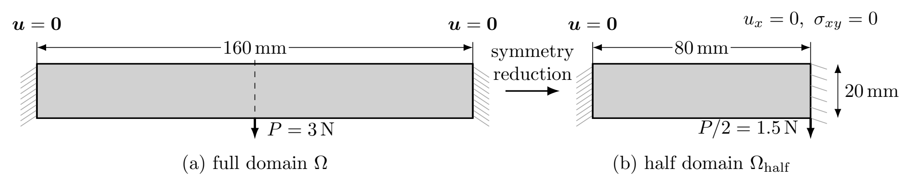

<b>
图 5.1  两端固支梁的几何尺寸、载荷与对称边界条件。
</b>

利用对称性，采用 $80\,\mathrm{mm}\times20\,\mathrm{mm}$ 的左半域，在 $x=80\,\mathrm{mm}$ 上施加 $u_x=0$、$\sigma_{xy}=0$。在 LFEM 中，两者分别为本质和自然条件；在 HZMFEM 中，$u_x=0$ 自然施加，$\sigma_{xy}=0$ 通过约束应力法向迹的切向分量施加。对于 HZMFEM $k=2$，位移跳量惩罚仅作用于内部边和左端固支边，不作用于对称边界。半域载荷为 $P/2=1.5\,\mathrm N$，所报告的柔顺度均为半域值的两倍，对应完整结构。

半域采用含 $N_e=3\,200$ 个单元的结构化三角形网格，过滤半径为 $r_{\min}=2.4\,\mathrm{mm}$。两类方法均采用算法 4.1 的 MMA 更新，取均匀初始密度 $\rho_e^{(0)}=\bar V$、移动极限 $m=0.2$、设计变化容差 $\varepsilon_\rho=10^{-2}$，且 $0\le\rho_e\le1$。

图 5.2 给出 LFEM 位移阶次 $p=2,3,4$ 与 HZMFEM 应力阶次 $k=2,3,4$ 所得的六组设计。其主要承载构型相近，均具有交叉斜杆，局部差异体现在连接形式和杆件厚度上。

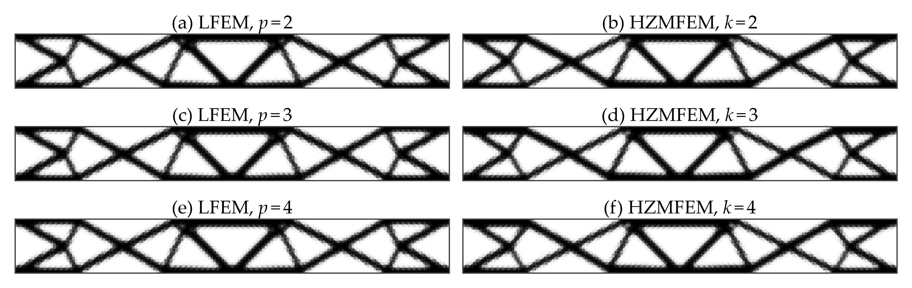
**图 5.2 两端固支梁的最终物理密度分布，由半域计算结果对称镜像得到。**

图 5.3 给出柔顺度与体积分数迭代历史。柔顺度在初期快速下降，随后变化趋缓。六组计算均满足设计变化停止准则，最终体积分数接近 $0.4$。

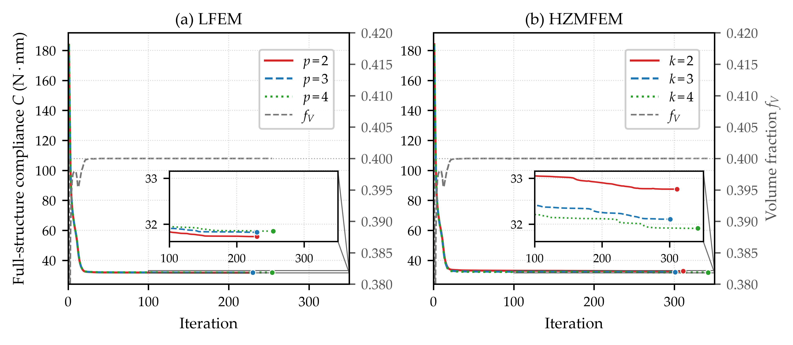

<b>
图 5.3 两端固支梁的 MMA 优化历史。实心圆点标示各组最终柔顺度，内嵌图放大显示后期迭代过程。
</b>

为采用统一离散比较设计性能 [39]，固定各组最终物理密度场，不再更新设计，分别采用 LFEM $p=3,4$ 与 HZMFEM $k=3,4$ 进行再分析。因此，表 5.3 的后四列分别采用同一种离散评价全部六组设计。

<b>
表 5.3 两端固支梁的优化所得柔顺度与再分析柔顺度（单位：$\mathrm{N\cdot mm}$）。
</b>

|     设计来源     | 迭代步数 | 优化所得柔顺度 | LFEM 再分析 $p=3$ | LFEM 再分析 $p=4$ | HZMFEM 再分析 $k=3$ | HZMFEM 再分析 $k=4$ |
| :----------: | :--: | :-----: | :------------: | :------------: | :--------------: | :--------------: |
|  LFEM $p=2$  | 230  |  31.73  |     31.83      |     31.85      |      32.39       |      32.14       |
|  LFEM $p=3$  | 230  |  31.83  |     31.83      |     31.85      |      32.39       |      32.14       |
|  LFEM $p=4$  | 254  |  31.85  |     31.83      |     31.85      |      32.39       |      32.14       |
| HZMFEM $k=2$ | 284  |  32.78  |     31.60      |     31.63      |      32.13       |      31.89       |
| HZMFEM $k=3$ | 277  |  32.12  |     31.57      |     31.59      |      32.12       |      31.86       |
| HZMFEM $k=4$ | 319  |  31.91  |     31.61      |     31.64      |      32.18       |      31.91       |

每个再分析列内的相对极差 $(C_{\max}-C_{\min})/C_{\min}$ 均不超过约 $0.88\%$，而各组自身离散下优化终态柔顺度的相对极差约为 $3.31\%$。这表明，各组优化目标值的差异并不直接反映最终设计的性能差异。结合图 5.2 中相近的主要承载构型，六组设计在本算例中表现出接近的柔顺度性能，且这一判断在四种再分析离散下均一致。

#### 5.2.2 Compliance Minimization of a Nearly Incompressible Bearing

考察图 5.4 所示 $120\,\mathrm{mm}\times40\,\mathrm{mm}$ 设计域上的二维轴承算例，采用单位厚度的平面应变模型。底边固支（$u_x=u_y=0$），顶边施加竖直向下的均布牵引 $t_0=8\times10^{-2}\,\mathrm{N/mm}$，左右边界为零牵引。实体材料取 $E_0=1\,\mathrm{MPa}$，可压缩基准组与近不可压缩组的泊松比分别取 $\nu_0=0.3$ 和 $\nu_0=0.4999$。

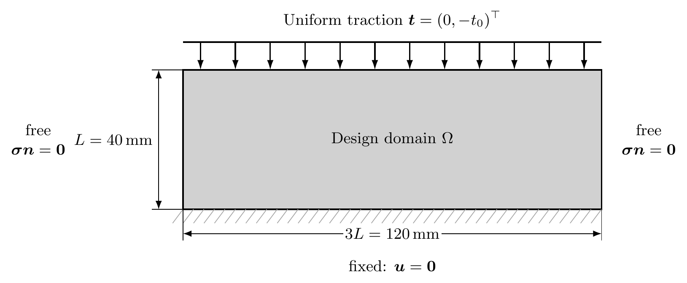

<b>
图 5.4  二维轴承算例的几何尺寸、载荷与边界条件
</b>

在全实体域（$E=E_0$）上，分别固定 $\nu=0.3$ 和 $0.4999$，采用 LFEM $p=1,2$ 与 HZMFEM $k=2,3$ 在 $30\times10$、$60\times20$、$120\times40$ 和 $240\times80$ 网格上进行网格加密测试。对每个 $\nu$，由 HZMFEM $k=4$ 在前三级网格上的结果经 Richardson 外推得到参考柔顺度 $C_{\mathrm{ref}}$ [15]。图 5.5 给出了相对偏差 $|C_h-C_{\mathrm{ref}}|/|C_{\mathrm{ref}}|$ 随水平网格间距 $h_x=120/n_x\,\mathrm{mm}$ 的变化。

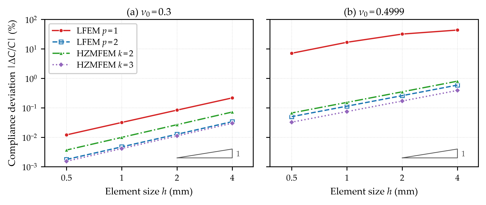

<b>
图 5.5 全实体轴承算例中柔顺度相对偏差随网格加密的变化。
</b>

各离散的柔顺度相对偏差均随网格加密减小。在 $120\times40$ 网格上，泊松比由 $0.3$ 增至 $0.4999$ 时，LFEM $p=1$ 的偏差由约 $0.03\%$ 增至 $16.81\%$，加密至 $240\times80$ 后仍为 $7.13\%$，表明存在明显的体积自锁。相比之下，近不可压缩组的 LFEM $p=2$、HZMFEM $k=2$ 和 $k=3$ 在 $120\times40$ 网格上的偏差分别仅约为 $0.11\%$、$0.15\%$ 和 $0.075\%$。

拓扑优化采用 $120\times40$ 结构化三角形网格（$9\,600$ 个单元），取 $\bar V=0.35$、$r_{\min}=2.0\,\mathrm{mm}$、$\rho_e^{(0)}=\bar V$、$E_{\min}=10^{-9}\,\mathrm{MPa}$ 和 $p_E=3$。可压缩组固定 $\nu=0.3$，近不可压缩组按式 (4.4) 插值并取 $\nu_0=0.4999$、$\nu_{\mathrm{void}}=0.3$、$p_\nu=1$。优化采用算法 4.1 的 OC 更新，取 $m=0.2$、$\xi=0.5$、$\varepsilon_\rho=10^{-2}$。

两组均采用 LFEM $p=1,2$ 与 HZMFEM $k=2,3$，按位移近似阶次配对。图 5.6 中各设计均呈三拱构型。可压缩组的构型相近。在近不可压缩组中，LFEM $p=1$ 的局部杆件较粗且拱形轮廓差异明显，其余三种离散的主要构型接近。各组均满足设计变化停止准则，最终体积分数接近 $0.35$，最大超出量约为 $2.28\times10^{-5}$。

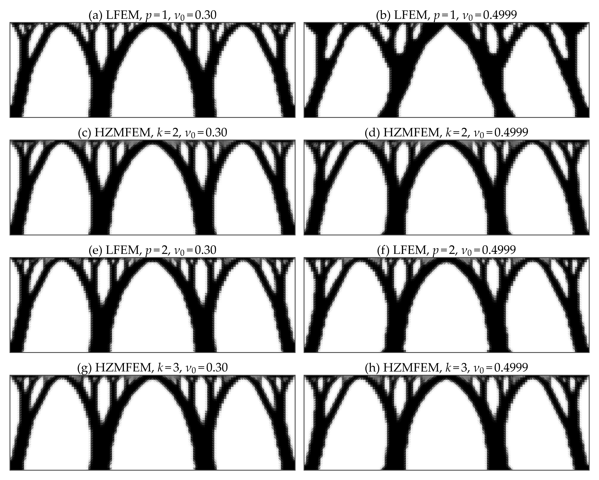

**图 5.6 二维轴承算例的最终物理密度分布：左列为可压缩组，右列为近不可压缩组。**

为比较八组优化设计在各自材料组内的表现，表 5.4 汇总固定最终物理密度场后，采用 HZMFEM $k=4$ 在 $120\times40$ 网格上重新计算的柔顺度。

**表 5.4 轴承算例的优化结果与柔顺度复分析（柔顺度单位：$\mathrm{N\cdot mm}$）。**

| 实体材料泊松比 $\nu_0$ | 设计来源 | 迭代步数 | 优化所得柔顺度 | HZMFEM $k=4$ 再分析柔顺度 |
| :---: | :--- | :---: | :---: | :---: |
| $0.30$ | LFEM $p=1$ | 281 | $119.33$ | $125.42$ |
| $0.30$ | HZMFEM $k=2$ | 255 | $127.38$ | $124.48$ |
| $0.30$ | LFEM $p=2$ | 351 | $122.73$ | $124.25$ |
| $0.30$ | HZMFEM $k=3$ | 302 | $124.83$ | $124.13$ |
| $0.4999$ | LFEM $p=1$ | 372 | $76.43$ | $122.91$ |
| $0.4999$ | HZMFEM $k=2$ | 382 | $101.36$ | $98.89$ |
| $0.4999$ | LFEM $p=2$ | 245 | $98.06$ | $99.68$ |
| $0.4999$ | HZMFEM $k=3$ | 351 | $99.53$ | $98.91$ |

可压缩组设计的柔顺度相对极差（定义见第 5.2.1 节）约为 $1.04\%$。近不可压缩组中，LFEM $p=1$ 设计的复分析柔顺度比两种 HZMFEM 设计均高约 $24.3\%$，而 LFEM $p=2$ 与 HZMFEM $k=2,3$ 之间的相对极差约为 $0.80\%$。这些结果与全实体域网格加密结果表明，体积自锁影响了本算例中 LFEM $p=1$ 的柔顺度评价与设计性能。

#### 5.2.3 Volume Minimization of a Cantilever Beam under Local Stress Constraints

悬臂梁设计域为 $80\,\mathrm{mm}\times40\,\mathrm{mm}$（图 5.7），采用单位厚度平面应力模型，左边界固支。取 $E_0=70\,000\,\mathrm{MPa}$、$\nu_0=0.25$、许用应力 $\bar\sigma=180\,\mathrm{MPa}$、$E_{\min}=10^{-9}E_0$ 和 $p_E=3.5$。将竖直向下的合力 $P=400\,\mathrm N$ 均匀分布于以右边界中点为中心、宽 $l=6\,\mathrm{mm}$ 的区间，牵引强度为 $\bar t=P/l$，端点与网格节点对齐。两类方法使用相同的牵引数据，由节点插值至连续 $\mathbb P_1$ 边界迹空间得到。

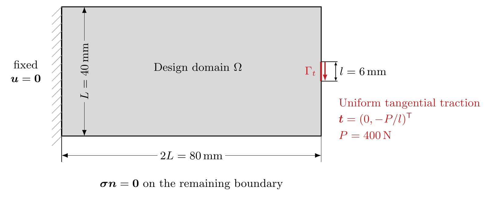

<b>
图 5.7  悬臂梁的几何尺寸、载荷与边界条件
</b>

采用含 $6\,400$ 个单元的结构化三角形网格。在密度与泊松比固定、载荷不变且位移边界条件齐次时，弹性模量同比缩放不改变应力响应。计算取 $E_0^{\mathrm{calc}}=1\,\mathrm{MPa}$，相应缩放 $E_{\min}$ 和 HZMFEM $k=2$ 的稳定化系数，载荷与许用应力保持物理值。

局部应力约束采用第 4.3 节的模型，取 $\epsilon=10^{-3}$。为处理载荷端点的应力集中，将形心距任一载荷端点不超过 $r_{\mathrm{pad}}=1.5\,\mathrm{mm}$ 的单元划为被动实体区 $\Omega_{\mathrm{pad}}$。该区不施加局部应力约束，也不计入增广应力约束项 [13]。过滤与投影后，该区物理密度固定为 $1$，密度映射导数置零 [27]。其体积仍计入总体积分数，增广项仍按总单元数 $N_e$ 归一化。其余全部单元均施加应力约束。

取 $r_{\min}=6.0\,\mathrm{mm}$、均匀初始密度 $\rho_e^{(0)}=0.5$。过滤后采用阈值 $\eta_{\mathrm p}=0.5$ 的 tanh 投影，$\beta$ 从 $1$ 起每 $5$ 个外层步增加 $1$，直至 $10$。算法 4.2 取 $\mu_0=50$、$\gamma_\mu=1.1$、$\mu_{\max}=\lambda_{\max}=10^4$，MMA 移动极限为 $m=0.15$，渐近线最小间距为 $10^{-4}$。迭代上限为 $N_{\mathrm{out}}^{\max}=200$、$N_{\mathrm{in}}^{\max}=5$，停止参数为 $\delta_\rho=0.002$、$\delta_g=0.005$、$N_{\mathrm{hold}}=3$。

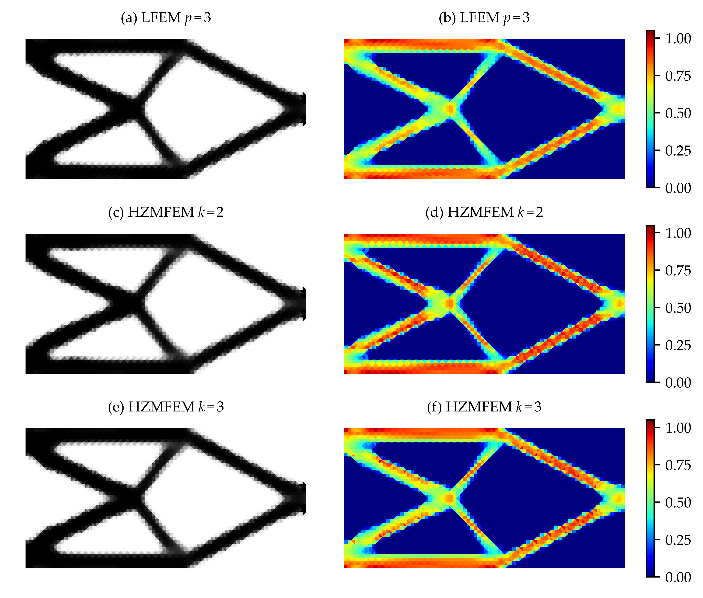

**图 5.8 悬臂梁最终设计：密度（左）与表观 von Mises 应力比（右）。**

比较采用二次应力近似的 LFEM $p=3$、HZMFEM $k=2$ 与采用三次应力近似的 HZMFEM $k=3$。图 5.8 中三组设计的主要构型相近，均由上下缘杆件和交叉斜杆组成，右侧斜杆汇聚于载荷区。局部差异主要体现在杆件宽度和交汇区域的材料分布，较高应力主要沿承载杆件分布。表观 von Mises 应力比取各组最终设计在自身离散下的单元形心值，并采用统一色标。

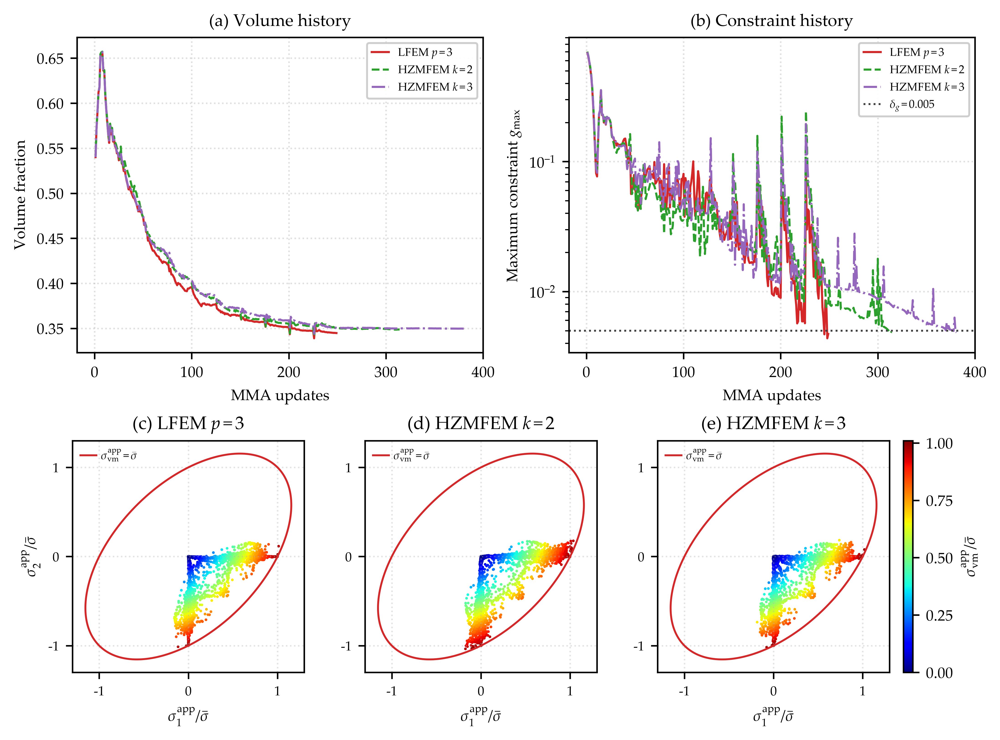

**图 5.9 悬臂梁的优化历史与终态应力分布：(a) 体积分数；(b) 最大局部约束值 $g_{\max}$；(c–e) 归一化表观主应力分布。**

图 5.9 中，体积分数在初期短暂上升后总体下降，最终趋于相近水平。三组计算的 $g_{\max}$ 虽有波动，但总体减小，终态均低于 $\delta_g=0.005$，且均满足算法 4.2 的停止准则。归一化表观主应力取各组最终设计在自身离散下全部受约束单元的形心值，并按表观 von Mises 应力比着色。三组散点呈现相近的总体趋势：较高应力点主要接近单轴受拉或受压状态，部分接近代表表观 von Mises 应力比为 $1$ 的红色椭圆，较低应力点则集中于原点附近。

为考察跨单元牵引连续性，固定三组最终物理密度场，采用各自优化时的离散格式重新求解状态方程。对内部边 $F=T^+\cap T^-\in\mathcal F_h^i$，选取固定单位法向 $\boldsymbol n_F$，定义表观应力的牵引跳量为

$$
[\![\boldsymbol\sigma_h^{\mathrm{app}}\boldsymbol n_F]\!]
=\left(\boldsymbol\sigma_h^{\mathrm{app}}|_{T^+}-\boldsymbol\sigma_h^{\mathrm{app}}|_{T^-}\right)\boldsymbol n_F.
$$

以许用应力 $\bar\sigma$ 归一化，定义边上的均方根指标及单元指标为

$$
A_F=\frac{1}{\bar\sigma}\left(\frac{1}{|F|}\int_F\bigl\|[\![\boldsymbol\sigma_h^{\mathrm{app}}\boldsymbol n_F]\!]\bigr\|^2\,\mathrm ds\right)^{1/2},\qquad A_e=\max_{\substack{F\in\mathcal F_h^i\\F\subset\partial T_e}}A_F.
$$

不同于在 $\Omega_{\mathrm{pad}}$ 外全部单元上执行的应力约束检查，$A_e$ 仅在 $\Omega_{\mathrm{pad}}$ 外满足 $\overline\rho_e>0.9$ 的单元上统计（计算公共边跳量时不限制相邻单元密度）。

<b>
表 5.5 悬臂梁的优化结果与固定设计复分析。
</b>

| 离散 | MMA 更新次数 | 体积分数 (%) | 最大局部约束值 $g_{\max}$ | 最大归一化牵引跳量 |
|:---:|:---:|:---:|:---:|:---:|
| LFEM $p=3$ | 249 | 34.4807 | $4.7113\times10^{-3}$ | $1.1807\times10^{-1}$ |
| HZMFEM $k=2$ | 314 | 34.8770 | $4.9034\times10^{-3}$ | $1.5728\times10^{-16}$ |
| HZMFEM $k=3$ | 381 | 34.9713 | $4.8509\times10^{-3}$ | $1.8055\times10^{-16}$ |

表 5.5 中三组最终体积分数接近，固定设计复分析所得最大局部约束值均低于 $\delta_g=0.005$。对于二次应力近似，LFEM $p=3$ 与 HZMFEM $k=2$ 在所定义统计区域内的最大归一化牵引跳量分别约为 $0.118$ 和 $1.57\times10^{-16}$，而 HZMFEM $k=3$ 的相应值约为 $1.81\times10^{-16}$。两种 Hu–Zhang 格式的牵引跳量均处于浮点舍入误差量级，与其应力空间的 $H(\operatorname{div})$ 协调性一致。

#### 5.2.4 Stress-Constrained Volume Minimization of a Portal Frame

为考察所提框架对非矩形设计域和非结构化网格的适用性，采用 HZMFEM $k=3$ 求解图 5.10 所示含斜边与凹角的单位厚度平面应力门式框架局部应力约束体积最小化问题 [25, 32]。左支座固支（$u_x=u_y=0$），右支座为水平滑动支座（$u_y=0$ 且切向牵引为零）。竖直向下的合力 $P=300\,\mathrm N$ 在顶边中点宽 $l=1\,\mathrm{mm}$ 的区间上产生均布牵引 $\bar t=P/l$，并按第 5.2.3 节方式插值至连续 $\mathbb P_1$ 边界迹空间。取 $E_0=100\,000\,\mathrm{MPa}$、$\nu_0=0.25$ 和许用应力 $\bar\sigma=1000\,\mathrm{MPa}$，材料插值参数及弹性模量缩放同第 5.2.3 节。

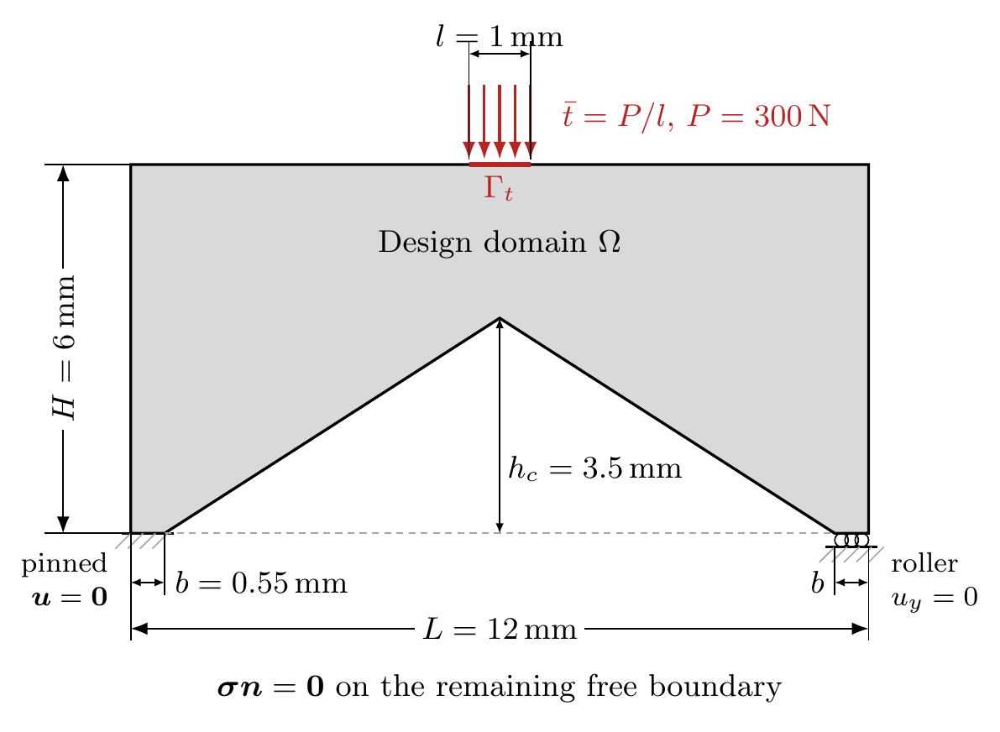

<b>
图 5.10  门式框架的几何尺寸、载荷与边界条件。
</b>

采用关于 $x=L/2$ 镜像对称的非结构化三角形网格进行全域计算，共含 $N_e=31\,554$ 个单元，目标单元尺寸为 $0.0625\,\mathrm{mm}$。网格与设计域边界贴合，凹角顶点及载荷区间端点均为网格节点（图 5.11）。

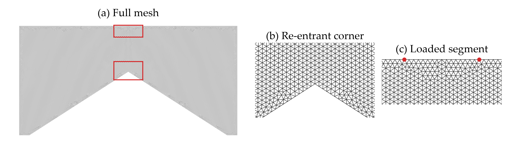

<b>
图 5.11 门式框架的非结构化三角形网格：(a) 全域；(b) 凹角局部放大；(c) 载荷区间局部放大。红框和红点分别标示放大区域与载荷端点。
</b>

由于全实体域网格加密测试未显示载荷端点附近的应力发散，本算例不设被动实体区，全部单元均施加局部应力约束（$\mathcal E_{\mathrm{acc}}=\{1,\dots,N_e\}$）。取 $r_{\min}=0.25\,\mathrm{mm}$，优化中保持设计关于 $x=L/2$ 对称。算法 4.2 取 $N_{\mathrm{hold}}=10$，其余密度映射、应力松弛及 ALM–MMA 参数均沿用第 5.2.3 节。

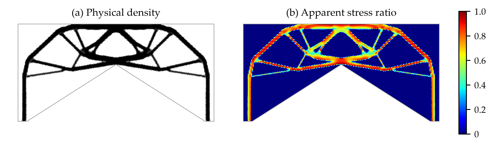

**图 5.12 门式框架最终设计的物理密度与表观 von Mises 应力比。灰线表示设计域边界。**

图 5.12 中，HZMFEM $k=3$ 所得最终构型由上部弦杆、斜杆及凹角上方的连接杆件组成，形成从顶边载荷区通向两侧支座的主要传力路径。较高应力主要沿承载杆件分布，其单元形心表观 von Mises 应力比接近 $1$。

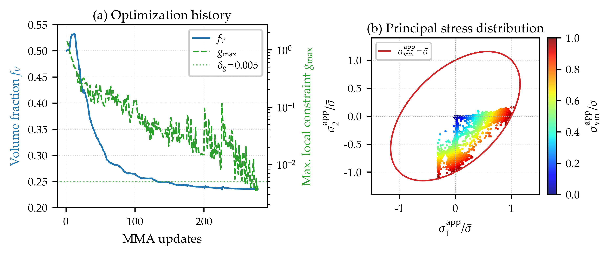

**图 5.13 门式框架的优化历史与终态归一化表观主应力分布。**

图 5.13 中，体积分数在初期短暂上升后总体下降至 $23.57\%$，$g_{\max}$ 总体减小至 $4.243\times10^{-3}<\delta_g=0.005$。与图 5.9 类似，最终设计的单元形心表观主应力主要分布在单位 von Mises 椭圆内的单轴受拉或受压状态附近，较低应力点则集中于原点附近。

在最终物理密度 $\overline\rho_e>0.9$ 的单元上，按第 5.2.3 节定义统计的最大归一化牵引跳量 $A_e$ 为 $2.687\times10^{-16}$，同样处于浮点舍入误差量级。结合全部单元松弛局部应力约束的满足，这验证了高阶 Hu–Zhang 框架在含斜边与凹角的非结构化三角形网格上的有效性。

---

## 6 Concluding Remarks

### 6.1 Key Conclusions

本文建立了面向密度法拓扑优化的高阶 Hu–Zhang 混合有限元框架，主要结论如下：

1. **高阶混合有限元优化框架及其对非结构化网格的适用性。** 所提框架支持柔顺度最小化与局部应力约束下的体积最小化，并采用计入离散右端设计依赖的一致伴随灵敏度。数值算例验证了该框架在结构化与非结构化三角形网格上的适用性，包括含斜边与凹角的非矩形设计域上的贴体网格。

2. **收敛精度与近不可压缩条件下的数值表现。** 在混合边界制造解问题中，$k=1,2$ 的稳定化格式与 $k=3,4$ 的高阶格式均在位移 $L^2$ 和应力 $H(\operatorname{div})$ 范数下达到 $k$ 阶收敛，而 $k=3,4$ 的应力 $L^2$ 误差达到 $k+1$ 阶收敛。在近不可压缩条件下，Hu–Zhang 离散避免了线性位移元出现的体积自锁，提高多项式阶次进一步降低了柔顺度偏差。

3. **直接应力评价与跨单元牵引连续性。** Hu–Zhang 格式以应力为独立未知量，可直接评价局部应力约束而无需从位移梯度恢复应力。其 $H(\operatorname{div})$ 协调应力空间在浮点舍入误差量级上保证了法向牵引 $\boldsymbol{\sigma}_h\boldsymbol n$ 的跨单元连续性，所得设计在规定容差内满足全部松弛局部应力约束。

### 6.2 Future Work and Outlook

本文的数值研究限于二维小应变线弹性问题，后续可从以下三个方面进一步拓展：

1. **三维数值验证与高效求解。** 在三维拓扑优化算例中验证所提框架，并结合快速求解算法与预条件技术，降低大规模混合线性系统的求解时间和内存需求。

2. **自适应离散与移动网格。** 结合局部误差估计与材料分布特征，探索网格加密、阶次调整及移动网格策略，在保持网格质量与密度过滤物理尺度的同时，提高关键区域的分辨能力和计算效率。

3. **几何与材料非线性问题。** 面向大变形与非线性材料行为的拓扑优化，发展相应的混合变分形式与一致伴随灵敏度，重点研究低密度区域大变形引起的数值不稳定及其处理方法。

---

## Acknowledgments

本研究得到国家重点研发计划（项目编号：2024YFA1012600）和国家自然科学基金（项目编号：12371410）的资助。

---

## References

1. S. Adams and B. Cockburn. A mixed finite element method for elasticity in three dimensions. *Journal of Scientific Computing*, 25:515–521, 2005.
2. R. Andreani, E. G. Birgin, J. M. Martínez, and M. L. Schuverdt. On augmented Lagrangian methods with general lower-level constraints. *SIAM Journal on Optimization*, 18(4):1286–1309, 2008.
3. E. Andreassen, A. Clausen, M. Schevenels, B. S. Lazarov, and O. Sigmund. Efficient topology optimization in MATLAB using 88 lines of code. *Structural and Multidisciplinary Optimization*, 43(1):1–16, 2011.
4. D. N. Arnold, R. S. Falk, and R. Winther. Mixed finite element methods for linear elasticity with weakly imposed symmetry. *Mathematics of Computation*, 76(260):1699–1723, 2007.
5. D. N. Arnold and R. Winther. Mixed finite elements for elasticity. *Numerische Mathematik*, 92(3):401–419, 2002.
6. I. Babuška and M. Suri. Locking effects in the finite element approximation of elasticity problems. *Numerische Mathematik*, 62(1):439–463, 1992.
7. M. P. Bendsøe. Optimal shape design as a material distribution problem. *Structural Optimization*, 1(4):193–202, 1989.
8. M. P. Bendsøe and O. Sigmund. *Topology Optimization: Theory, Methods, and Applications*. Springer, 2004.
9. D. Boffi, F. Brezzi, and M. Fortin. *Mixed Finite Element Methods and Applications*, volume 44 of *Springer Series in Computational Mathematics*. Springer, 2013.
10. B. Bourdin. Filters in topology optimization. *International Journal for Numerical Methods in Engineering*, 50(9):2143–2158, 2001.
11. M. Bruggi. Topology optimization with mixed finite elements on regular grids. *Computer Methods in Applied Mechanics and Engineering*, 305:133–153, 2016.
12. M. Bruggi and P. Venini. Topology optimization of incompressible media using mixed finite elements. *Computer Methods in Applied Mechanics and Engineering*, 196(33–34):3151–3164, 2007.
13. M. Bruggi and P. Venini. A mixed FEM approach to stress-constrained topology optimization. *International Journal for Numerical Methods in Engineering*, 73(12):1693–1714, 2008.
14. T. E. Bruns and D. A. Tortorelli. Topology optimization of non-linear elastic structures and compliant mechanisms. *Computer Methods in Applied Mechanics and Engineering*, 190(26–27):3443–3459, 2001.
15. I. B. Celik, U. Ghia, P. J. Roache, C. J. Freitas, H. Coleman, and P. E. Raad. Procedure for estimation and reporting of uncertainty due to discretization in CFD applications. *Journal of Fluids Engineering*, 130(7):078001, 2008.
16. C. Chen, L. Chen, X. Huang, and H. Wei. Geometric decomposition and efficient implementation of high order face and edge elements. *Communications in Computational Physics*, 35(4):1045–1072, 2024.
17. L. Chen, J. Hu, and X. Huang. Stabilized mixed finite element methods for linear elasticity on simplicial grids in $\mathbb{R}^n$. *Computational Methods in Applied Mathematics*, 17(1):17–31, 2017.
18. L. Chen, J. Hu, and X. Huang. Fast auxiliary space preconditioners for linear elasticity in mixed form. *Mathematics of Computation*, 87(312):1601–1633, 2018.
19. L. Chen, J. Hu, X. Huang, and H. Man. Residual-based a posteriori error estimates for symmetric conforming mixed finite elements for linear elasticity problems. *Science China Mathematics*, 61(6):973–992, 2018.
20. L. Chen and X. Huang. $H(\operatorname{div})$-conforming finite element tensors with constraints. *Results in Applied Mathematics*, 23:100494, 2024.
21. G. Cheng and X. Guo. $\epsilon$-relaxed approach in structural topology optimization. *Structural Optimization*, 13(4):258–266, 1997.
22. G. Cheng and Z. Jiang. Study on topology optimization with stress constraints. *Engineering Optimization*, 20(2):129–148, 1992.
23. R. Codina, I. Castañar, and J. Baiges. Finite element approximation of stabilized mixed models in finite strain hyperelasticity involving displacements and stresses and/or pressure—an overview of alternatives. *International Journal for Numerical Methods in Engineering*, 125(18):e7540, 2024.
24. P. Duysinx and M. P. Bendsøe. Topology optimization of continuum structures with local stress constraints. *International Journal for Numerical Methods in Engineering*, 43(8):1453–1478, 1998.
25. O. Giraldo-Londoño and G. H. Paulino. PolyStress: a Matlab implementation for local stress-constrained topology optimization using the augmented Lagrangian method. *Structural and Multidisciplinary Optimization*, 63(4):2065–2097, 2021.
26. L. He, H. Wei, and T. Tian. SOPTX: A modular and extensible framework for topology optimization with multi-backend support. *Communications in Computational Physics*, 40(2):525–572, 2026.
27. E. Holmberg, B. Torstenfelt, and A. Klarbring. Stress constrained topology optimization. *Structural and Multidisciplinary Optimization*, 48(1):33–47, 2013.
28. J. Hu. Finite element approximations of symmetric tensors on simplicial grids in $\mathbb{R}^n$: the higher order case. *Journal of Computational Mathematics*, 33(3):283–296, 2015.
29. J. Hu and R. Ma. Partial relaxation of $C^0$ vertex continuity of stresses of conforming mixed finite elements for the elasticity problem. *Computational Methods in Applied Mathematics*, 21(1):89–108, 2021.
30. J. Hu and S. Zhang. A family of conforming mixed finite elements for linear elasticity on triangular grids. *arXiv preprint arXiv:1406.7457*, 2014.
31. U. Kirsch. On singular topologies in optimum structural design. *Structural Optimization*, 2(3):133–142, 1990.
32. C. Le, J. Norato, T. Bruns, C. Ha, and D. Tortorelli. Stress-based topology optimization for continua. *Structural and Multidisciplinary Optimization*, 41(4):605–620, 2010.
33. J. París, F. Navarrina, I. Colominas, and M. Casteleiro. Topology optimization of continuum structures with local and global stress constraints. *Structural and Multidisciplinary Optimization*, 39(4):419–437, 2009.
34. F. V. Senhora, O. Giraldo-Londoño, I. F. M. Menezes, and G. H. Paulino. Topology optimization with local stress constraints: a stress aggregation-free approach. *Structural and Multidisciplinary Optimization*, 62(4):1639–1668, 2020.
35. K. Svanberg. The method of moving asymptotes—a new method for structural optimization. *International Journal for Numerical Methods in Engineering*, 24(2):359–373, 1987.
36. G. Sved and Z. Ginos. Structural optimization under multiple loading. *International Journal of Mechanical Sciences*, 10(10):803–805, 1968.
37. F. Wang, B. S. Lazarov, and O. Sigmund. On projection methods, convergence and robust formulations in topology optimization. *Structural and Multidisciplinary Optimization*, 43(6):767–784, 2011.
38. H. Wei and Y. Huang. FEALPy: Finite Element Analysis Library in Python. https://github.com/weihuayi/fealpy, Xiangtan University, 2017–2024.
39. M. Xiao, S. Mukherjee, B. Raghavan, S. Dutta, P. Breitkopf, and W. Zhang. Revisiting p-refinement in structural topology optimization. *Structures*, 34:3640–3646, 2021.
40. Y. Zheng, H. Wei, Y. Huang, C. Chen, T. Tian, H. Liu, W. Wang, and L. He. FEALPy: A cross-platform intelligent numerical simulation engine. *Communications in Computational Physics*, 40(5):1676–1704, 2026.
